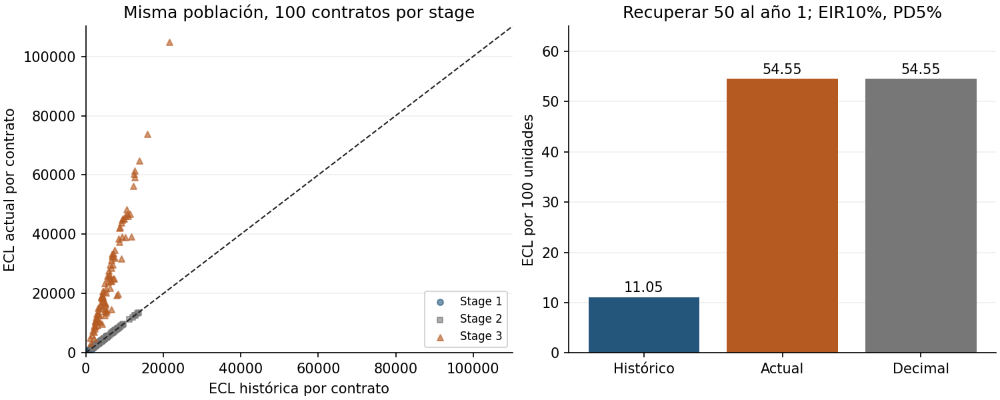

# MVP 2026-10-19: reconciliación de la migración IFRS 9

## Pregunta e hipótesis

¿Puede conservarse la auditoría histórica tras migrar Stage3 y demostrar que
Stage1/2 no cambian en el dominio compartido? Hipótesis fijadas: reproducir el
baseline exacto por hash; reconciliar la misma población por loan_id; error
relativo máximo <=1e-12 para Stage1/2 y frente al oráculo Decimal para Stage3.
Además, la pérdida de demora diminuta no debe desaparecer al integrar la forma
estable en el motor actual. Es integración/validación, no una nueva teoría ECL.

## Estado del repositorio y brecha reproducida

Base revisada: f1658d32226a517f2e7e88652120001eeea6f47d. PR50 ya integrado y
motor padre ya migrado a flujos Stage3. No se duplica esa ruta ni se presenta
el defecto antiguo como si siguiera vigente. El adapter de la auditoría aún
cargaba dinámicamente el padre como baseline antiguo: al exigir ahora flujos,
fallaba. Se ejecutó antes de modificar: 1 failed,20passed. Traza real conservada
en results/prechange-reproduction.txt; no se oculta el experimento fallido.

## Prior art y novedad incremental

IFRIC March2019 contextualiza cash shortfalls descontados; NumPy2.1 documenta
expm1 para precisión con argumentos pequeños; NIST distingue reproducibilidad
de precisión numérica. La literatura arXiv de LGD/write-off sigue siendo contexto,
no evidencia de este código. Ocho entradas reales en referencias.bib; búsqueda
focalizada y restricciones de acceso registradas en benchmarks/prior-art.md.
No se afirma prioridad ni revisión completa de IFRS9 vigente2026.

El aporte incremental es un baseline inmutable, reconciliación explícita por
contrato, pruebas del dominio de equivalencia y estabilidad ya integrada en el
padre. No se considera el snapshot viejo un producto válido para operar.

## Implementación

1. baselines/ifrs9_engine_20261018.py: copia byte a byte del commit
   f03f242222a0410f4558fb0522544afcd9ebb4f8. SHA256 comprobado por test:
   c0d747d609e642d3788426d0f20484ad19daa8fccb192238f96b917cf0d643f3.
2. src/baseline.py carga ese snapshot; src/migration.py carga el padre actual
   por separado. Sus hashes se registran, sin red ni git histórico en reproducción.
3. reconciliation une por loan_id con validate=one_to_one y exige población y
   stage iguales. No declara equivalencia cuando PD>=.95, LGD>.95 o PD origen
   <1e-6, pues caps/clipping cambiaron entre versiones. El padre valida los inputs.
4. En credit_impaired_shortfall del padre, para EIR>=0 y suma de recuperaciones
   nominales<=G, se usa (G-sumaC)+sum(C*(-expm1(-log1p(r)*t))). Las rutas de
   tasas negativas o surplus conservan la fórmula anterior. La medición no cambia
   de fundamento; se reduce cancelación en el dominio declarado.
5. run.sh ejecuta también tests del padre y nueva auditoría de migración. No se
   formatea ni corrige el snapshot: un hash detecta cualquier alteración.

## Diseño experimental y configuración

- Stage3: los432 casos fijados de la auditoría original, G100, PD12m4valores,
  recuperación4valores, demora3, EIR3, horizonte3. Oráculo independiente Decimal
  de70dígitos sobre inputs binarios; mismo estado ya deteriorado.
- Población mixta:300 contratos sintéticos, seed20261019,100 por stage. Índice
  pandas reordenado para comprobar unión por identificador, no por índice.
  PD=.05 y origen=.04; Stage1/2 LGD=.4, sin caps activos. Flujos esperados
  nominales=.6×G al año2; Stage3 LGD histórica consistente con su VP. Inputs y
  reconciliación contrato a contrato guardados en JSON/CSV.
- No cartera real, moneda ni régimen de mercado estimados. Stage ilustrativo
  activado por DPD0/35/95, no una política aprobada de SICR/default.
- Criterio de éxito numérico: <=1e-12 relativo, no identidad bit a bit; se cambió
  también la aritmética de hazards y descuentos en el padre antes de este ciclo.
- Rendimiento: n1/32/256, tres métodos, siete réplicas, orden aleatorizado por
  réplica, warmup excluido, seed20261019:63 filas. Tiempo y tracemalloc separados.
- Python3.12.14, NumPy2.1.3, pandas2.2.3, Linux6.18.55 x86_64/glibc2.39,
  AMD EPYC9V74; lock heredado de50versiones. Hardware en summary.json.

## Resultados ejecutados

| Comprobación | Resultado |
|---|---:|
| Casos Stage3 reconciliados contra Decimal |432 |
| Error relativo máximo Stage3 |1.3230795769326005e-16 |
| Contratos mixtos, misma población/stage |300 |
| Contratos Stage1/2 comparados |200 |
| Cambio relativo máximo Stage1/2 |9.084315339071267e-16 |
| Tests de auditoría |32 pasan |
| Tests del laboratorio padre |21 pasan |

El caso G100, recuperar50 al año1, EIR10%, PD12m5%, horizonte5, da ECL
histórica11.0489622414 frente a actual/Decimal54.5454545455 (valores completos
en migration-stage3.csv). Es cambio esperado de semántica Stage3, no regresión
que deba ocultarse. Los60 casos de pérdida0 permanecen en la rejilla original.



Panel izquierdo: misma población, con Stage1/2 sobre identidad y Stage3 separado.
Panel derecho: caso controlado por100unidades. Son escenarios matemáticos, no
predicciones ni intervalos de confianza.

Ablación negativa de estabilidad: G=C100,t1,r1e-18. La resta G-PV calculada en
float da0; el motor actual conserva1.0000000000000001e-16. No tiene por sí sola
materialidad financiera. El PV devuelto puede redondear todavía aG: no se debe
reconstruir el raw_shortfall estable restando nuevamente esos dos floats.

Medianas locales n256: histórico3.318990ms,actual47.436378ms,batch0.143823ms.
La ruta actual por contrato es mucho más lenta; se conserva el resultado negativo.
Cada método realiza trabajo distinto y el histórico tiene semántica equivocada
para Stage3: no es comparación de velocidad entre modelos igualmente correctos.
Crudo de memoria en migration-performance.csv; tracemalloc no es RSS total ni
toda memoria nativa. No se infiere significancia de siete mediciones.

## Tests, cobertura y notebook

32 tests locales incluyen21 previos y11 nuevos; tres propiedades Hypothesis
de100ejemplos deterministas en total. Nuevas pruebas: hash, independencia Stage3
dePD futura, cartera mixta, inputs faltantes, dominio de comparación, tasas
negativas/surplus y pérdida pequeña. Los21 tests del padre también pasan.

Cobertura medida sólo src.model+src.migration:55/57sentencias,20/22ramas;
combinado94.9367%. src.model sigue100%; migration deja sin cubrir dos defensas
(carga imposible y drift de población/stage). No se afirma cobertura integral
del padre, snapshot ni benchmarks. Ruff/formato/mypy pasan sobre src/benchmarks
del audit; no se reformató código histórico o padre ajeno al cambio.

Notebook ampliado y ejecutado top-to-bottom con cuatro celdas reales; stdout,
tablas y SVG guardados y nbformat validado. FiguraPNG de migración inspeccionada:
marcadores distintos, identidad, ejes desde0 y etiquetas visibles. No se afirma
revisión de todo el notebook en visor gráfico. Guías notebooks/visualización
aplicadas; referencias compartidas no disponibles, declarado durante el trabajo.

## Limitaciones y gobierno de modelo

- La igualdad Stage1/2 es sólo del dominio común. No se ocultaron diferencias
  de caps, clipping o contratos inválidos: se rechaza compararlos como equivalentes.
- No se estima recuperación, cura, tiempos ni LGD sobre datos reales. Tampoco
  POCI, EAD revolving, contabilización de intereses/gasto/reintegro o provisionesSFC.
- El stage de este laboratorio es ilustrativo: preservar su clasificación no
  la valida económicamente ni jurídicamente.
- El baseline congelado preserva defectos deliberadamente y está aislado del
  motor actual. Su hash prueba identidad de bytes, no legitimidad del modelo.
- La corrección estable es acotada; no promete exactitud universal ni resistencia
  a overflow. Tasas negativas/surplus conservan su ruta y se prueban, no se recortan
  silenciosamente para que la nueva función acotada acepte todo.
- La reparación de reproducibilidad no aporta mejora predictiva ni aprobación
  contable. No hay serie OOT que justifique pruebas Kupiec/Christoffersen.
- El lock requiere internet inicial y no fija hashes/imagen de sistema. Los
  informes fechados anteriores son históricos; run.sh regenera mediciones.

## Reproducción y checklist

Desde la raíz, Python3.12 con venv:

```bash
bash 03-financial-risk/01-credit-risk/credit-risk-products/ifrs9-investigacion-cuantitativa/stage3-cash-shortfall-audit/run.sh
```

Checklist completo: src real, comando único, tests aprobados, baseline con números,
CSV/JSON/figuras/notebook, README/informes/BibTeX/MVP, carpeta03-financial-risk.
No hay código C++ nuevo: sanitizers no aplican. CI se reporta sólo tras observarlo.

Autoevaluación1–5: novedad3, rigor4, reproducibilidad5, código4, claridad4, impacto4,
honestidad5, MVP completo/ejecutable5. No equivale a revisión independiente.

Siguiente iteración recomendada: extender equivalencia y rendimiento sin perder trazabilidad.
1. 03-financial-risk: pruebas de migración en caps/PDextrema y escenarios adversos,
   documentando cambios deliberados en lugar de imponer igualdad falsa.
2. 03-financial-risk: vectorizar la ruta Stage3 con flujos heterogéneos y comprobar
   igualdad por contrato antes de reclamar una mejora de rendimiento.
3. 04-quant-strategy-and-products/risk-engines: portar el contrato de flujos y las
   fixtures a C++, con paridad de resultados y sanitizers.
