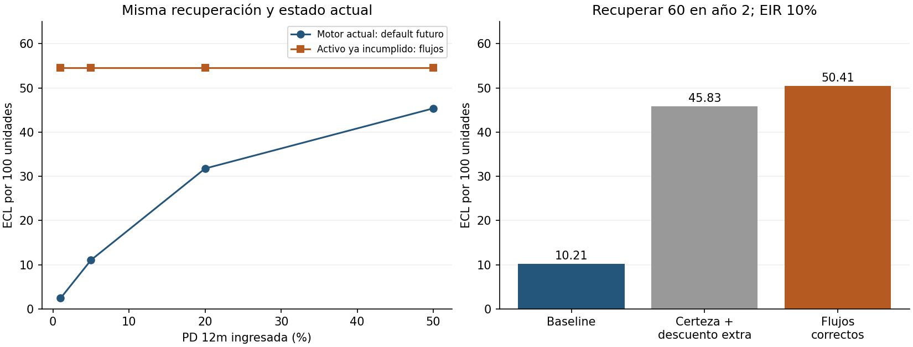

# Stage3: estado incumplido, recuperación y descuento

Fecha2026-10-18. Base: f03f242222a0410f4558fb0522544afcd9ebb4f8.

## Pregunta, hipótesis y aporte

¿El motor IFRS9 del repo trata coherentemente un activo ya deteriorado cuando
recibe LGD a valor presente? Hipótesis: aplicar PD de primer default futuro
atenúa indebidamente esa pérdida; un descuento adicional puede atenuarla otra
vez. El módulo debe ser invariante a esa PD/horizonte y coincidir con oráculo
Decimal70dígitos con error relativo<=1e-12 en la rejilla fijada.

La fórmula es conocida; novedad incremental local: baseline real, ablaciones,
descomposición estable, escenarios y pruebas. Se revisaron el nuevo laboratorio,
motor/tests/docs, arquitectura03/04 y aportesES anteriores. No se duplican
auditoríasJSON. El padre queda intacto y advertido en README: no se cambian
resultados contables silenciosamente ni se proclama prioridad científica.

## Prior art y acceso

IFRIC Update March2019, decisión final sobre curing, explica cash shortfalls y
la naturaleza descontada de gross carrying amount/allowance. B5.5.33 del texto
histórico oficial adoptado2016 especifica G-PV(flujos) para credit-impaired
noPOCI. EUR-Lex informa que el acto2016 fue sustituido en2023: no se presenta
como revisión de regulación vigente2026. El PDF completo IFRS Foundation
requirió suscripción; texto2023 devolvió anti-bot. No se eludieron esos accesos.
Se distingue la decisiónIFRIC leída de extractos oficiales indexados del estándar.

Botha/Gabru/Muller/Larney2026 modelan riesgo de write-off durante el tiempo desde
default paraLGD, distinto de predecir primer default ya ocurrido. Reitgruber2015
discute metodología/backtestingLGD; BIS2015 complementa, no sustituye,IFRS9.
Siete fuentes primarias conURL/arXiv/DOI en referencias.bib. Búsqueda focalizada
en benchmarks/prior-art.md: cobertura parcial, no prueba de inexistencia.

## Derivación y supuestos

Activo noPOCI ya deteriorado; gross carrying amount G al cierre; EIR original
r conocida>=0; recuperaciones netas esperadas C_t>=0, sum(C_t)<=G. Sin nuevos
desembolsos ni cura/redefault. No se infiere impairment sólo porDPD:95DPD sirve
únicamente para activar Stage3 del baseline ilustrativo en el adapter.

\[
 L=G-\sum_t E[C_t\mid\mathrm{estado\ actual}](1+r)^{-t},\quad LGD_{PV}=L/G.
\]

EAD×LGD sigue siendo válido si EAD=G yLGD corresponde a ese estado/fecha/EIR.
Lo incompatible en ESTE uso es multiplicarlo por otraPD de primer default o
descontarlo de nuevo. No se refuta toda implementaciónPD×LGD×EAD.

El baseline produce L_old=L×A, A=sum(m_t DF_t). Conr>=0 y horizonte finito,
0<=A<=sum(m_t)<=1, por tanto L_old<=L. Quitar sóloDF deja sum(m_t); imponer
certeza pero mantener descuento un año deja L/(1+r). Ambas ablaciones se
conservan. SiL=0, ambos coinciden; no se excluyen esos casos.

Forma estable implementada:

\[
 L=(G-\sum C_t)+\sum C_t[-\mathrm{expm1}(-t\log1p(r))].
\]

Escenarios: sum(w_s L_s), pesos fijos no negativos/suma1 y EIR común. Se prueba
la reconciliación con flujos medios; no se estiman probabilidades macroeconómicas.

## Diseño y ejecución

- G100; PD12m[.01,.05,.2,.5]; recuperación/G[.2,.5,.8,1]; demora[0,1,3]años;
  EIR[0,.1,.2]; horizonte futuro[1,5,10]:432 casos completos en config.json.
- Datos sintéticos, sin moneda ni régimen estimado; no porcentajesSFC niCOP.
- Oráculo: resta deVP con Decimal70dígitos sobre inputs binarios originales.
  Tratamiento: suma estable vectorizada; no copia del algoritmo de referencia.
- Baseline real importado dinámicamente: ecl_componentes del padre,escenario
  base,CCF/undrawn0,mismaLGD_PV/G. LGDmáxima.884259<cap.95 yPD<=.5<cap.95:
  el clipping del padre no explica el hallazgo en esta rejilla.
- Rendimiento:n1/32/256/2048,7réplicas,seed20261018,orden aleatorizado,warmup
  excluido;56filas. Tiempo separado de tracemalloc, que no mideRSS total.
- Python3.12.14,NumPy2.1.3,pandas2.2.3,Linux6.18.55x86_64/glibc2.39,
  AMD EPYC9V74; lock50versiones; hashes baseline/modelo en summary.json.

## Resultados reales

432casos:372 con pérdida positiva y60 con pérdida0. Baseline inferior en los372
positivos; coincide en los60 de pérdida0. Error relativo máximo del módulo
frente aDecimal:1.3230795769326005e-16. Es validación de implementación, no
error predictivo ni prevalencia de fallos en una cartera real.

Ejemplo:G100,C60,año2,EIR10%,PD12m5%,horizonte5.

| Variante | ECL por100 |
|---|---:|
| Motor padre real |10.2119196474 |
| Certeza con descuento extra |45.8302028550 |
| Flujos descontados al cierre |50.4132231405 |

Recuperaciones80/40 en año2,pesos.6/.4:ECL47.1074380165, equivalente a
100-64/1.1². Recuperar todo tarde no es pérdida0: G100,C100,año1,r10% da
9.09090909. ConC100en0,L0.



Panel izquierdo:G100,C50,año1,r10%,horizonte5; panel derecho:C60,año2.
La línea naranja no depende dePD externa; la azul sí. Son sensibilidades, no
series temporales ni intervalos de confianza.

n2048:padre2.108655ms,módulo0.076104ms; pico asignado734329/66864bytes.
El padre construyeDataFrame,staging,PD y cinco periodos; el módulo sólo resuelve
flujos dados. No son tareas idénticas: no se proclama aceleración universal.

## Pruebas, fallos y ablaciones

21tests pasan, incluidas dos propiedadesHypothesis×100ejemplos deterministas:
cotas,escala,demora,linealidad escenarios,inputs inválidos,pesos,zero/fullrecovery.
src.model:27/27sentencias y14/14ramas,100%. No cobertura de todo el pipeline
ni del padre. Ruff/formato y mypy de src+benchmarks pasan.

Negativo numérico:G=C100,t1,r1e-18,resta directafloat0 frente a forma estable
1.0000000000000001e-16. No es materialidad financiera; prueba el mecanismo.
Ablaciones negativas: corregir sóloPD o sólo descuento no elimina ambos
efectos. Las columnas crudas y los60casos0 se conservan. No se seleccionan
sólo resultados desfavorables al baseline.

Notebook:3celdas realmente ejecutadas top-to-bottom víaIPython in-process,
stdout/tablaHTML/SVG guardados y nbformat validado. PNG inspeccionado: ejes
desde0,unidades,leyenda,marcadores y etiquetas sin superposición. Revisión
gráfica limitada a figura exportada, no notebook completo en visor. Guías
jupyter-notebooks/visualize-data aplicadas; referencias compartidas inaccesibles.

## Limitaciones y riesgos financieros/de modelo

1. Recuperaciones conocidas,sin estimación ni censura,curas,costos,colateral o
   dependencia macro. No superioridad predictiva ni estimación delLGD real.
2. NoPOCI,EIR>=0,C>=0,sum<=G son restricciones del prototipo, no universalesIFRS9.
3. No clasificaciónStage3,asientos,intereses netos,unwinding completo,Stage1/2,
   SFC,IFRS7,gasto/reintegro ni EADrevolving. EIR ingresada, no estimada.
4. Baseline sin migrar: usuarios del padre deben revisar Stage3; READMEadvierte.
5. No norma consolidada2026 revisada íntegramente; requiere contraste normativo
   y aprobación de política antes de uso real. No dictamen contable.
6. Sin pronóstico temporal:no correspondenKupiec/Christoffersen; hace falta
   backtesting real de tiempos/recuperaciones fuera de muestra.
7. Timing ruidoso y trabajos distintos; tracemalloc no esRSS. Lock sin hashes
   ni imagen fija; internet inicial. SinC++,sanitizers no aplican.
8. Cobertura100%no garantiza exactitud para todofloat,tamaño,overflow ni dato
   inválido imaginable. No es software de provisiones productivo.

## Reproducción y cierre

Desde raíz,Python3.12/venv:

```bash
bash 03-financial-risk/01-credit-risk/credit-risk-products/ifrs9-investigacion-cuantitativa/stage3-cash-shortfall-audit/run.sh
```

Instala lock y ejecuta todo. Checklist completo:src real,comando único,tests,
baseline numérico,CSV/JSON/figura,README/informe/referencias/MVP ycarpeta03.
CI/publicación se reportan sólo después de verificarlas enPR.

Rúbrica1–5:novedad3;rigor4;reproducibilidad5;código4;claridad4;impacto4;
honestidad5;MVPcompleto/ejecutable5. Autoevaluación,no revisión independiente.

Siguiente iteración recomendada: migración revisada y recuperación estimada.
1. 03-financial-risk: rutaStage3 explícita en padre,regresionesStage1/2 y
   reconciliación porcontrato,documentando cambios numéricos.
2. 03-financial-risk: estimar recuperaciones/tiempos con censura y validaciónOOT,
   separando riesgo dewrite-off del primer default y error deLGD.
3. 04-quant-strategy-and-products/risk-engines: portar flujos yfixtures aC++
   con CMake,paridad ysanitizers.
