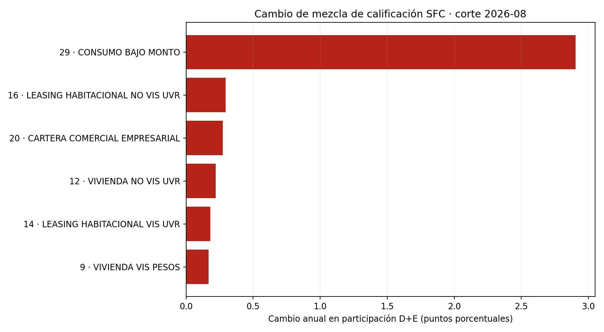

# Cambio observado de mezcla de calificación D+E por producto

**Corte más reciente:** 2026-08-31. **Productos:** 32. **Comparaciones interanuales disponibles:** 32.

Esta aplicación usa saldos agregados mensuales de calificación de riesgo A–E publicados por la SFC. Para cada producto compara la participación D+E del corte con el mismo producto y fecha calendario un año antes. El resultado sirve para priorizar revisión de mezcla sectorial.

## Lectura y límites

Una variación positiva significa que aumentó la parte de los saldos calificados A–E ubicada en D+E. No significa que cuentas hayan migrado individualmente desde A–C hacia D–E: los cortes agregados no enlazan prestatarios. La variación también responde a altas, bajas, amortización, castigos, composición y cambios en reportantes. D+E no se interpreta como default universal, PD, mora ni tasa de transición.

El tablero es una referencia descriptiva para vigilancia de mezcla. No estima la matriz de transición del laboratorio ni valida una PD de originación o IFRS 9. Esa validación requiere panel por operación, identificador seudonimizado estable, estados de origen y destino, saldo, curas, cierres y default definido institucionalmente.

## Reproducción y linaje

Desde este directorio, ejecutar `python3 build_companion.py` (requiere pandas y matplotlib). El snapshot agregado está en `data/`; el manifiesto registra hash del archivo, fuente y vintage del extracto SFC original. La transformación ascendente, campos y controles están descritos en el companion [SFC de mezcla de calificación por producto](../../../perdida-esperada-pd-lgd-ead/observed-sfc-product-risk-mix/README.md).

Salidas: `results/sfc_product_grade_mix_shift.csv`, `results/summary.json`, `results/manifest.json` y la figura anterior.
