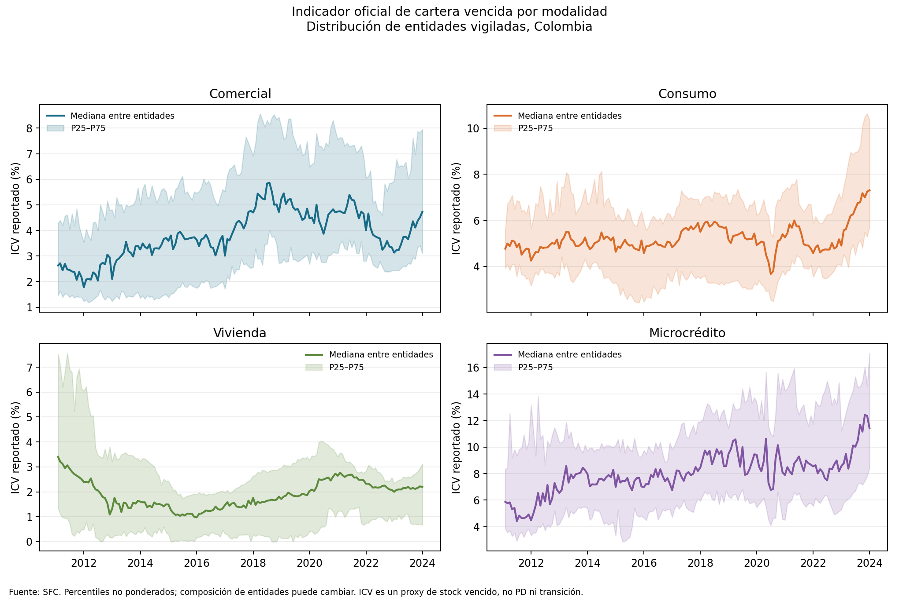

# Proxy observado de calidad de cartera SFC por modalidad

**Serie fuente:** 2011-01–2023-12 (156 cortes mensuales). **Corte final del archivo:** 2023-12-31. **Grano:** entidad × modalidad × mes.

El indicador de calidad por vencimiento de la SFC se presenta como una señal de deterioro agregado por modalidad. Puede ayudar a priorizar revisión de segmentos y construir escenarios macro o límites de seguimiento. No es una PD de originación, una etiqueta individual de default ni una matriz de transiciones.

## Resultado al último corte

| Modalidad | Entidades con dato | Mediana ICV (%) | P25–P75 (%) | Cambio mediana en 12 meses (pp) |
|---|---:|---:|---:|---:|
| Comercial | 41 | 4.73 | 3.11–7.96 | +1.60 |
| Consumo | 42 | 7.31 | 5.70–10.38 | +2.41 |
| Vivienda | 27 | 2.20 | 0.67–3.12 | +0.20 |
| Microcrédito | 21 | 11.42 | 8.42–17.09 | +2.85 |

## Definición y decisiones metodológicas

- **Indicador observado:** ICV mensual por entidad y modalidad, reportado por la SFC. El concepto es saldo vencido dividido por saldo bruto. El runner conserva el cociente publicado; no reconstruye numerador o denominador a partir de alturas de mora superpuestas.
- **Distribución:** mediana y percentiles no ponderados entre entidades por modalidad y mes. No se calcula una tasa de sistema ponderada a partir de ratios entidad, porque no se dispone aquí del denominador bruto alineado para ponderar.
- **Datos faltantes:** se omiten celdas vacías y no se convierten en cero. Ceros numéricos publicados se conservan como cero.
- **Clave:** código de tipo de entidad × código de entidad × modalidad × mes. Cambios de razón social y composición requieren revisar equivalencias antes de comparar una entidad a través del tiempo.

## Límites de uso y sesgos

El numerador vencido es un saldo de cartera ya deteriorada en una fecha; no es un conteo de nuevos defaults. El ratio mezcla comportamiento, saldo amortizado, castigos, curas, originación, composición y cambios de perímetro. La mediana de entidades da el mismo peso a entidades pequeñas y grandes; por ello describe la institución típica de la muestra y no el sistema agregado. Entradas, salidas, fusiones, cambios de modalidad y coberturas pueden mover la distribución sin un cambio comparable en riesgo subyacente.
La serie histórica incluida termina en diciembre de 2023. No se usa para límites actuales ni calibración de PD/LGD/EAD, scoring, transición, IFRS 9, cosechas o decisiones de crédito. Para eso se requieren microdatos fechados con saldo bruto/vencido, definición de default, observación por operación y seguimiento temporal; además de revisiones de vintage, cobertura y aprobaciones de MRM.

## Fuente y calidad

Fuente primaria: [SFC, histórico de calidad de cartera](https://www.superfinanciera.gov.co/publicaciones/10082252/informes-y-cifrascifrasestablecimientos-de-creditoinformacion-periodicamensualcalidad-de-cartera-establecimientos-de-credito-10082252/). Archivo congelado en `data/raw/sfc_calidad_cartera_historico.xlsx`; SHA-256: `ee6bfe42fa1fff45716c2cc517c9099fbea15a1faac03d8f5109eed9aa5487be`.
Metodología SFC descargada a `data/raw/sfc_metodologia_calidad_cartera.xls`; SHA-256: `3d620d021637ab316f37ced98026665c0a9bbcdc10a2f17470508eeb560cd4bf`. La definición general es cartera y leasing vencidos / cartera y leasing brutos × 100. Para vivienda, la metodología documenta indicadores separados por alturas (1–4 y más de 4 meses); este análisis conserva la serie histórica publicada sin reconstruir ni reasignar esas bandas.
Extracción: 21050 valores numéricos válidos en cuatro modalidades; 0 llaves duplicadas; 0 ratios fuera de [0,1] omitidos. Celdas vacías omitidas por modalidad: `{"Comercial": 4461, "Consumo": 4081, "Vivienda": 6765, "Microcrédito": 7323}`. Las hojas del archivo reportan periodicidad mensual y fuente en estados financieros/Formato 0.

## Figura

## Reproducción

Desde esta carpeta: `python3 scripts/build_sfc_quality_proxy.py`. Requiere `openpyxl`, `pandas` y `matplotlib`; toma el snapshot local y regenera CSV, manifiesto, resumen visual e informe.
