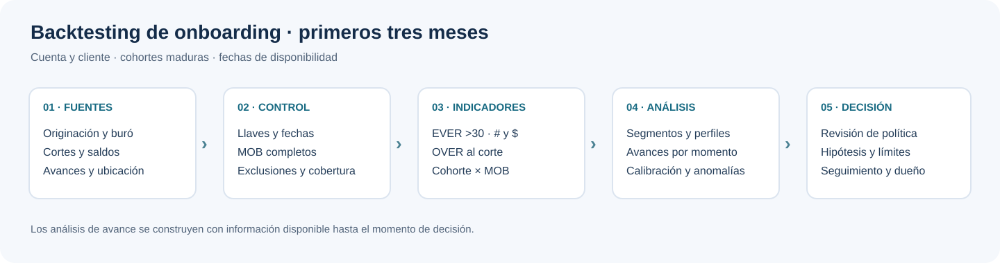

# Tarjeta de crédito: backtesting de onboarding y mora temprana

Una política de originación necesita saber qué ocurrió durante los primeros meses de cada cosecha y si el comportamiento cambia por segmento. Este laboratorio organiza el cálculo de **EVER >30 a MOB 3**, en número y saldo, y presenta un recorrido para analizar originación, score, ubicación y avances de efectivo.



> **Estado:** construcción metodológica con plantillas y demostraciones didácticas. Los valores simulados se identifican en los notebooks y sirven para explicar los cálculos. La aplicación a una cartera requiere validar la política, las fuentes, las reglas y los resultados de la entidad.

## De la medición a la decisión

Medir la mora temprana es el punto de partida. El laboratorio responde seis preguntas de negocio y termina en una recomendación cuantificada:

| # | Pregunta de decisión | Método principal | Decisión que habilita | Notebook |
|---|---|---|---|---|
| 1 | ¿El EVER30@MOB3 predice la pérdida o solo es rápido? | puente a castigo MOB 18, captura y lift; castigo proyectado | leer cosechas de 3 meses en pérdida esperada (COP) | [07](07_puente_perdida_y_curva_esperada.ipynb) |
| 2 | ¿Qué cosecha salió mala y qué fue culpa del ciclo? | curva esperada con bandas y sobredispersión; hazard edad–cohorte con macro | separar calidad de originación de entorno | [07](07_puente_perdida_y_curva_esperada.ipynb) |
| 3 | ¿Cada segmento gana o pierde plata? | mezcla frente a tasa; margen ajustado, PD y tasa de malos de equilibrio; valor del corte | apetito, precio, cupo y corte por segmento | [08](08_economia_segmentos_y_corte.ipynb) |
| 4 | ¿TPV aporta algo que el buró no ve? | Gini, KS, orden y PSI por estrategia; ΔAUC fuera de tiempo; swap set e inferencia de rechazados | ampliar, restringir o reenfocar TPV | [09](09_score_tpv_y_rechazados.ipynb) |
| 5 | ¿El avance temprano causa la mora o la anuncia? | landmark MOB 1 con Mantel-Haenszel; diferencias en diferencias sobre un cambio de política; RD en el umbral de cupo | alerta temprana frente a restricción de producto | [10](10_avances_senal_o_causa.ipynb) |
| 6 | ¿Cómo probamos el cambio antes de generalizarlo? | potencia y MDE, prueba de precisión del swap-in, asignación por hash, balance | prueba controlada y memo al comité | [11](11_prueba_controlada_y_memo.ipynb) |

Cada notebook nuevo tiene una sección *Con datos de la entidad*, que con las plantillas vacías queda en PENDIENTE, y una *Demostración aislada* sobre una cartera **simulada** con mecanismos plantados: un efecto causal del avance junto con selección por estrés no observado, una cohorte mala, un choque macro, una política de cupo de avance, un umbral de cupo y rechazados con desempeño oculto. Los `assert` comprueban qué recupera cada método y qué no. Por ejemplo, el landmark exagera el efecto del avance y la inferencia de rechazados pierde precisión lejos del corte.

## Recorrido

| Paso | Notebook | Pregunta |
|---|---|---|
| 1 | [Calidad y modelo de datos](01_calidad_y_modelo_datos.ipynb) | ¿Hay llaves, cortes y saldos suficientes para calcular? |
| 2 | [Snapshots y cosechas](02_snapshots_y_cosechas.ipynb) | ¿Cuál es el EVER >30 por número y saldo en cada MOB y cohorte? |
| 3 | [Planos y transiciones](03_planos_y_transiciones.ipynb) | ¿Cómo migran las cuentas entre estados de mora? |
| 4 | [Segmentos y avances](04_variables_territorio_y_transacciones.ipynb) | ¿Quién hizo avances, en qué momento y qué información estaba disponible? |
| 5 | [EDA, perfiles, anomalías y modelos](05_eda_clusters_anomalias_modelos.ipynb) | ¿Qué relaciones y perfiles merecen investigación sin fuga temporal? |
| 6 | [Diccionario y SQL Athena](06_diccionario_y_sql_athena.ipynb) | ¿Qué contratos y consultas se requieren para una extracción revisable? |
| 7 | [Puente a pérdida y curva esperada](07_puente_perdida_y_curva_esperada.ipynb) | Preguntas 1 y 2 |
| 8 | [Economía por segmento y corte](08_economia_segmentos_y_corte.ipynb) | Pregunta 3 |
| 9 | [Score, TPV y rechazados](09_score_tpv_y_rechazados.ipynb) | Pregunta 4 |
| 10 | [Avances: señal o causa](10_avances_senal_o_causa.ipynb) | Pregunta 5 |
| 11 | [Prueba controlada y memo](11_prueba_controlada_y_memo.ipynb) | Pregunta 6 y memo al comité |

El cálculo vive en dos módulos con pruebas unitarias: `vintage_core.py` (EVER y sus denominadores, vectorizado) y `decision_core.py` (puente, bandas, hazard, mezcla/tasa, economía, valor de vida, corte, discriminación, PSI, swap set, inferencia de rechazados, Mantel-Haenszel, DiD, RD, potencia y asignación). `demo_inputs.demo_cartera()` genera la cartera simulada con su verdad.

Los gráficos generados a partir de datos didácticos llevan una identificación explícita. Para usar un extracto propio, revisar el modo y los parámetros de cada notebook, mantener los datos sensibles fuera de Git y adaptar el contrato de entrada. Las consultas Athena son propuestas: **no se ejecutaron contra una fuente institucional**.

## Contrato inicial de la métrica

Por defecto, una cuenta tiene evento si presenta **DPD > 30** en alguno de los cortes MOB 1, 2 o 3. Una cuenta es evaluable si sus tres cortes y DPD están presentes. El número y el saldo tienen denominadores independientes; el saldo de ejemplo es el capital observado en MOB 3 y no representa pérdida. El motor también resume por cliente con las cuentas que aparecen en el panel.

Las convenciones se deben acordar con el dueño del indicador: `>30` frente a `≥30`, origen de MOB, unidad cuenta/cliente, saldo, cancelaciones y castigos. Conciliar el panel contra originación: las cuentas ausentes por completo del panel no aparecen en el universo calculado. Los cortes mensuales pueden omitir episodios intrames.

Las fuentes que agregan las preguntas de decisión tienen plantilla propia: `plantilla_desempeno_largo.csv` (castigo y pérdida a MOB 18), `plantilla_macro_mensual.csv`, `plantilla_solicitudes.csv` (incluye **rechazadas**), `plantilla_bureau_retro.csv`, `plantilla_economia_segmento.csv` y `plantilla_experimentos.csv`. Sus campos están en el diccionario y el notebook 06 propone las consultas.

Las [equivalencias de campos](EQUIVALENCIAS_CAMPOS.md) documentan los nombres anteriores y el contrato nuevo para integrar fuentes.

La [guía metodológica](GUIA_METODOLOGICA.md) explica fórmulas, segmentos, disponibilidad temporal, controles y limitaciones. Los [contratos de métricas](contratos_metricas.csv), [diccionario](diccionario_variables.csv) y `plantilla_*.csv` describen el intercambio esperado; las plantillas de datos contienen encabezados, no información real.

## Ejecutar

Desde la raíz del repositorio, en un entorno Python con los paquetes de `requirements-research.txt` instalados:

```bash
python -m pip install -r requirements-research.txt
python -m jupyter nbconvert --to notebook --execute --inplace 03-financial-risk/01-credit-risk/credit-vintage-snapshot-lab/02_snapshots_y_cosechas.ipynb
python -m unittest discover -s 03-financial-risk/01-credit-risk/credit-vintage-snapshot-lab/tests -v
python scripts/execute_notebooks.py --output artifacts/notebooks 03-financial-risk/01-credit-risk/credit-vintage-snapshot-lab/*.ipynb
```

Los notebooks 01 y 02 muestran por defecto una demostración ficticia; 03, 04 y 05 distinguen sus gráficos simulados de la ejecución con plantillas vacías. Para datos propios, siga las instrucciones de cada notebook y seleccione el archivo y modo adecuados. El notebook 05 incluye un AFM opcional que requiere `prince==0.20.2`; K-Prototypes queda como línea futura. El análisis de tiempo al evento se hace con un hazard en tiempo discreto (notebook 07), más adecuado que Kaplan–Meier o Cox con solo tres cortes mensuales. La [plantilla de seguimiento en MOB 1](plantilla_modelado_mob1.csv) contiene solo encabezados y define un resultado posterior, no un score de originación. La instalación de Jupyter/`nbconvert` puede requerir `python -m pip install nbconvert` si el entorno no lo incluye.

## Análisis y gobierno

AFM mixto, perfiles, pruebas de asociación, supervivencia, modelos y anomalías se interpretan según el momento de decisión. Los avances posteriores no son predictores disponibles al originar; los perfiles deben ajustarse en entrenamiento y compararse fuera de tiempo. Anomalía, asociación o SHAP no prueban fraude ni causalidad. Revisar pequeñas muestras, sesgo de selección, estabilidad, calibración, privacidad y uso justo antes de tomar decisiones.
