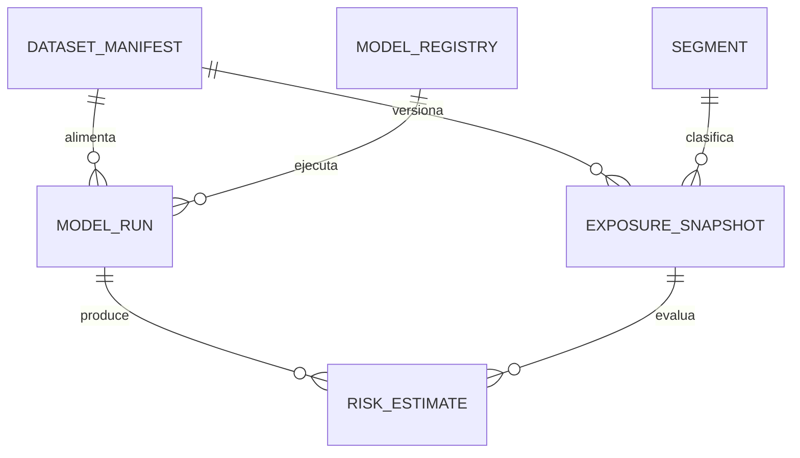

# Modelo de datos y controles

`001_credit_risk_schema.sql` crea un esquema PostgreSQL 15+ exclusivamente para un sandbox sintético. El control `CHECK (synthetic)` hace explícito que este artefacto no admite una carga marcada como real. No sustituye segregación de ambientes, cifrado, RBAC, retención, privacidad ni procedimientos de recuperación de una institución.



## Grano y llaves

| Tabla | Grano | Llave / control principal |
|---|---|---|
| `dataset_manifest` | versión de dataset | semilla, checksum y `synthetic=true` |
| `exposure_snapshot` | exposición × fecha × versión | PK compuesta; sin identificador de cliente |
| `model_registry` | versión inmutable de modelo | hash de código; producción prohibida |
| `model_run` | ejecución de modelo | `run_id`, horizonte y estado |
| `risk_estimate` | exposición × corrida | FK a snapshot; identidad EL comprobada |
| `audit_event` | evento de cambio | estado anterior/posterior JSONB |

## Controles operativos demostrados

- `v_data_quality_exceptions`: reconciliación de conteo de manifiesto y resultados en corridas no aceptadas.
- `v_run_audit`: linaje mínimo desde dataset y modelo hasta pérdida esperada agregada.
- Trigger en `risk_estimate`: registro de inserciones, actualizaciones y eliminaciones.

Ejemplo de uso, en una instancia aislada:

```sql
\i database/001_credit_risk_schema.sql
SET search_path = credit_risk_sandbox, public;
SELECT * FROM v_data_quality_exceptions;
SELECT * FROM v_run_audit ORDER BY executed_at DESC;
```

Para una plataforma real se requerirían, como mínimo, clasificación de datos, tokenización, permisos por rol, gestión de secretos externa, particionado/retención, monitoreo, validación independiente y aprobaciones formales de modelo.
