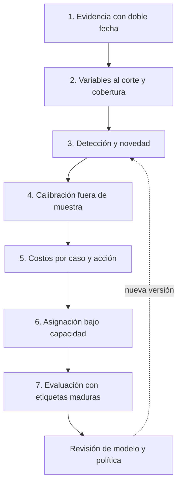
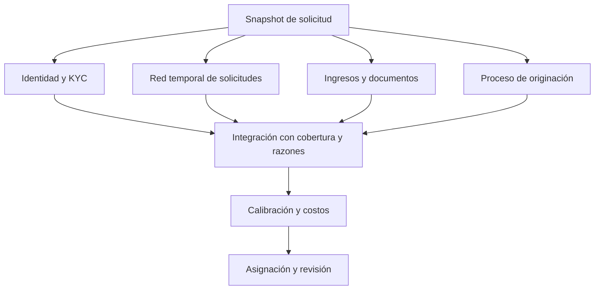
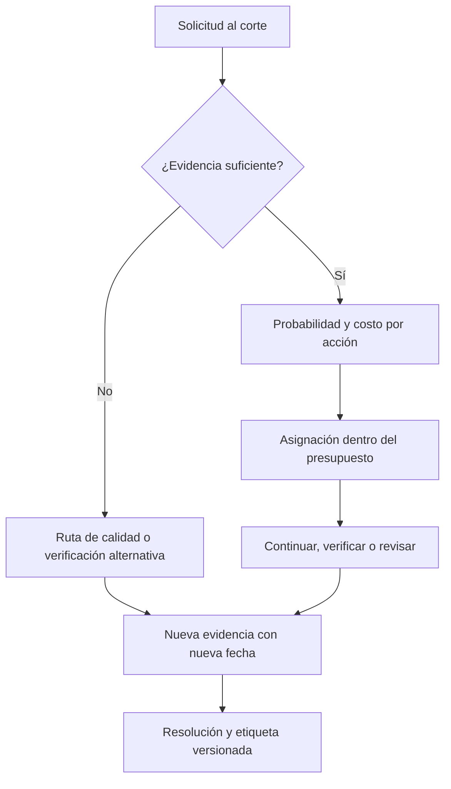

# Arquitectura de modelos, motores y capas

## Alcance de esta entrega

La línea conserva cuatro diseños S1 de detección especializada, añade [ocho experimentos de notebook S2 acotados](notebook-lab/README.md) e incorpora un [motor S2 acotado](loss-minimization-engine/README.md) para comparar modelos tabulares y decidir cómo asignar intervenciones. El motor usa cuatro señales sintéticas ya agregadas. No interpreta documentos, no entrena una GNN, no conecta proveedores KYC y no despliega un servicio.

| Componente | Implementado en esta entrega | Pendiente |
|---|---|---|
| Contratos económicos | Casos, acciones y escenarios; rechazo de entradas no finitas, pesos inválidos y casos duplicados | Validación de procedencia y cobertura institucional |
| Variables temporales | Conteo por entidad compartida con doble fecha, deduplicación y exclusión de solicitud actual; notebook de fuga temporal | Constructor integral de señales, snapshot y feature store |
| Detección | Logit y gradient boosting sobre cuatro señales simuladas; Isolation Forest como novedad | Integración de los especialistas de las cuatro fichas y datos adjudicados |
| Calibración | Sigmoide ajustada en período posterior; evaluación Brier, log loss y confiabilidad | Selección temporal anidada y validación independiente |
| Severidad y eficacia | Montos y eficacia por acción explícitos; análisis de sensibilidad | Estimación de pérdida neta y efecto causal de la intervención |
| Decisión | MILP con acciones discretas, capacidad y escenarios esperados/minimax | Red, colas dinámicas, múltiples recursos y dependencia de casos |
| Monitoreo | Resultados CSV/JSON, sensibilidad y dos figuras reproducibles | Servicio de monitoreo, auditoría durable y alertas operativas |

## Capas y responsabilidades

| Capa | Entrada y salida | Motor responsable | Fallo que debe impedir |
|---|---|---|---|
| 1 · Evidencia | Eventos con fecha del hecho y disponibilidad → contrato validado | Ingesta y calidad | Confundir ausencia de fuente con legitimidad |
| 2 · Variables | Snapshot al corte → señales, cobertura y linaje | Feature engine temporal | Usar una verificación o vecino conocido en el futuro |
| 3 · Detección | Señales → probabilidades base y score de novedad separado | Motores KYC, red, ingresos y proceso | Promediar scores de escalas incompatibles |
| 4 · Calibración | Predicción fuera de muestra → probabilidad y versión | Calibrador por cohorte | Optimizar sobre el período de prueba |
| 5 · Economía | Probabilidad, pérdida, eficacia y fricción → costo por acción | Cost engine | Multiplicar alertas por saldo y llamarlo pérdida evitada |
| 6 · Asignación | Matriz de costos y presupuesto → acción por caso | Policy engine MILP | Sobreasignar minutos o investigar dos veces el mismo caso |
| 7 · Evaluación | Decisiones y desenlaces maduros → métricas y comparación | Validation engine | Declarar una mejora por una sola métrica o simulación |

Estas capas son responsabilidades lógicas. El prototipo es un programa local; no requiere siete microservicios.

## Motores especializados: diseño objetivo

El nodo de integración no suma probabilidades. Si hay datos suficientes se entrenará una metacapa con predicciones temporales fuera de muestra. Con pocos positivos se conservarán modelos y reglas separados y se deduplicarán alertas a nivel de caso. El prototipo compara modelos sobre señales agregadas; todavía no implementa esta metacapa.

## Contratos entre motores

`RiskEstimate`: caso, corte de información, versión, población aplicable, probabilidad calibrada o tipo explícito de score, cobertura y razones. `EconomicEstimate`: caso, moneda, horizonte, pérdida condicionada a fraude, versión de severidad, costos y eficacia supuesta por acción. `PolicyDecision`: caso, acción sugerida, matriz de costos, capacidad, versión de política y estado del solver.

En el código actual `Case`, `Action` y `Scenario` cubren el contrato numérico; los CSV registran decisiones por caso/día/política. El contrato completo de procedencia y auditoría es una extensión pendiente. No se considera que un score de novedad satisfaga el campo de probabilidad.

## Flujo de decisión propuesto

La ruta de calidad y la llegada de nueva evidencia son diseño objetivo. La simulación tiene una única decisión por caso y no modela colas, apelaciones ni múltiples etapas. Las acciones no incluyen rechazo automático.

## Aprendizaje y reproducción

El ajuste usa solicitudes sintéticas de días 0–69 y etiquetas disponibles a día 80. La calibración usa solicitudes de días 80–99 y etiquetas disponibles hasta día 110. La prueba comienza en día 110. Los períodos intermedios actúan como embargo. El generador hace que las etiquetas maduren entre 3 y 10 días; estos cortes solo son adecuados para ese supuesto.

Imputación y modelos se ajustan con entrenamiento; el calibrador utiliza exclusivamente la ventana posterior. Los hiperparámetros y el modelo de política se fijan antes del test. El test evalúa, no selecciona al ganador. La función temporal de entidades se prueba por separado y no construye las cuatro señales de la simulación.

## Crecimiento sin perder control

Primera extensión: sustituir una señal simulada por un baseline especializado, conservando la interfaz económica y comparando su aporte incremental. Segunda: registrar versiones de features, modelos y políticas con replay temporal. Tercera: cola con tiempo variable y costos de demora; después, dependencias por red y decisiones secuenciales. Solo separar servicios cuando latencia, carga o aislamiento lo requieran.

No se certifica volumen ni latencia de producción. El MILP actual usa matrices densas para pequeños lotes diarios; la evolución a gran escala exige estructura dispersa, límites de tiempo, una solución factible de respaldo y medición de brecha de optimalidad.
