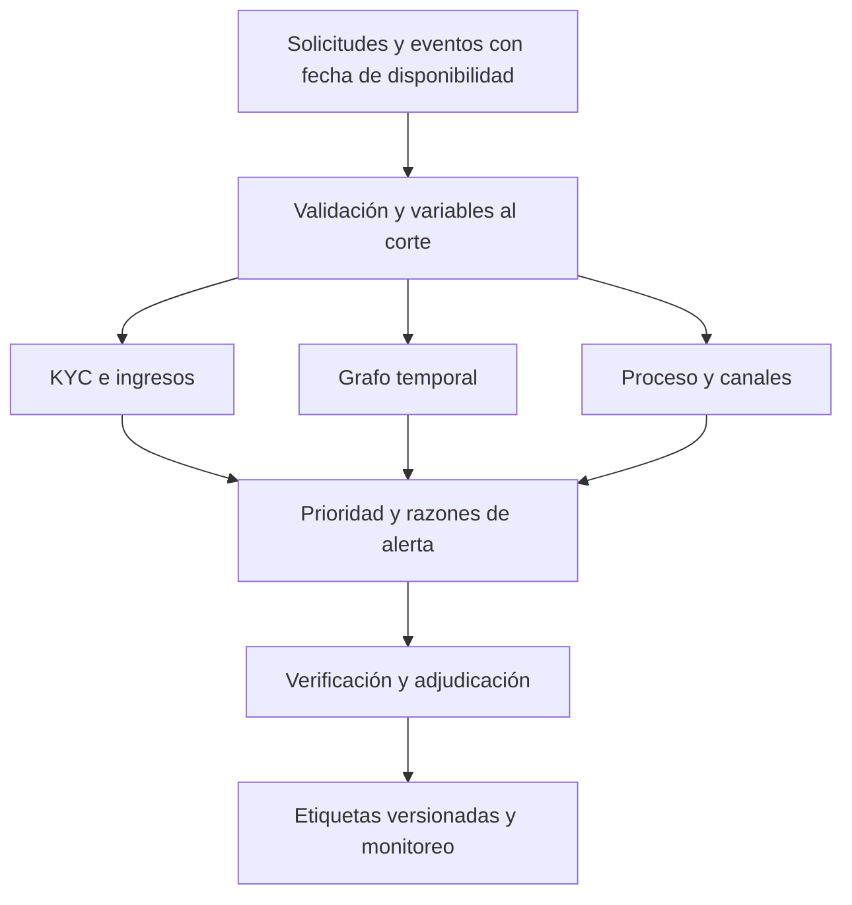

# Fraude y anomalías en originación de crédito

Cuatro programas de investigación para solicitudes de crédito y KYC. Revisión de la estructura: 21 de octubre de 2026, sobre `main` en `69983fb`. **Los cuatro especialistas permanecen en S1. Incluye ahora un motor S2 acotado con modelos tabulares entrenados y comparación de políticas sobre datos sintéticos; sin validación productiva.** Los umbrales y cronogramas siguientes son propuestas experimentales.

## Notebooks, ecuaciones e ideas

[Ocho notebooks ejecutados](notebook-lab/README.md), dos por especialista: 160 celdas y 16 figuras, con derivaciones, sensibilidad y contraejemplos. Las fichas originales conservan S1 para su alcance integral; los experimentos concretos son S2 acotados a datos sintéticos. Cada carpeta añade una agenda de ecuaciones e investigación.

## Modelos, pérdida y arquitectura

- [Arquitectura por capas y motores](ARCHITECTURE.md): responsabilidades, contratos, tres diagramas y estado de implementación.
- [Técnicas y minimización de pérdida](MODEL_AND_LOSS_METHODS.md): calibración, costos por acción, MILP y escenarios.
- [Motor ejecutable](loss-minimization-engine/README.md) y [resultados](loss-minimization-engine/RESULTS.md): logit, boosting, novedad y siete políticas.

## Preguntas que cubre la línea

| Proyecto | Pregunta | Baseline | Desarrollo propuesto | Unidad de análisis |
|---|---|---|---|---|
| [01 · Identidad y KYC](01-identity-kyc-consistency/README.md) | ¿La identidad y las evidencias son coherentes? | Reglas y logit | Boosting calibrado y detector de novedad | Solicitud al completar KYC |
| [02 · Redes de fraude](02-temporal-application-graphs/README.md) | ¿Hay solicitudes coordinadas por entidades compartidas? | Conteos temporales | Grafo heterogéneo temporal; GNN como challenger | Solicitud y componente conectado |
| [03 · Ingresos y documentos](03-income-document-consistency/README.md) | ¿Los ingresos declarados tienen respaldo consistente? | Conciliaciones y residuos robustos | Regresión cuantílica y clasificación de discrepancias verificadas | Solicitud y período de ingreso |
| [04 · Proceso de originación](04-origination-process-anomalies/README.md) | ¿Aparecen desvíos en canal, asesor o secuencia de aprobación? | Tasas ajustadas por mezcla | Modelo jerárquico, CUSUM y anomalías de secuencia | Evento y grupo por período |

Los cuatro programas comparten [contratos, etiquetas y validación](DESIGN_AND_VALIDATION.md). El objetivo es producir evidencia para investigar y verificar; una anomalía aislada no confirma fraude. Un deterioro crediticio tampoco demuestra engaño. El score de fraude se conserva separado de PD, LGD, EAD y staging IFRS 9.

## Arquitectura propuesta

Las salidas se consolidarán por solicitud y caso para evitar tres alertas operativas sobre el mismo incidente. La prioridad dependerá de la pérdida prevenible, la capacidad de revisión y la evidencia disponible. No se sumarán probabilidades de modelos correlacionados.

## Secuencia de desarrollo y entregables

1. **Fundación:** generador sintético sin PII, tablas bitemporales, catálogo de etiquetas, constructor de variables al corte y pruebas de fuga temporal.
2. **Baselines:** reglas KYC, conteos del grafo, conciliación de ingresos y tasas de proceso ajustadas por mezcla. Cada uno con notebook ejecutado y diagnóstico de falsos positivos.
3. **Comparación:** logit/boosting, regresión cuantílica, modelo jerárquico y detección de novedad; mismos cortes, población y presupuesto de investigación.
4. **Integración:** deduplicación de alertas, simulación de cola, pérdida y fricción; evaluación conjunta e incremental frente a reglas.
5. **Validación externa:** únicamente en entorno institucional autorizado, con fuentes verificadas, revisión independiente y operación en sombra antes de considerar decisiones.

Una primera iteración puede organizarse en seis sprints semanales: contratos; KYC; grafos; ingresos; proceso; integración. Es una estimación de trabajo, condicionada a datos y capacidad. El paso a S2 exige artefactos ejecutados; una carpeta con documentación no basta.

## Criterio de éxito

Se propondrá una mejora solo si aporta beneficio incremental frente a las reglas al mismo volumen de alertas, con incertidumbre reportada, sin usar futuro ni empeorar materialmente los falsos positivos de segmentos relevantes. No se fija una precisión objetivo sin conocer prevalencia y maduración de etiquetas.

## Referencias y alcance

- [NIST SP 800-63A-4](https://pages.nist.gov/800-63-4/sp800-63a.html): referencia técnica de comprobación de identidad y gestión de fraude; no se presenta como normativa colombiana ni certificación de este diseño.
- [IsolationForest, documentación oficial](https://scikit-learn.org/stable/modules/generated/sklearn.ensemble.IsolationForest.html): detector de anomalías; su score no es una probabilidad de fraude.
- [Average precision, documentación oficial](https://scikit-learn.org/stable/modules/generated/sklearn.metrics.average_precision_score.html): definición de AP; no confundir con área trapezoidal de la curva PR.
- [Duan et al., CaT-GNN, 2024](https://arxiv.org/abs/2402.14708): antecedente de grafos temporales en fraude transaccional. Su desempeño no se extrapola a originación.

Las propuestas, ecuaciones de decisión y experimentos de esta línea son diseños propios para investigar; no describen una implementación existente de un banco. Solo se versionarán datos sintéticos y evidencia reproducible sin identificadores personales.
