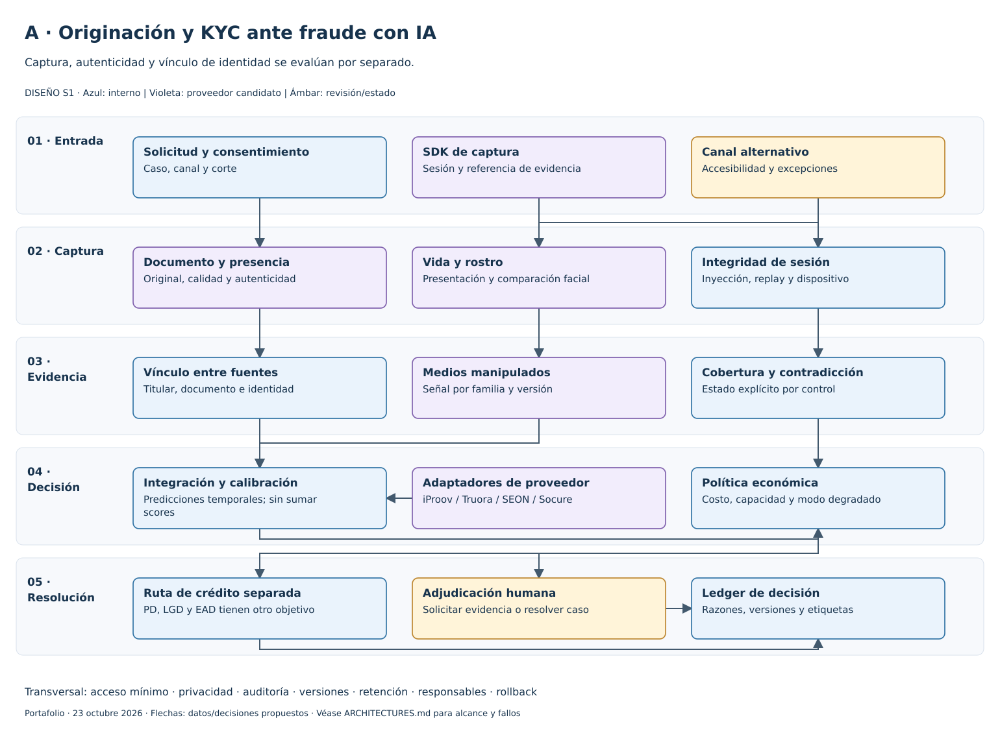
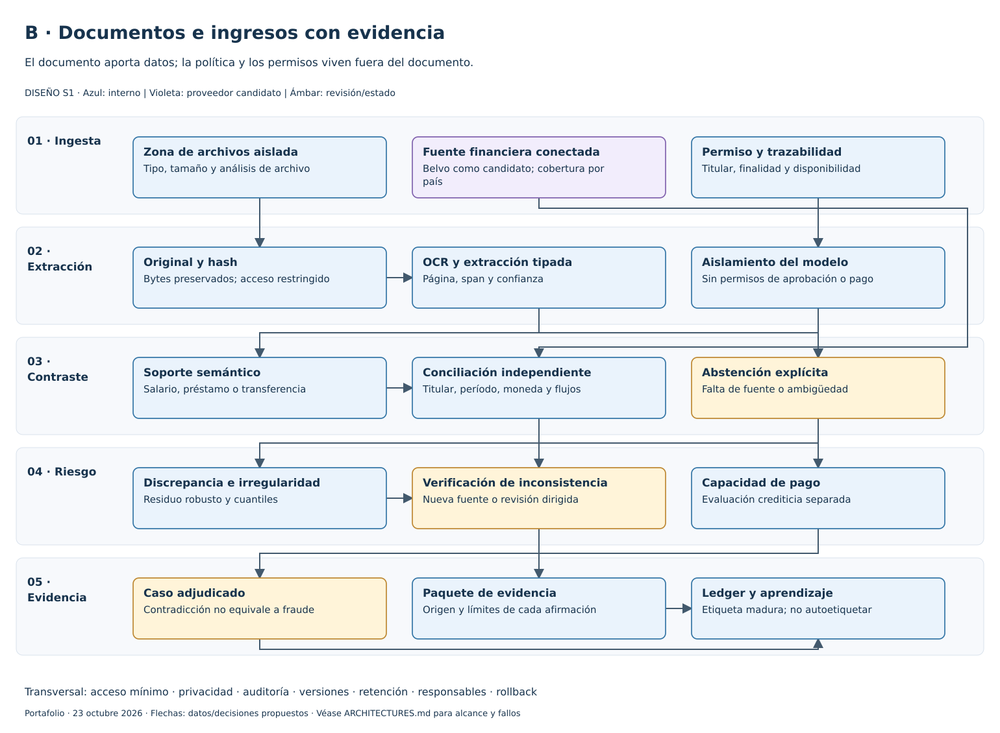
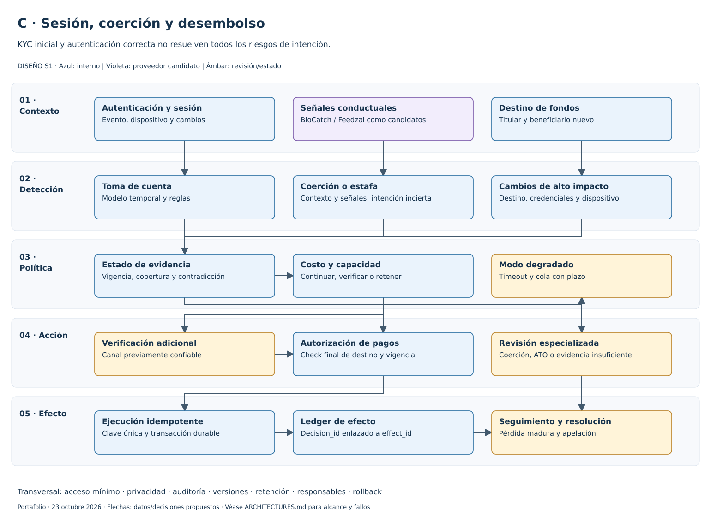
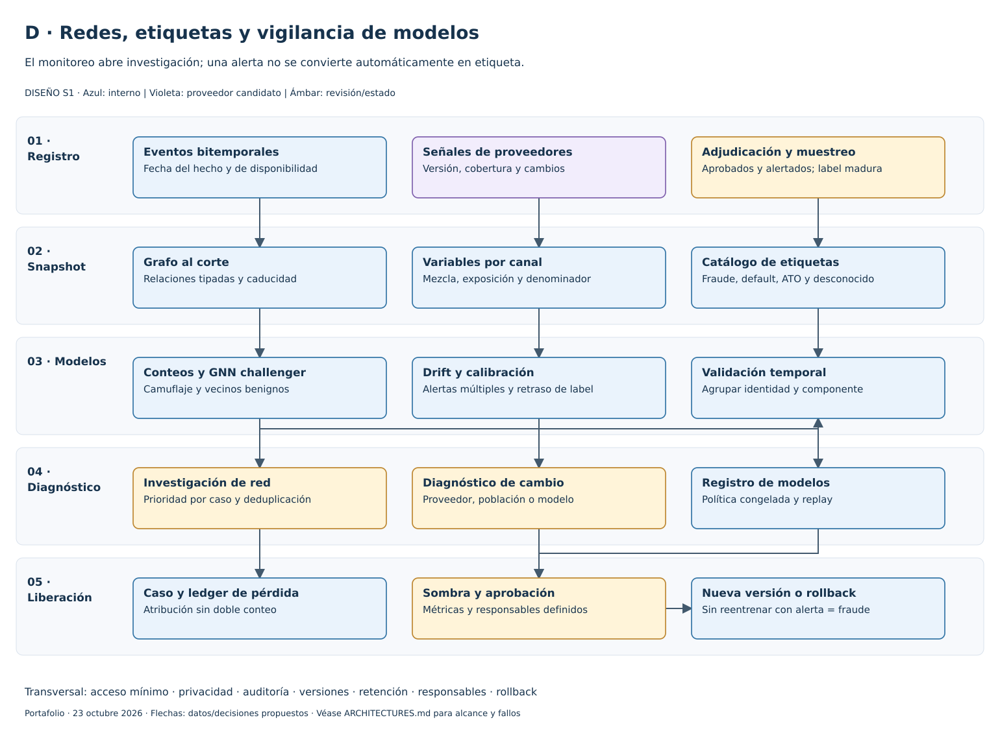

# Arquitecturas editables

Abrir [fraud-defense.drawio](fraud-defense.drawio) en diagrams.net/draw.io: **Archivo → Abrir desde → Dispositivo**. Contiene cuatro páginas con cajas, textos, conectores y geometrías nativas editables. No es una imagen pegada en el lienzo. Los contenedores de capa se pueden editar; no se configuraron capas de visibilidad independientes.

| Página | Vista portable | Pregunta |
|---|---|---|
| A · KYC | [01-kyc.svg](01-kyc.svg) | ¿Qué evidencia de persona, documento y captura se verificó? |
| B · Ingresos | [02-documents.svg](02-documents.svg) | ¿Qué afirmación tiene soporte y qué concepto financiero representa? |
| C · Desembolso | [03-session.svg](03-session.svg) | ¿Quién actúa, bajo qué contexto y con qué destino de fondos? |
| D · Red/modelos | [04-network.svg](04-network.svg) | ¿Cómo se detecta coordinación y se valida un cambio de modelo? |

Reproducir: `python ../build_architectures.py` desde esta carpeta. El script también funciona desde cualquier directorio con su ruta absoluta. El modelo de geometría produce XML mxGraph sin compresión y vistas SVG deterministas con el mismo contenido y conectores. El render SVG es propio; no se declara exportación desde la aplicación draw.io. Se validaron XML, IDs, referencias, hashes y vistas renderizadas; no se hizo un round-trip en la interfaz de draw.io.

La condición S1 aplica a las cuatro arquitecturas. Los enlaces y controles describen una integración propuesta; no equivalen a un servicio desplegado. [Contratos, ecuaciones y rutas de fallo](../ARCHITECTURES.md).
