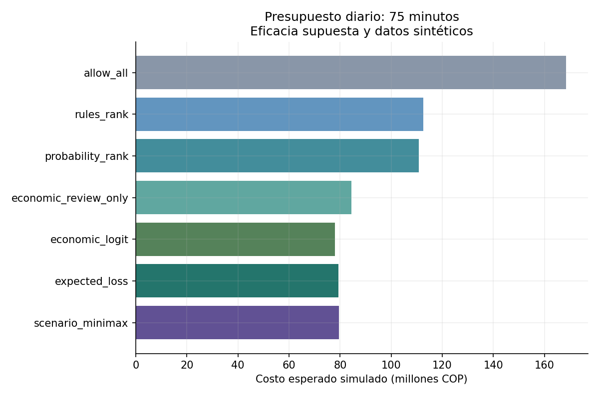
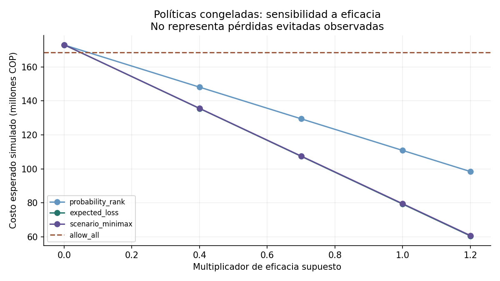

# Resultados del prototipo — 21 de octubre de 2026

## Condiciones del experimento

2.800 solicitudes sintéticas en 140 días; entrenamiento de 1.400 casos, calibración de 400 y test de 600 en 30 días. El test contiene 69 positivos (11,5%): una prevalencia del simulador, sin representar una tasa de fraude bancaria. Las cuatro señales observadas son agregados simulados con ruido y 6% de faltantes por campo; la probabilidad verdadera contiene interacción y heterogeneidad no observada.

Se presupuestan 75 minutos diarios. Verificar cuesta 4.000 COP, 3 minutos, eficacia 0,35 y fricción legítima 2.500 COP. Revisar cuesta 18.000 COP, 15 minutos, eficacia 0,80 y fricción legítima 15.000 COP. Son supuestos del experimento, no estimaciones de mercado. La eficacia es la fracción prevenible condicionada a fraude, no una tasa observada de éxito.

La política esperada usa escenarios base, menor eficacia y menor prevalencia con pesos 0,60/0,25/0,15. La política minimax utiliza los mismos tres escenarios sin ponderarlos en el objetivo máximo.

## Costo bajo la probabilidad verdadera del simulador

| Política | Costo esperado simulado, millones COP | Minutos en 30 días |
|---|---:|---:|
| allow_all | 168.55 | 0 |
| rules_rank | 112.59 | 2250 |
| probability_rank | 110.87 | 2250 |
| economic_review_only | 84.50 | 2250 |
| economic_logit | 77.88 | 2250 |
| expected_loss | 79.31 | 2250 |
| scenario_minimax | 79.50 | 2250 |

Ordenar por probabilidad y asignar solo revisiones cuesta 110,87 millones; asignar económicamente con el mismo menú cuesta 84,50 millones, una reducción simulada de 23,79%. La política económica con verificación adicional cuesta 79,31 millones, 28,47% menos que el ranking probabilístico; esta segunda diferencia incluye el cambio de menú. El logit con asignación económica cuesta 77,88 millones, inferior al boosting calibrado en este test. No se selecciona un ganador con esta observación.

El bootstrap por días de la diferencia entre ranking probabilístico y política económica completa entrega un intervalo de 23,40–42,18 millones COP. Refleja repetición de estos días sintéticos y mantiene el modelo entrenado fijo; no incluye incertidumbre del efecto de intervención, modelos, severidad ni mecanismo generador.

## Resultados que limitan la conclusión

La AP de logit es 0,2274, frente a 0,2238 de boosting. El calibrador mantiene el ranking en esta corrida, pero su Brier empeora de 0,09821 a 0,10137 y su probabilidad media sube a 0,1602 frente a prevalencia observada 0,115. La calibración posterior no garantiza una mejora y una ventana de 400 casos puede aportar ruido.

Isolation Forest obtiene AP 0,1533 como score de rareza; no se interpreta ni se calibra como probabilidad en este prototipo. El modelo de política fue preespecificado como boosting calibrado; se conserva aunque logit haya resultado mejor en esta prueba. Una futura selección necesita validación temporal adicional y un nuevo test cerrado.

Cuando la eficacia cae a cero, investigar aumenta el costo frente a continuar. La sensibilidad muestra ese contraejemplo y no reajusta las políticas después de observar el test.

## Evidencia y límites de reproducción

21 pruebas locales aprobadas. Incluyen 20 lotes aleatorios por dos objetivos, contrastados contra enumeración exhaustiva independiente, presupuesto cero, revisión no económica, entradas inválidas, duplicación de casos, efecto de capacidad, reconciliación del costo y evidencia futura/tardía. El ajuste de modelos permanece idéntico al cambiar datos y etiquetas de test.

Las decisiones individuales se regeneran con `python run_experiment.py` y se excluyen de Git por volumen; las tablas diarias y agregadas quedan versionadas. El workflow reproduce pruebas y experimento, y sube las decisiones como artefacto de CI. Su estado remoto se informa aparte: tener el archivo YAML no acredita que haya pasado.

El primitivo de conteo temporal se prueba de manera independiente; no existe todavía un pipeline de grafo real. Tampoco hay motor forense documental, estimación causal de eficacia, cola durable, comparación de campañas independientes ni validación externa. El MILP resuelve el problema pequeño formulado bajo costos suministrados: no certifica mínimo de pérdida real.
