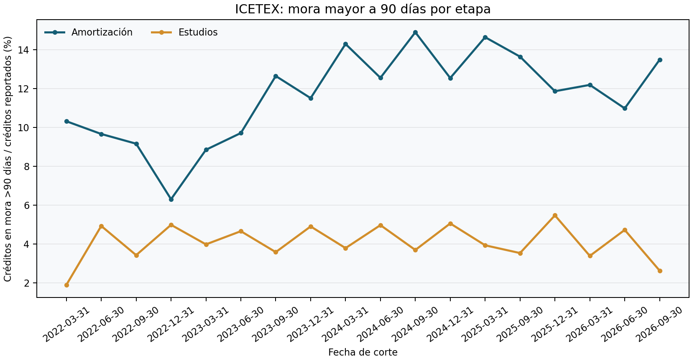
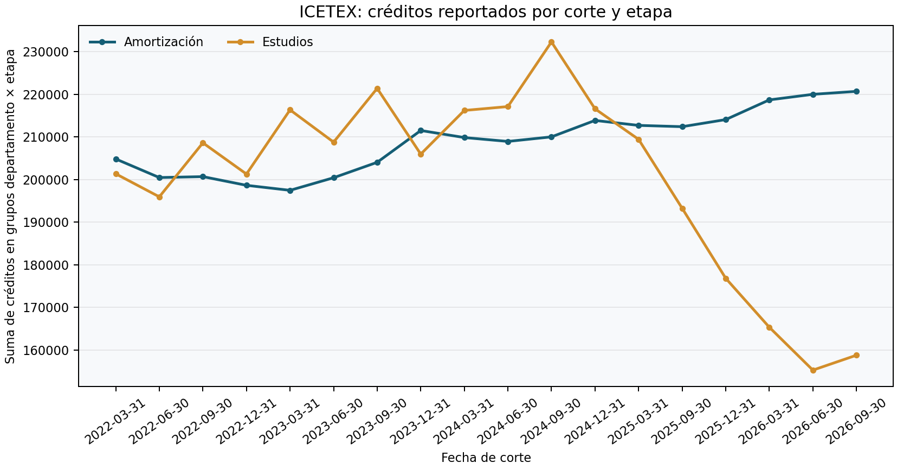
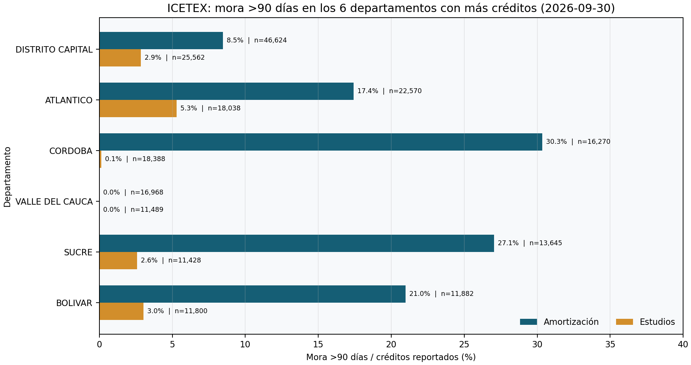
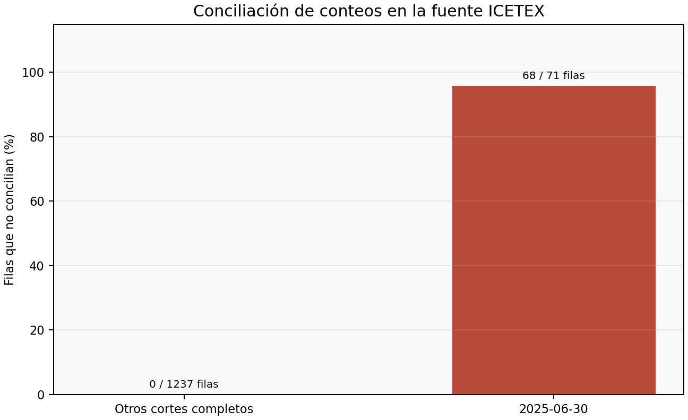

# Evidencia observada ICETEX — snapshot 2026-11-10

## Pregunta

¿Qué muestran los cortes públicos de cartera educativa del ICETEX sobre el conteo de créditos y la prevalencia agregada de mora mayor a 90 días por etapa y departamento, una vez que se excluyen los cortes que no concilian?

## Fuente, grano y tratamiento

- **Fuente:** [ICETEX, Comportamiento de Cartera y Crédito](https://www.datos.gov.co/Educaci-n/Comportamiento-de-Cartera-y-Cr-dito-/dugh-vkir), publicado en el [Portal Nacional de Datos Abiertos](https://www.datos.gov.co/). El catálogo reportaba última actualización 2026-10-15; snapshot descargado 2026-11-10.
- **Grano:** fecha de corte × departamento × fase (`ESTUDIOS` / `AMORTIZACION`). Los recuentos son grupos observados, no contratos individuales.
- **Validación:** el snapshot contiene 1.308 filas; 68 no reconcilian `al día + con mora + mora >90 = total`. Las 68 pertenecen al corte 2025-06-30. Tres filas adicionales de ese mismo corte conciliaban, pero se excluyó la fecha completa para evitar un periodo parcial.
- **Población analítica:** 1.237 filas, 18 fechas completas, 44 departamentos, 2022-03-31 a 2026-09-30. SHA-256 de fuente y salida en [`data/processed/manifest.json`](../data/processed/manifest.json); el bruto y los rechazos están versionados en [`data/`](../data/README.md).
- **Métrica:** suma de conteos >90 días dividida por suma de créditos totales dentro de cada corte y fase. Es una prevalencia de stock ponderada por denominador, no una media de porcentajes por departamento.

## Lecturas descriptivas

- Entre el primer y el último corte completo, la prevalencia agregada >90 días pasó de **10,32% a 13,48% en Amortización** y de **1,90% a 2,63% en Estudios**. Son diferencias descriptivas en stocks; no identifican causas ni transición futura a default.
- En el último corte, 2026-09-30, el conteo agregado de créditos reportados en Estudios fue **158.794**, frente a **220.723** en Amortización. La serie de Estudios muestra un descenso marcado después de 2025-06-30. Hay un corte omitido por falla de conciliación, y esta extracción no trae vintages de publicación ni una explicación metodológica; la variación requiere confirmación del ICETEX antes de comparaciones de desempeño.
- En la comparación departamental del último corte aparecen valores extremos, incluidos grupos con 0,0% y otros por encima de 25%. El gráfico muestra denominadores; aun con volúmenes grandes, un resultado extremo debe contrastarse con definiciones, registro de cambios y publicación fuente antes de asignarle significado de riesgo.
- La cuarentena no distribuye los rechazos por varias fechas: **68 de 71 filas** del 2025-06-30 fallaron conciliación; se retiró el corte completo. El archivo de datos es oficial; la integridad semántica de esa fecha no es suficiente para análisis.

## Figuras









## Interpretación y decisión

La fuente sirve para monitoreo descriptivo del portafolio de crédito educativo ICETEX y para probar trazabilidad de cargas agregadas. No representa cartera del sistema financiero ni permite estimar PD individual, migraciones entre estados, LGD, recuperaciones, SICR o ECL. La decisión inmediata habilitada es mantener el corte 2025-06-30 fuera de comparaciones y solicitar la explicación del cambio de conteos/fases al responsable de la fuente. Para análisis IFRS 9 se requieren datos autorizados de contrato con fechas as-of, transiciones a default, exposición y flujos de recuperación, además de sus vintages.

## Reproducción

Desde la raíz del repositorio:

```bash
python3 03-financial-risk/01-credit-risk/observed-data-proxies/src/observed_portfolio.py \
  --as-of 2026-11-10 \
  --source-json 03-financial-risk/01-credit-risk/observed-data-proxies/data/raw/icetex-dugh-vkir-2026-11-10.json \
  --source-last-updated 2026-10-15 \
  --output /tmp/icetex-observed-2026-11-10
MPLCONFIGDIR=/tmp/mplconfig MPLBACKEND=Agg python3 \
  03-financial-risk/01-credit-risk/observed-data-proxies/src/build_observed_figures.py
```

Los archivos gráficos se regeneran desde `data/processed/delinquency_observed.csv`. Atribución requerida por el portal: **Fuente: Portal de Datos Abiertos www.datos.gov.co**; última actualización de la fuente 2026-10-15.
