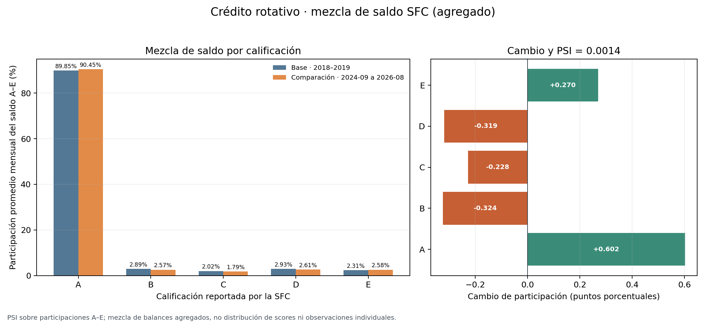

# PSI observado de mezcla de calificaciones SFC

## Pregunta y decisión que habilita

¿Cambió la composición de los saldos reportados en calificaciones A–E para crédito rotativo entre 2018–2019 y 2024-09–2026-08? Este companion calcula una estadística PSI sobre la distribución de **saldos agregados** por categoría de calificación. Puede ayudar a decidir si se debe investigar un cambio en la composición reportada del portafolio y pedir validación de exposición, cobertura y prácticas de rating.

El PSI de esta aplicación es **cambio descriptivo de distribución de saldos**. No es deriva de score, deriva de covariables de un modelo, degradación predictiva, evidencia de default ni validación de una PD. No se usan rentabilidades FIC como etiquetas crediticias.

## Fuente, vintage y grano

Se reutiliza el derivado mensual del conjunto abierto oficial de la SFC [Distribución de cartera por producto, rvii-eis8](https://www.datos.gov.co/en/en/Public-Finance/Distribuci-n-de-cartera-por-producto/rvii-eis8). La fuente pública se describe como saldos por entidad, modalidad/producto, altura de mora y calificación. El producto se selecciona por `unicap=1`, `CRÉDITO ROTATIVO`, que tiene 140 cortes mensuales desde enero de 2015 hasta agosto de 2026 y cobertura histórica de calificación A–E sobre saldo bruto de al menos 96,63% en el derivado empleado.

El vintage SFC usado en el derivado se consultó el 11 de noviembre de 2026; su corte máximo es **31 de agosto de 2026**. Hash del CSV de fuente empleado por el pipeline oficial: `94e767a38e182ca9a6b0d188eea1617be2afe061ed6841c97e523c6d0168fa2d`. Este companion consume el CSV derivado ya existente, no vuelve a descargar ni duplica los datos crudos: hash del derivado `45c116db15aac1912ebf17d6fa4ce69ed328a4a3f71be00d440fcf5d0d782690`. La [ficha de fuente y sus límites de interpretación](../../../01-credit-risk/credit-risk-products/perdida-esperada-pd-lgd-ead/observed-sfc-product-risk-mix/README.md) registra el grano, filtro de línea total y linaje del CSV.

Se comparan dos periodos de 24 cortes cada uno: **base enero de 2018–diciembre de 2019** y **reciente septiembre de 2024–agosto de 2026**. La comparación excluye 2020–2024 inicial para mantener dos ventanas del mismo tamaño separadas por años de transición. No se excluyen meses por cobertura: los 48 cortes superan 95% de cobertura A–E.

## Método

Para cada mes se calcula la proporción del saldo calificado en cada grado (g\in\{A,B,C,D,E\}\):

```text
share_g,t = saldo_g,t / (saldo_A,t + saldo_B,t + saldo_C,t + saldo_D,t + saldo_E,t)
```

La métrica principal promedia las 24 participaciones mensuales con el mismo peso dentro de cada ventana. Luego calcula:

```text
PSI = Σ_g (actual_g − esperado_g) × ln(actual_g / esperado_g)
```

Se usa una cota numérica de `1e-6` y se renormalizan las participaciones después de aplicarla. Una sensibilidad agrupa los saldos de los 24 meses antes de calcular las participaciones (ponderación por saldo acumulado); ambas reglas pueden diferir cuando el tamaño del producto cambia con el tiempo.

## Resultado observado

El PSI de las participaciones mensuales promedio fue **0,00137**; al ponderar por saldo acumulado fue **0,00133**. Entre ambas ventanas, A sube 0,60 puntos porcentuales, mientras B, C y D bajan alrededor de 0,23–0,32 puntos cada una y E aumenta 0,27 puntos. En la comparación descriptiva, la mezcla agregada de saldo luce similar bajo esta partición por producto y ventanas.

Los valores 0,10 y 0,25 se usan a veces como bandas heurísticas en PSI de scores. **No se aplican como semáforos aquí**: no están calibrados para participaciones de saldos agregados por rating, meses serialmente dependientes y cobertura variable. El resultado pequeño no demuestra que un modelo se mantuvo estable.



## Límites: qué falta para Gini y calibración

La fuente agrupa saldos por mes y producto; no incluye score/PD individual, evento de default según definición institucional, horizonte de desempeño ni una llave seudonimizada que permita vincular predicciones con resultados. Por ello:

- **No se estima Gini/AUC**: hace falta una predicción por observación y el outcome binario observado en un horizonte fijo.
- **No se evalúa calibración**: hacen falta PD predicha y frecuencia de default realizada en cohortes comparables, junto con reglas de censura y maduración del outcome.
- **No se monitorea PSI de score o de variables de entrada**: aquí se comparan cinco categorías de calificación reportada en saldos, no scores ni datos de originación.
- Un cambio en mezcla también puede reflejar entradas/salidas de cartera, entidades reportantes, cobertura, reclasificaciones o políticas de calificación; no se identifica su causa.
- Las 24 observaciones de cada periodo son cortes mensuales dependientes; no se tratan como registros de préstamo independientes ni se calcula p-valor.
- Este resultado solo orienta una revisión descriptiva de composición. No es un límite operativo ni habilita originación, precio, provisiones, cambios de estrategia o decisiones adversas.

Para validar un modelo se requiere un extracto institucional gobernado con scores y versión de modelo, atributos de observación, outcome y definición de default aprobados, horizonte fijo, fechas de desempeño, exposición y tratamiento de censura; debe haber suficientes casos maduros fuera de desarrollo y validación independiente.

## Reproducibilidad

Requisitos: Python 3, `pandas`, `numpy` y `matplotlib`. Desde esta carpeta:

```bash
python3 build_observed_psi.py
```

Opcionalmente se puede indicar la ruta del mismo derivado:

```bash
python3 build_observed_psi.py --input "/ruta/sfc_product_risk_grade_mix_monthly.csv"
```

El runner valida SHA-256, filas, esquema, llaves únicas, 24 cortes mensuales por ventana, saldos no negativos y cobertura mínima antes de calcular. El hash esperado está en `data/source_reference.json`.

Artefactos:

- `results/observed_risk_grade_mix.csv` — participaciones por grado, cambios y sensibilidad ponderada por saldo;
- `results/observed_psi_summary.json` — hash, ventanas, cobertura, resultado y alcance;
- `figures/observed_risk_grade_mix_psi.png` — figura comparativa.
