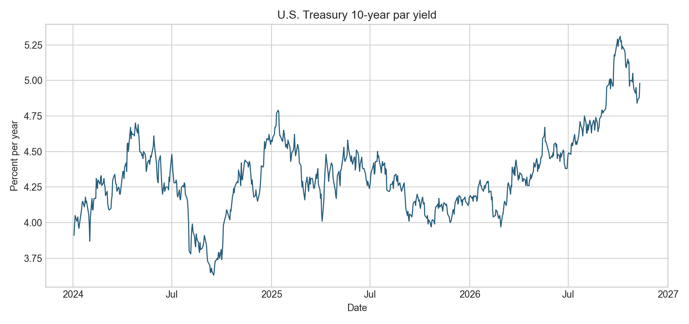
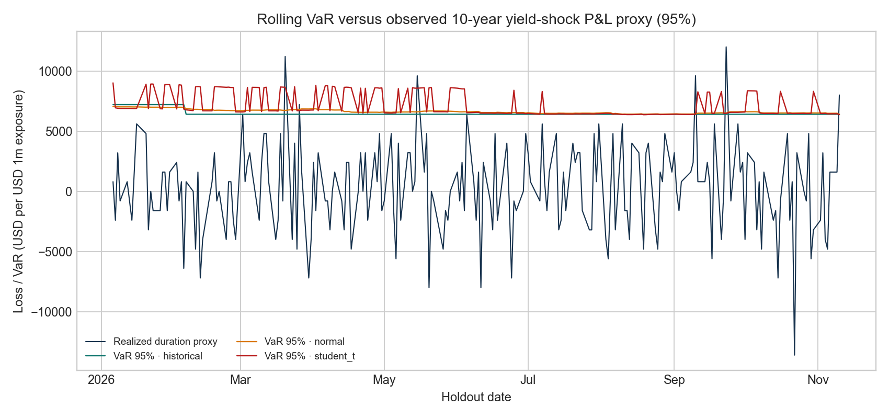

# VaR y ES sobre choques observados de tasa: edición oficial

## Pregunta de aplicación

¿Cómo se comportan VaR histórico, normal y t ajustada al evaluar fuera de tiempo choques diarios observados en la curva de rendimientos del Tesoro de EE. UU. a 10 años?

## Evidencia y transformación

La serie primaria del [U.S. Treasury](https://home.treasury.gov/resource-center/data-chart-center/interest-rates/TextView?page=0&type=daily_treasury_yield_curve) contiene 715 observaciones diarias entre 2024-01-02 y 2026-11-10. Tras calcular cambios se obtienen 714 observaciones. Los archivos fuente, sus hashes, el procesamiento y las salidas están descritos en la [tarjeta de datos](../data/README.md) y el [manifiesto](../data/official/manifest.json).

Como proxy de riesgo de tasa, se fija duración modificada de 8 años y se aproxima el cambio de precio de una posición larga por `−D_mod × Δy`. El P&L se escala a USD 1 millón. Es una exposición estilizada al factor de tasa; el dato del Treasury es una curva par interpolada, no el retorno total de un bono individual.

## Diseño de validación

Para cada fecha de prueba, cada método se ajusta con los 500 cambios inmediatamente anteriores. La ventana fuera de tiempo comprende 214 observaciones del 2026-01-06 al 2026-11-10. Se reporta cobertura VaR a 95% y 99%, junto con el p-valor de cobertura incondicional de Kupiec. Los parámetros de test se fijan antes de calcular los resultados en `official_version.py`.

| Nivel | Método | Excepciones / 214 | Esperadas | Tasa observada | Kupiec UC p-valor | VaR medio | ES medio |
|---:|---|---:|---:|---:|---:|---:|---:|
| 95% | Histórico | 6 | 10,70 | 2,80% | 0,109 | USD 6.482 | USD 8.701 |
| 95% | Normal | 6 | 10,70 | 2,80% | 0,109 | USD 6.627 | USD 8.295 |
| 95% | t ajustada | 6 | 10,70 | 2,80% | 0,109 | USD 7.183 | USD 11.240 |
| 99% | Histórico | 2 | 2,14 | 0,93% | 0,923 | USD 10.131 | USD 11.730 |
| 99% | Normal | 4 | 2,14 | 1,87% | 0,254 | USD 9.348 | USD 10.701 |
| 99% | t ajustada | 2 | 2,14 | 0,93% | 0,923 | USD 12.788 | USD 19.820 |

VaR y ES son promedios de los pronósticos diarios expresados por USD 1 millón de nocional, no pérdidas contables de un portafolio. No rechazar cobertura en esta muestra no demuestra calibración: con 214 días, especialmente a 99%, la potencia estadística es limitada. La prueba de Kupiec solo contrasta la frecuencia incondicional; no prueba independencia temporal de excepciones.

## Lectura de riesgo y decisión

En este tramo fuera de tiempo, el ajuste normal registró cuatro excepciones al 99% frente a dos con los otros métodos. La t estimada produjo el VaR y ES promedio más altos, lo que refleja más peso modelado en la cola bajo esta ventana. El resultado apoya conservar comparación de métodos y ampliar el monitoreo; no justifica elegir un modelo por una sola ventana ni un umbral de apetito.

Para una decisión de límites hacen falta retornos de instrumentos o factores completos, posiciones y sensibilidades reales, backtesting multi-año con validación de independencia, análisis de estabilidad de parámetros, estrés, costos de cobertura y umbrales aprobados por gobierno de modelos. La prueba no representa VaR regulatorio ni un modelo validado para negociación.

## Figuras

## Referencia metodológica

El Tesoro explica que los rendimientos constantes se interpolan desde su curva par y se estiman a partir de cotizaciones indicativas bid-side; los cambios de metodología histórica están documentados en la página fuente. Esta edición conserva el notebook controlado para estudiar propiedades de estimación con verdad conocida y añade esta validación de aplicación observada como evidencia distinta.
