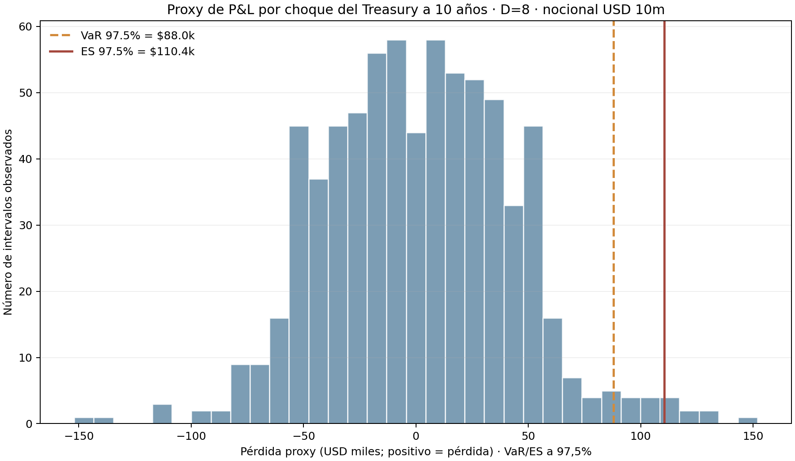

# ES observado sobre un proxy de choque de tasa

## Pregunta y uso

¿Qué pérdida de cola empírica produce el motor de Expected Shortfall (ES) al procesar cambios observados de la tasa del Tesoro estadounidense a 10 años, bajo una regla fija de duración? Esta aplicación conecta el contrato de masa fraccionaria del auditor de ES con un factor de mercado oficial.

El resultado es el ES de un **P&L proxy de duración**, no una pérdida observada de un bono, cartera bancaria ni sector. La duración y el nocional son supuestos explícitos. No se presentan indicadores agregados como pérdidas individuales.

## Datos y vintage

Fuente primaria: [U.S. Department of the Treasury — Daily Treasury Par Yield Curve Rates](https://home.treasury.gov/resource-center/data-chart-center/interest-rates/TextView?page=0&type=daily_treasury_yield_curve), serie de rendimiento par constante a 10 años. Se reutiliza la salida derivada [`daily_rate_shocks.csv`](../../pruebas-de-estres-escenarios/data/official/daily_rate_shocks.csv) del proyecto de estrés del mismo repositorio; esta carpeta no copia el CSV ni los archivos crudos.

El vintage congelado cubre rendimientos desde **2 de enero de 2024** hasta **10 de noviembre de 2026**, 715 observaciones y 714 cambios entre fechas consecutivas. SHA-256 de la entrada derivada: `32b89153d1df625432e740d1d35b123722753d19c7bd6be21c4300e4c4f8ffa4`. Los hashes de los tres archivos fuente oficiales están en `data/source_reference.json`.

## Traducción a P&L proxy

Para cada cambio observado de la tasa par de 10 años:

```text
P&L proxy = −Duración modificada × cambio de tasa en decimal × nocional
Pérdida proxy = −P&L proxy
```

La entrada prederivada guarda `long_bond_loss_usd = Duración × Δy × nocional`: una subida de tasa produce pérdida positiva para una posición larga, y una caída produce una ganancia negativa. Se asumen duración modificada de **8 años** y nocional de **USD 10 millones**. El runner vuelve a verificar esta identidad, el hash, el número de filas y el rango de fechas.

El motor calcula VaR como inversa izquierda de la CDF y ES como integral de la cola superior a **α=97,5%**. Los 714 intervalos reciben igual probabilidad; la cola empírica de 2,5% contiene 17 observaciones completas y 85% de la siguiente. Una integración independiente en el runner debe coincidir con el motor antes de guardar resultados.

## Resultado

La ejecución reproducible da **VaR 97,5% = USD 88.000** y **ES 97,5% = USD 110.409** para este escenario de exposición. La cola comprende 17 pérdidas completas y 85% de la observación frontera. El runner también guarda masa de cola y los diez intervalos con mayor pérdida proxy en `results/observed_es_summary.json`. La figura muestra la distribución completa y las dos medidas de cola.



El uso admisible es revisar la mecánica del ES sobre un factor de tasa observado y ver cómo el motor trata una frontera fraccionaria. No valida exposición, selección de duración, apetito, suficiencia de capital ni un modelo de VaR/ES regulatorio.

## Limitaciones

- El cambio de un rendimiento par constante no equivale al retorno total de un bono específico. La aproximación lineal omite convexidad, cupón, carry, roll-down y cambios de forma de la curva.
- Duración 8 y nocional USD 10m son escenario de demostración, no posiciones observadas. No se incorpora base, moneda, liquidez ni diversificación.
- La muestra comienza en 2024, por lo que no contiene regímenes de crisis como 2008 o 2020. Con 714 intervalos, la cola empírica a 97,5% es ruidosa y dependiente del periodo.
- La igualdad de probabilidad por intervalo representa la distribución histórica de cambios observados, no una distribución física calibrada ni una distribución de valuación.
- Un backtest regulatorio requiere P&L de posiciones reales y modelo congelado, horizonte apropiado, reglas de excepción, selección de ventanas y validación independiente.

## Reproducción

Requiere Python, `numpy`, `pandas` y `matplotlib`; el módulo central `src.tail` forma parte del proyecto padre. Desde esta carpeta:

```bash
python3 build_observed_es.py
```

El runner utiliza por defecto la salida derivada existente. También acepta una ruta explícita con el mismo contenido y hash:

```bash
python3 build_observed_es.py --input "/ruta/daily_rate_shocks.csv"
```

Artefactos generados:

- `results/observed_es_summary.json` — métricas, vintage, hashes, masa fraccionaria y límites;
- `results/observed_es_metrics.csv` — VaR y ES;
- `figures/observed_treasury_es_proxy.png` — distribución con VaR y ES.
