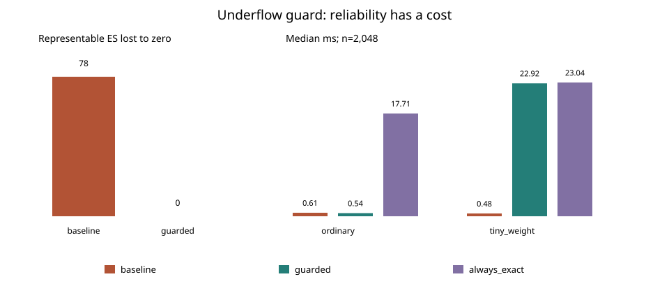

# ES ponderado: detectar underflow y recuperar desde los datos originales

**Iteración 2026-10-17:** [informe-recepcion.md](informe-recepcion.md) documenta
el nuevo receptor. Las métricas históricas siguientes no son las de esa extensión.

**Iteración actual 2026-10-16:** ver [informe-consumidor.md](informe-consumidor.md).
Este texto conserva los resultados históricos de 2026-10-15; run.sh regenera
los resultados crudos, por lo que sus tiempos pueden variar entre ejecuciones.

Fecha: 2026-10-15. Base revisada: `afcbc7facb17485786c02e539759afc31b5d23fd`.

## Pregunta, brecha e hipótesis

¿Puede una entrada protegida evitar que el ES ponderado pierda una contribución
representable cuando la normalización binary64 de sus pesos sufre underflow?

Las auditorías previas Python y C++ ya implementan ES con masa fraccionaria en la
frontera. No se propone otra definición de ES. La brecha concreta es operativa:
el baseline Python puede normalizar un peso hasta cero antes de multiplicarlo
por una pérdida grande. El motor C++ previo usa precisión extendida, pero ello
no constituye un contrato portable de recuperación para Python.

Hipótesis falsable y acotada: en las fixtures compartidas y el barrido fijado en
config.json, el guard no perderá ningún ES representable por este mecanismo;
sus recuperaciones coincidirán exactamente con el oráculo racional independiente
y su ruta sin excepción conservará los resultados del baseline. No se formula
una garantía sobre todo error de redondeo ni sobre toda operación subnormal.

## Prior art y novedad incremental

Acerbi–Tasche y Rockafellar–Uryasev establecen el tratamiento de distribuciones
discretas y masa en el cuantil; esta contribución no reclama novedad matemática.
NumPy documenta el manejo contextual de excepciones de punto flotante y Python
la representación racional exacta de floats. Higham proporciona el contexto de
estabilidad numérica. NIST distingue reproducibilidad numérica de identidad
universal entre plataformas. Referencias verificables y limitaciones de búsqueda
en referencias.bib y benchmarks/prior-art.md (8 entradas). La búsqueda no es
exhaustiva y no permite afirmar prioridad ni inexistencia de soluciones previas.

La novedad incremental local es una política ejecutable: detectar underflow
con `np.errstate`, recuperar desde pesos y pérdidas originales con Fraction o
rechazar explícitamente; conservar el ES racional y señalar si su conversión
final a float da cero. Es una API opt-in: el baseline existente NO cambia.

## Diseño y ejecución

Pérdidas firmadas, distribución empírica finita, pesos no negativos y suma
positiva; alpha=0.975 por defecto. Sin mercado, instrumento, horizonte ni régimen
estimados: datos sintéticos para estrés aritmético, no calibración financiera.
Los floats de entrada son el objeto exacto del experimento, no sus decimales
ideales. Pesos cero no aportan probabilidad.

- 207 fixtures heredadas del audit C++, 180 combinaciones de exponentes de
  pérdida/pesos y un caso explícito de salida final no representable: 388 casos.
- Oráculo independiente: formulación bisagra racional del audit C++; fallback:
  integración ordenada de masa fraccionaria. Comparación racional, no tolerancia
  que pueda ocultar valores pequeños.
- Seed 20261015; n=2,32,256,2048; 7 réplicas por método/régimen/tamaño.
- Baselines: implementación Python real del portafolio y cálculo siempre exacto.
- Orden de métodos aleatorizado con seed por réplica; warmup excluido. Tiempo
  separado de tracemalloc. 168 registros crudos. Se conserva también el piloto
  de orden fijo en initial-fixed-order-performance.csv, no se mezcla con el final.
- Python 3.12.14, NumPy 2.1.3, Linux x86_64, AMD EPYC 9V74; versiones completas,
  hashes de fuentes/configuración y plataforma en results/metadata.json.
- Cap de fallback: 4096 filas de entrada. Política alternativa `raise`.

## Resultados ejecutados

| Comprobación | Resultado |
|---|---:|
| Casos auditados | 388 |
| Recuperaciones racionales | 107 |
| ES representables perdidos a cero por baseline | 78 |
| ES representables perdidos a cero por guard | 0 |
| Salidas racionales no nulas que no caben en float | 29 |
| Ruta rápida idéntica al baseline | 281 |

Las 107 recuperaciones coinciden racionalmente con el oráculo. Los 29 casos
no representables están señalados y retienen Fraction: NO se convierten en
floats no nulos por arte de magia. Consumir solamente `.es` ignorando
`output_rounds_to_zero` pierde esa protección semántica.

Ejemplo: pérdidas [1e308,0], pesos [1e-300,1e300], alpha=.975.
Baseline=0; guard=3.999999999999996e-291, backend=fraction. El evento detectado
es `underflow encountered in divide`. Ver results/example.json.

Medianas de tiempo, n=2048 (ms; no inferencia de significancia):

| Régimen | Baseline | Guard | Siempre exacto |
|---|---:|---:|---:|
| Ordinario | 0.61292 | 0.61229 | 19.29909 |
| Peso diminuto | 0.54428 | 25.71326 | 25.10134 |

Picos de asignación tracemalloc, n=2048, bytes:

| Régimen | Baseline | Guard | Siempre exacto |
|---|---:|---:|---:|
| Ordinario | 230878 | 231286 | 398384 |
| Peso diminuto | 231262 | 654400 | 584192 |

No se atribuye una aceleración a diferencias pequeñas de tiempo: son ruido de
medición. En estrés, recuperar cuesta aproximadamente 47 veces el baseline que
devuelve cero incorrectamente. Siempre exacto es algo más rápido que el guard
en varios tamaños de estrés: resultado negativo conservado. En ordinario n=32,
el guard cuesta alrededor de 14% más en esta ejecución. El fallback conserva
exactitud a costa de CPU/memoria; no es una mejora gratuita de rendimiento.

## Tests y calidad

Comando único desde raíz: `bash 03-financial-risk/02-market-and-model-risk/weighted-tail-underflow-guard/run.sh`.
Instala el lock en venv y ejecuta lint, formato, tipos, tests, benchmark y notebook.
Resultado: 21 tests pytest pasan; dos propiedades Hypothesis con 100 ejemplos
deterministas cada una. Incluye datos inválidos, pesos cero, empates, pérdidas
firmadas, invariancias, presupuesto, rechazo y restauración de estado NumPy.

Cobertura medida SOLO de src.guard: 65/65 sentencias (100%), 20/22 ramas
(90.91%), combinado 97.70%. Dos salidas defensivas de bucle no cubiertas;
no se afirma cobertura integral del pipeline. Ruff, formato y mypy de src y
benchmarks pasan. Notebook ejecutado con tres celdas de código y outputs.
No hay nuevo C++: sanitizers no aplican a este aporte Python.

## Fallos, límites y riesgo de modelo

1. El baseline falla en la rejilla adversarial; 78/388 NO es tasa de fallo en
   mercados reales. Los exponentes extremos no prueban materialidad económica.
2. Fraction no mejora la calidad estadística de escenarios/pesos ni corrige
   muestras pequeñas, dependencia, regímenes o riesgo de cola no observado.
3. El guard sólo responde a eventos NumPy detectados: no promete exactitud
   general, resolución de overflow, ni detección de toda cancelación/redondeo.
4. La entrada ya convertida a float puede haber perdido información antes de
   llegar al guard. La representación decimal original no se reconstruye.
5. Un underflow irrelevante también puede activar recuperación conservadora;
   el límite de filas no es un presupuesto universal de complejidad racional.
6. Por encima del cap se rechaza, no se devuelve silenciosamente el baseline.
   El consumidor debe manejar excepciones y la bandera de representabilidad.
7. Tracemalloc no es RSS ni toda memoria nativa; hardware/ruido condicionan
   tiempos. Sin intervalos de confianza ni claims de velocidad poblacional.
8. No se ejecutó backtesting predictivo Kupiec/ES: no hay pronóstico temporal
   que justifique esas métricas. No es software de capital regulatorio validado.
9. La instalación inicial requiere acceso al índice de paquetes; el lock fija
   versiones pero no hashes ni imagen de sistema. Entorno documentado en README.
10. El piloto tenía orden fijo, susceptible a sesgo; se retuvo el crudo y se
    repitió con orden aleatorio. No se seleccionó sólo el tiempo favorable.

## Entregables y cierre

Checklist completo: src ejecutable; run.sh documentado; tests pasan; baseline con
números; CSV/JSON/SVG; README, informe, referencias y MVP; carpeta financiera
correcta. Notebook con outputs y workflow dedicado incluidos. Resultados de CI
remoto deben consultarse en el PR: no se presuponen en este informe local.

Autoevaluación (1–5): novedad 3; rigor 4; reproducibilidad 5; código 4;
claridad 4; impacto potencial 4; honestidad 5; MVP completo/ejecutable 5.
Son juicios propios, no certificación externa.

Siguiente iteración recomendada: formalizar el contrato del consumidor.
1. 03-financial-risk: probar integración opt-in y manejo obligatorio de bandera,
   excepciones y presupuesto en una aplicación consumidora.
2. 04-quant-strategy-and-products/risk-engines: automatizar paridad de fixtures
   en plataformas con diferentes long double y políticas de rechazo.
3. 03-financial-risk: evaluar ES fuera de muestra con escenarios estimados,
   separando error estadístico y error aritmético.
