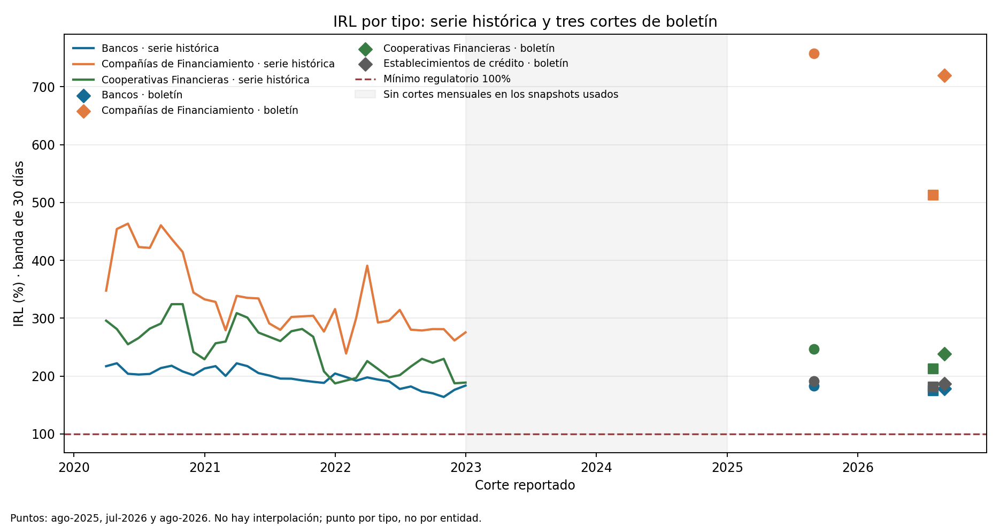

# IRL oficial SFC como señal de liquidez

**Edición observada complementaria:** histórico oficial del Indicador de Riesgo de Liquidez (IRL) de la SFC. El laboratorio Markov / primera ruptura conserva sus simulaciones controladas. El IRL agrega una referencia prudencial de cobertura para priorizar vigilancia; no valida una probabilidad de iliquidez ni sustituye una distribución de caja.

## Fórmula y decisión admisible

La SFC define el IRL como:

```text
IRL = ALM_promedio_mensual / RLN_promedio_mensual_a_30_días
IRL_% = 100 × IRL
```

ALM son activos líquidos de mercado y RLN es el requerimiento neto de liquidez para banda de 30 días. El archivo expresa ALM y RLN en miles de pesos y publica la razón IRL. La nota de la fuente indica un mínimo regulatorio de 100%.

El uso admisible es observar la holgura reportada frente a ese umbral, su distribución por entidad, y cambios entre grupos para priorizar revisión de fondeo. El cociente es un indicador prudencial de cobertura, no la probabilidad de que ocurra un faltante de caja. No estima cash-flow-at-risk ni pérdida por venta de activos.

## Resultado de la vintage

El archivo cubre 34 cortes mensuales entre marzo de 2020 y diciembre de 2022. En el corte final, 44 entidades tenían dato: mediana IRL 213,1%, P10 146,6%, mínimo 112,8%, y ninguna observación por debajo del 100%. El P90 fue 560,5%; valores muy altos pueden aparecer cuando RLN es bajo y no equivalen a una gran reserva monetizable. La distribución por tipo de entidad y el mínimo observado en cada fecha se muestran en las figuras. Esta vintage no describe la posición actual del sistema.

- [Informe de resultados, fórmula, conciliación y límites](results/official_irl_report.md)
- [Serie por entidad y mes](results/sfc_irl_by_entity_month.csv)
- [Serie por tipo y mes](results/sfc_irl_by_entity_type_month.csv)
- [Distribución interinstitucional por corte](results/sfc_irl_entity_distribution_month.csv)
- [Manifiesto y hash](results/manifest.json)
- [IRL por tipo de entidad](figures/sfc_irl_by_type.png)
- [Distribución entre entidades y umbral](figures/sfc_irl_entity_distribution.png)

## Fuente, grano y vintage

Fuente primaria: [SFC — Indicador de Riesgo de Liquidez](https://www.superfinanciera.gov.co/publicaciones/10108220/informes-y-cifrascifrasestablecimientos-de-creditoinformacion-periodicamensualindicadores-de-riesgo-de-liquidez-indicador-de-riesgo-de-liquidez-irl-10108220/). El [XLS histórico](https://www.superfinanciera.gov.co/loader.php?idFile=1055598&lFuncion=descargar&lServicio=Tools2&lTipo=descargas) se congela en `data/raw/sfc_irl_historico.xlsx`.

- Frecuencia de publicación subyacente: Formato 458 / Informe 64 semanal; este libro presenta promedios mensuales.
- Grano: entidad reportante × mes; hoja agregada: tipo de entidad × mes.
- 1.438 observaciones entidad-mes válidas, 34 cortes y cobertura de 42–44 entidades por corte.
- El libro reporta ALM y RLN promedio. El runner reconcilia ALM/RLN con IRL publicado, considerando el redondeo de tres decimales. Diferencias pequeñas quedan registradas en el manifiesto.
- Las tres filas con IRL vacío se omiten; no se imputan ceros. No hay claves entidad-mes duplicadas.
- SHA-256: `52b24483f73b7a7402b26708826b417d5169ec2604c2aaacb5007a5ba72296e0`.
- En `Por Tipo`, un corte de octubre de 2022 aparece fechado el día 30, mientras que la hoja `Por Entidad` lo fecha el 31. El runner conserva la fecha fuente y normaliza ambos a fin de mes para el análisis mensual; la excepción queda anotada en el manifiesto.

## Trade-offs, sesgo y límites

Se conserva el indicador oficial en vez de reconstruirlo desde partidas, para mantener la definición prudencial y comparación con el mínimo declarado por la SFC. El ratio no presenta por sí solo la distribución de salidas de caja, la concentración o estabilidad de depósitos, los haircuts, activos comprometidos, límites de monetización, liquidez intradía, monedas o líneas contingentes.

Los percentiles por entidad no están ponderados por tamaño; describen la dispersión de las entidades reportantes, no una tasa agregada del sistema. La composición cambia por altas, bajas, consolidaciones y estructuras de balance. Los grupos tienen perfiles distintos, por lo que su IRL no equivale a una clasificación general de fortaleza.

El histórico termina en diciembre de 2022 y no incluye vintages de publicación suficientes para análisis “as known at”. No usar como estado actual, probabilidad de quiebra o validación de un modelo de liquidez.

El laboratorio de primera ruptura simula trayectorias de flujos y caja. La relación entre esa primera ruptura y el IRL oficial no está estimada. Para calibrar una entidad se requieren flujos internos fechados, vencimientos, depósitos, concentración de fondeo, colateral y encumbrance, capacidad de venta, monedas, intradía, estrés, líneas contingentes y eventos observados de faltante, con validación independiente.

## Reproducción

Desde esta carpeta:

```bash
python3 scripts/build_sfc_irl_companion.py
```

Requiere `openpyxl`, `pandas` y `matplotlib`; lee el snapshot local y regenera resultados, hash, informe y figuras.

## Anexo de vintage posterior: boletín SFC agosto de 2026

El XLS histórico de IRL termina en diciembre de 2022. El boletín de resultados SFC a agosto de 2026 publica ALM y RLN para tres cortes posteriores: agosto de 2025, julio de 2026 y agosto de 2026. Son observaciones agregadas por tipo de entidad; no extienden la frecuencia mensual ni el grano entidad × mes de la vintage anterior. Se conservan aparte y no se interpolan ni se conectan como serie continua.

La Tabla 12 del PDF reporta componentes en millones de COP. Se reconstruye `IRL (%) = 100 × ALM / RLN`. Para agosto de 2026 los cuatro ratios por tipo coinciden, redondeados a una décima, con las etiquetas de la Gráfica 11. Los totales y suma de tipos difieren hasta COP 1 millón por redondeo de la tabla. El boletín advierte que cifras CUIF están sujetas a revisión y fueron reportadas hasta el 25 de septiembre de 2026.

- [Reporte del anexo, con los 12 valores](results/bulletin_appendix_report.md)
- [CSV extraído](results/sfc_irl_bulletin_appendix.csv)
- [Manifiesto, hash y conciliaciones](results/bulletin_appendix_manifest.json)
- [PDF congelado](data/raw/sfc_resultados_sistema_financiero_2026-08.pdf), SHA-256 `e38b879140f70d523b655af2aa72c12531f802473604d99bddc15fc57f8b985d`, página 20, Tabla 12 y Gráfica 11
- Fuente primaria: [boletín SFC agosto 2026](https://www.superfinanciera.gov.co/publicaciones/10116287/resultados-del-sistema-financiero-colombiano-agosto-de-2026/)

Reproducción desde esta carpeta: `python3 scripts/build_sfc_irl_bulletin_appendix.py` (PyMuPDF, pandas, matplotlib). El runner valida las fechas y grupos esperados, revisa componentes agregados y concilia los ratios de agosto de 2026 contra la figura. La cobertura de tipos no permite extender percentiles entre entidades. IRL sigue siendo un indicador de cobertura prudencial a 30 días, no una probabilidad de iliquidez ni un shortfall de caja.


