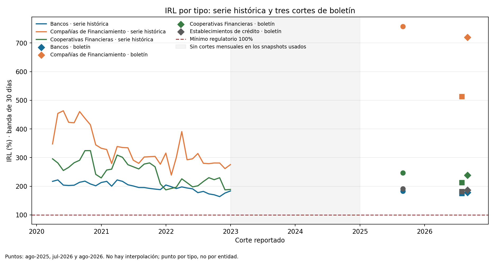

# Anexo de vintage posterior: IRL en boletín SFC agosto de 2026

## Alcance de la actualización

El archivo histórico XLS de IRL del supervisor termina en diciembre de 2022. El boletín SFC de resultados a agosto de 2026 publica una tabla más reciente con componentes ALM/RLN para tres cortes: agosto de 2025, julio de 2026 y agosto de 2026. Son snapshots de tipo de entidad, no una extensión mensual continua ni una actualización entity-level.

El informe indica que las cifras CUIF están sujetas a revisión y reportadas hasta el 25 de septiembre de 2026. La extracción de este apéndice conserva la publicación de agosto de 2026; no reescribe el snapshot histórico 2020–22.

## Método y conciliación

Desde la Tabla 12 se extraen ALM y RLN en millones de pesos. Se calcula IRL (%) = 100 × ALM/RLN. Para los cuatro agregados en agosto de 2026, las razones calculadas redondean a una décima igual a las etiquetas finales de la Gráfica 11: bancos 178,8%; compañías de financiamiento 719,5%; cooperativas financieras 238,2%; establecimientos de crédito 186,5%. El detalle de conciliación está en el manifiesto.

La suma por tipo y el total publicado difieren como máximo COP 1 millón por los redondeos visibles de la tabla. No se consideran faltantes ni se infieren valores de los tramos no publicados.

## Observaciones nuevas

| Corte | Tipo | ALM (millones COP) | RLN 30d (millones COP) | IRL calculado (%) |
|---|---|---:|---:|---:|
| ago.-25 | Bancos | 152,548,904 | 83,329,631 | 183.1 |
| ago.-25 | Compañías de Financiamiento | 8,480,041 | 1,119,033 | 757.8 |
| ago.-25 | Cooperativas Financieras | 843,500 | 341,463 | 247.0 |
| ago.-25 | Establecimientos de crédito | 161,872,444 | 84,790,127 | 190.9 |
| jul.-26 | Bancos | 156,019,010 | 89,173,640 | 175.0 |
| jul.-26 | Compañías de Financiamiento | 8,893,296 | 1,734,510 | 512.7 |
| jul.-26 | Cooperativas Financieras | 839,113 | 394,067 | 212.9 |
| jul.-26 | Establecimientos de crédito | 165,751,419 | 91,302,217 | 181.5 |
| ago.-26 | Bancos | 160,953,536 | 90,040,630 | 178.8 |
| ago.-26 | Compañías de Financiamiento | 9,150,492 | 1,271,819 | 719.5 |
| ago.-26 | Cooperativas Financieras | 829,342 | 348,168 | 238.2 |
| ago.-26 | Establecimientos de crédito | 170,933,371 | 91,660,617 | 186.5 |

## Lectura y límites

Estos tres cortes permiten refrescar una referencia de cobertura agregada por tipo y comprobar consistencia entre componentes ALM/RLN y el gráfico publicado. No sirven para estimar cambios mensuales entre diciembre de 2022 y agosto de 2025, variabilidad interna de entidades, ni distribución entity-level. No interpolar, suavizar ni unir los puntos con la serie 2020–22 como si hubiera observaciones intermedias.
El IRL es cobertura prudencial a 30 días; no es probabilidad de iliquidez, riesgo de cash shortfall, ni validación del laboratorio de primera ruptura. La medición de brecha corporativa requiere estados internos de flujos y obligaciones.

## Fuente y reproducción

[Página SFC del informe agosto 2026](https://www.superfinanciera.gov.co/publicaciones/10116287/resultados-del-sistema-financiero-colombiano-agosto-de-2026/); [índice de informes mensuales](https://www.superfinanciera.gov.co/publicaciones/60765/informes-y-cifrasinformesinforme-actualidad-del-sistema-financiero-colombiano-60765/). PDF congelado en `data/raw/sfc_resultados_sistema_financiero_2026-08.pdf`, SHA-256 `e38b879140f70d523b655af2aa72c12531f802473604d99bddc15fc57f8b985d`, página 20. Tabla 12, figura 11.
Desde la carpeta `observed-sfc-irl`: `python3 scripts/build_sfc_irl_bulletin_appendix.py`. Requiere PyMuPDF (`fitz`), pandas y matplotlib; lee el PDF congelado, valida el orden de filas/fechas, rehace los ratios y compara el corte ago-2026 con las etiquetas del gráfico.

