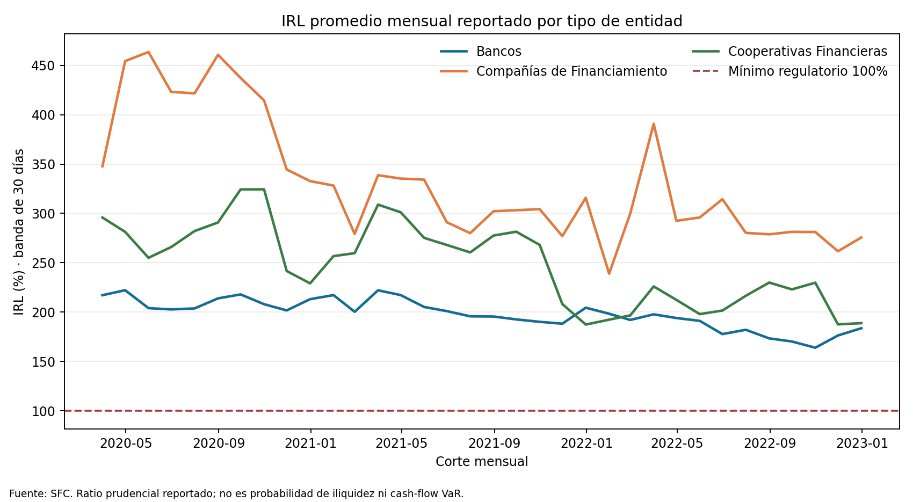
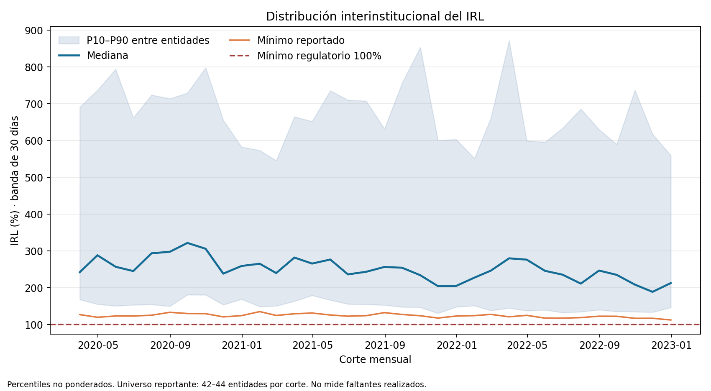

# Indicador IRL oficial SFC como señal de monitoreo de liquidez

**Vintage observado:** 2020-03–2022-12. **Frecuencia/grano:** corte mensual por entidad reportante y tipo de entidad. **Banda:** 30 días.

El IRL oficial relaciona activos líquidos de mercado (ALM) con el requerimiento de liquidez neto (RLN) a 30 días. La SFC publica ALM y RLN como promedios mensuales; el cociente se interpreta frente al mínimo normativo de 100%. Sirve para vigilar cobertura regulatoria reportada del sistema y señalar entidades/modalidades de revisión. No es una probabilidad de iliquidez ni mide déficits de caja realizados.

## Resultado al último corte de la vintage

A diciembre de 2022 la distribución por entidad (n=44) tenía mediana 213.1%, percentil 10 146.6%, mínimo 112.8% y 0 entidades por debajo del 100% reportado.

| Tipo de entidad | IRL reportado (%) | ALM promedio (miles COP) | RLN 30 días promedio (miles COP) |
|---|---:|---:|---:|
| Bancos | 183.7 | 111,537,484,170 | 60,728,809,010 |
| Compañías de Financiamiento | 275.6 | 1,603,321,321 | 581,749,502 |
| Cooperativas Financieras | 188.8 | 654,330,998 | 346,591,602 |

## Fórmula, grano y controles

```text
IRL_t = ALM_promedio_mensual_t / RLN_promedio_mensual_30d_t
IRL_porcentaje_t = 100 × IRL_t
```

El grano entidad es fecha mensual × código de entidad; el grano agrupado es fecha × tipo de entidad. ALM/RLN están publicados en miles de pesos; IRL es una razón sin unidad. Se conservaron ratios publicados y se verificó su conciliación con ALM/RLN redondeados (tolerancia 0,00051 en razón). Las tres filas con IRL faltante se omitieron; no se imputaron valores. Cero llaves duplicadas.
La hoja `Por Tipo` etiqueta octubre de 2022 como 2022-10-30, pero `Por Entidad` usa 2022-10-31. El runner conserva ambas fechas fuente, normaliza el corte al último día de mes y registra la excepción en el manifiesto para alinear la comparación mensual.

El mínimo regulatorio indicado en la descripción del archivo es 100%. La prueba de cobertura cuenta IRL < 1, sin interpolar ni redefinir el requisito. Las cifras agregadas por tipo se conservan tal como publica la SFC; la distribución entidad a entidad usa percentiles no ponderados.

## Lectura de riesgo y trade-offs

El indicador permite ver holgura observada frente a un umbral prudencial y dispersión entre entidades en la vintage. Se usa el ratio oficial porque corresponde al indicador prudencial definido por el supervisor; reconstruirlo desde partidas diarias no está disponible en este snapshot. A cambio, no se observa la trayectoria intramensual, la estabilidad de depósitos, la liquidez de mercado de cada activo, haircuts internos, concentraciones de fondeo, ni acciones gerenciales ante estrés.

La clasificación como cumplimiento del 100% no es una probabilidad de falla ni un score comparativo universal: los tipos de entidad tienen perfiles, balances y composición distintos. La serie termina en diciembre de 2022; no usar como estado actual, backtest vigente ni sustituto de datos de tesorería.

## Límites y brecha para aplicar el laboratorio

El laboratorio Markov / primera ruptura modela efectivo, secuencias de flujos y tiempo hasta caja negativa. El IRL cubre un indicador prudencial bancario de banda a 30 días. La relación entre ambos no está estimada. Para calibrar liquidez de una entidad hacen falta datos internos de entradas y salidas fechadas, depósitos y concentraciones de financiación, vencimientos, colateral, encumbrance, capacidad de monetización, monedas, intradía, líneas contingentes, escenarios de estrés y resultados de faltantes. También se requiere historia de publicaciones/vintages y definición validada de evento de liquidez.

## Fuente, calidad y reproducción

Fuente primaria: [SFC — Indicador de Riesgo de Liquidez (IRL)](https://www.superfinanciera.gov.co/publicaciones/10108220/informes-y-cifrascifrasestablecimientos-de-creditoinformacion-periodicamensualindicadores-de-riesgo-de-liquidez-indicador-de-riesgo-de-liquidez-irl-10108220/). Snapshot: `data/raw/sfc_irl_historico.xlsx`; SHA-256 `52b24483f73b7a7402b26708826b417d5169ec2604c2aaacb5007a5ba72296e0`. El libro indica reporte semanal de Formato 458/Informe 64, resumido aquí como promedio mensual.
Calidad: 34 cortes mensuales; 1438 observaciones entidad-mes válidas; cobertura entre 40 y 44 entidades por corte; 3 filas con campos faltantes omitidas; 0 duplicados. Conciliación de fórmula: 1438/1438 filas dentro de tolerancia.

Desde esta carpeta: `python3 scripts/build_sfc_irl_companion.py`. Requiere `openpyxl`, `pandas` y `matplotlib`; lee el snapshot local y regenera tablas, manifiesto, figuras e informe.




