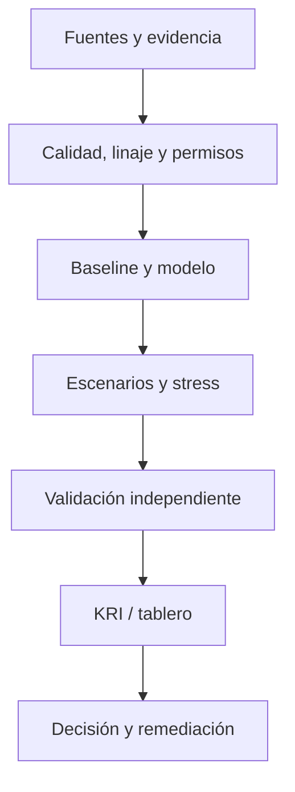

# Riesgo climático físico y transición

**Línea de servicio:** Seguros, clima y conducta  
**Madurez:** especificación de investigación y consultoría; no software ni validación ejecutada.

## 1. Mandato, alcance y decisión

**Objetivo:** Transmitir escenarios climáticos a pérdidas y capital. Formular un mandato escrito que precise entidad, jurisdicción, procesos, horizonte, riesgos materiales, responsables y restricciones de independencia. La decisión final deberá especificar acción, propietario, costo y umbral de reversión.

**Pregunta falsable:** ¿La metodología exposición geoespacial, escenarios, hazard-vulnerability mejora una métrica de riesgo o control respecto del procedimiento actual, con costo y errores medibles?

## 2. Fundamento cuantitativo

**Métodos candidatos:** Exposición geoespacial, escenarios, hazard-vulnerability. Definir variables de estado X_t, eventos N_t, severidad S_i, exposición E_t, acciones a_t y conjunto factible A_t. Como punto de partida para riesgos monetizables:

```math
L_T = Σ_{i=1}^{N_T} S_i;  EL_T = E[N_T] E[S]  (solo si N y S cumplen independencia adecuada)
ES_α(L) = E[L | L ≥ VaR_α(L)]  (solo para distribuciones continuas sin masa en VaR)
min_{a∈A} E[L_T(a)] + λ Cost(a), sujeto a límites y controles
```

Para riesgos no monetizables utilizar métricas de resiliencia, cumplimiento o efectividad de control, no imponer pérdida financiera artificial. Estudiar identificabilidad, censura, colas, dependencia, errores de medición y no estacionariedad. Definir propiedades del estimador y diagnóstico de convergencia antes de interpretarlo.

## 3. Inventario de datos y evidencia

Construir un **data contract** con granularidad, fecha de evento y disponibilidad, propietario, fuentes autorizadas, calidad, tratamiento de faltantes, permisos, retención, trazabilidad y diccionario. Distinguir evidencia documental, juicio experto, incidentes históricos y datos de exposición. No subir información sensible al repositorio. Los datos sintéticos únicamente prueban la implementación.

## 4. Protocolo estadístico y numérico

1. Línea base: reglas vigentes y estimador parsimonioso.
2. Modelado avanzado: estimación, hiperparámetros y diagnóstico de identificación.
3. Incertidumbre: bootstrap por unidad independiente, posterior bayesiano o intervalos robustos.
4. Validación temporal y por segmento: backtesting donde existan etiquetas, holdout de periodos y pruebas de drift.
5. Estrés: escenarios base, adverso, severo y reverso; sensibilidades y correlaciones extremas.
6. Validación numérica: tolerancias, estabilidad, monotonicidad, invariantes, edge cases y costo computacional.
7. Validación independiente: revisión de supuestos, evidencia y restricciones de uso.

**Métricas específicas:** Pérdida, exposición sectorial, sensibilidad. Definir fórmulas, unidades, denominadores, periodicidad, umbrales y niveles de escalamiento. Un buen ajuste predictivo no acredita eficacia de un control.

## 5. Arquitectura del producto objetivo



Paquetes futuros: `src/` (estimación/simulación), `tests/` (unitarios e invariantes), `configs/` (escenarios), `notebooks/` (validación), `reports/` (comité), `data/README.md` (lineage). **No se afirma que estos archivos existan.**

## 6. Entregables de consultoría

- **D1 — Diagnóstico:** alcance, entrevistas, procesos, riesgos, controles y hallazgos priorizados.
- **D2 — Metodología:** modelo matemático, hipótesis, fuentes, supuestos y limitaciones.
- **D3 — Motor analítico:** código reproducible, datos sintéticos, pruebas y benchmarks.
- **D4 — Validación:** backtesting, sensibilidad, stress, incertidumbre y revisión independiente.
- **D5 — Implementación:** KRIs, límites, responsables RACI, cronograma, costos y plan de remediación.
- **D6 — Board pack:** resultados, exposición, decisiones, alternativas, riesgos residuales y plan de seguimiento.

## 7. Riesgos metodológicos y gobierno

**Riesgo principal:** Escenarios no probabilísticos y resolución espacial. Documentar sesgos, dependencia de terceros, supuestos de distribución, incertidumbre epistemológica, escenarios no observados y controles compensatorios. Verificar aplicabilidad regulatoria específica (SFC, SBS, Basel, IFRS, ISO, NIST u otras según entidad), sin afirmar certificación ni cumplimiento automático. Mantener independencia entre diseño, operación y aseguramiento.

## 8. Criterios de aceptación y roadmap

**Gate A:** problema y métricas aprobados; **B:** datos auditables; **C:** baseline reproducible; **D:** modelo avanzado con pruebas; **E:** validación independiente y stress; **F:** decisión ejecutiva con evidencia y dueño. No promover de gate por documentación solamente.

**Fases:** descubrimiento → baseline → modelado → stress/validación → piloto controlado → transferencia y monitoreo. Registrar versionado, reproducibilidad y resultados negativos.
