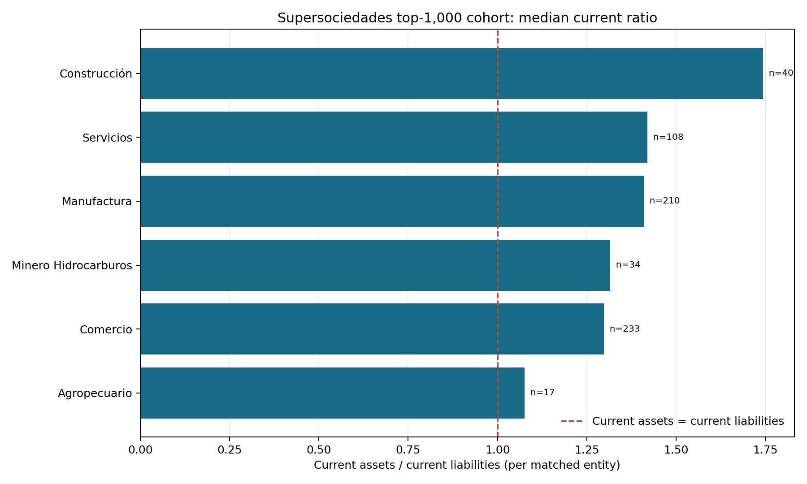

# Supersociedades current-ratio context

## Executive trailer

Corporate liquidity risk is shaped by both the amount of short-term assets and liabilities and the timing of cash receipts and obligations. This companion uses Colombia's official 2025 report on the 1,000 largest companies (financial cut 31 December 2024) to summarize current-ratio context by macro-sector. It links the official cohort workbook to the NIIF open financial-statement table using NIT **in memory only**, keeps filings with both current-asset and current-liability concepts, and publishes sector-level coverage, the median entity ratio, and a ratio of aggregate sums. No company-level record or identifier is released.

The result can support an executive discussion about which broad sectors merit deeper cash-flow diligence. It cannot estimate Liquidity-at-Risk, forecast a cash shortfall, set a liquidity buffer, or assess a specific borrower. A current ratio is a year-end accounting snapshot: it omits collection/payment dates, cash restrictions, revolving facilities, covenant headroom, and within-year volatility.

## Architecture

```text
Supersociedades 2025 top-1,000 workbook (2024 financial cut; macro-sector + NIT)
            +
Supersociedades NIIF balance-sheet records (2024-12-31; two current-account concepts)
            ↓ NIT join in memory; exact duplicate rows collapsed; latest complete instance selected
            ↓ positive-account filter; aggregate by macro-sector
Sector CSV + source/QA/hash manifest + chart
            ↓
Descriptive sector context for prioritizing authorized cash-flow diligence
```

## Observed result and source

- Cohort: [Supersociedades 1,000 largest companies report, 2025](https://www.supersociedades.gov.co/es/web/asuntos-economicos-societarios/sector-real-de-la-economia/-/asset_publisher/dbnl/content/informe-1000-empresas-m%C3%A1s-grandes-a%C3%B1o-2024), covering financial statements at 31 December 2024. Its official workbook supplies the 1,000-company cohort and macro-sector.
- Account data: [NIIF – Estado de Situación Financiera](https://www.datos.gov.co/Economy-and-Finances/Estados-Financieros-NIIF-Estado-de-Situaci-n-Finan/pfdp-zks5), concepts `Activos corrientes totales` and `Pasivos corrientes totales`, `fecha_corte=2024-12-31`, `periodo=Periodo Actual`.
- The runner retains no workbook or filing-level rows in the repository. It publishes only sector aggregates, the sample coverage, source hashes and QA counts. Supersociedades guidance says NIIF reports are presented in thousands of pesos; absolute currency totals are not released here, and the ratios are unit-free.
- Numerical values and coverage in `data/sector_current_liquidity.csv` describe the matched top-1,000 cohort only, not all firms or the Colombian corporate universe.

The executed snapshot matched **642 of 1,000 entities (64.2%)** after requiring both account concepts and aligning the NIIF presentation basis. Coverage ranges from **41.2% in services to 75.4% in commerce**. Median entity current ratios range from **1.0752 in agropecuario to 1.7436 in construction**; these are descriptive sample statistics and do not indicate cash availability or distress. The manifest separately records 612 explicit-basis matches, 30 generic-group matches, 12 ambiguous generic-group exclusions, and 0 conflicting within-filing values. See the CSV for all sectors and distinct ratio-of-sums values.

## Decision log

| Choice | Alternative | Reason |
|---|---|---|
| Use the top-1,000 cohort and disclose its selection | Treat the matched sample as the corporate universe | Companies are selected by revenue and are not representative of all firms. |
| Link sources in memory using NIT | Persist the linked entity panel | The output only needs macro-sector context; publishing the panel adds unnecessary identifiers. |
| Align the cohort's NIIF presentation basis with `punto_entrada`; for generic group labels exclude ambiguous bases | Join only on NIT and mix individual, separate, or consolidated statements | The basis changes the reporting entity perimeter. Where more than one basis is possible, omitting an observation is safer than mixing perimeters. |
| Keep the greatest `codigo_instancia` that has both concepts within the aligned basis | Sum all filings or silently average submissions | The source can contain multiple reports. A stated deterministic rule avoids counting an entity more than once in the cohort. |
| Report median entity ratio and ratio of sums separately | Use one unlabeled average | These answer different questions: typical matched entity vs. aggregate balances. |
| Include only positive values for both current accounts in ratio statistics | Include undefined or negative-denominator ratios | A positive denominator and numerator are required for an interpretable current-ratio comparison; exclusions remain in the coverage denominator. |

## Governance, limits, and use

This is an observed accounting proxy, not a Liquidity-at-Risk implementation or institutional validation. The cohort is selected by revenue; match coverage can vary by sector; official filings may be corrected or repeated; choosing the greatest instance ID is an analytical rule and must be reviewed if the source's filing semantics change. Median ratios can hide tail risk and do not measure the distribution of cash shortfalls.

Before use in a credit or treasury process, an authorized analyst must validate source definitions, filing/version selection, representativeness, accounting units, and linkage purpose. Supersociedades' [financial reporting FAQ](https://www.supersociedades.gov.co/web/asuntos-economicos-societarios/preguntas-frecuentes) specifies that reports are presented in thousands of pesos. A model-risk review would require dated receipts/payments, opening cash and eligible buffers, drawable committed facilities, realized shortfall events, and forecast vintages. Independent validation should reconcile inputs to bank/ERP evidence, test data lineage and invariants, compare against simple cash-flow baselines, backtest shortfall amounts and probabilities out of time, stress correlations and refinancing, and obtain pre-approved acceptance thresholds. Until then, use only to prioritize further diligence.

## Reproduction

Requires Python 3.10+ and network access to the two official endpoints:

```bash
python3 -m venv .venv
source .venv/bin/activate
pip install -r 03-financial-risk/07-financial-and-construction-risk-lab/01-corporate-financial-risk/01-liquidity-at-risk/observed-supersociedades-current-ratio/requirements.txt
python3 03-financial-risk/07-financial-and-construction-risk-lab/01-corporate-financial-risk/01-liquidity-at-risk/observed-supersociedades-current-ratio/build_companion.py
```

Outputs are `data/sector_current_liquidity.csv`, `data/sector_median_current_ratio.png`, and `data/source_quality_manifest.json`. The manifest records cohort and API hashes, response rows/bytes, match coverage, duplicate counts, cut date, and output hashes. Requests have explicit timeouts and limited retries. Re-running after the official source changes may change the output; compare the manifest before interpreting differences.


