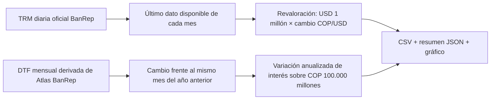
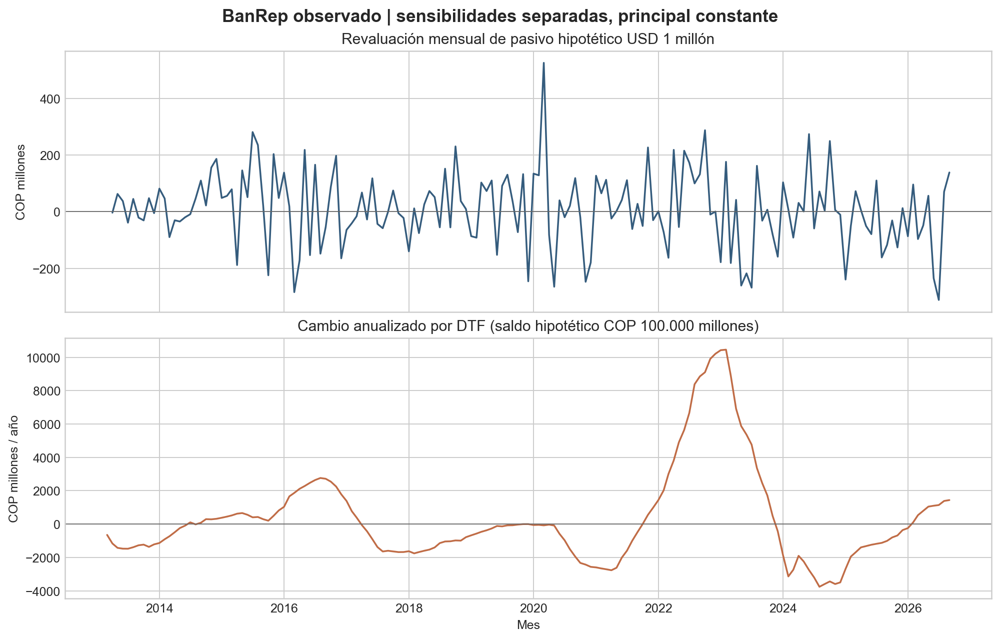

# Exposición cambiaria y de tasas

**Área:** riesgo financiero corporativo
**Estado:** caso observado reproducible de sensibilidades de factores de mercado; la exposición del deudor es hipotética.
**Unidad analítica:** TRM diaria agregada al último valor observado de cada mes y DTF mensual promedio.

## Caso ejecutivo

Una compañía colombiana con deuda en dólares y financiación local indexada necesita entender cómo los movimientos observados de la tasa de cambio y de una tasa de referencia pueden modificar, por separado, el valor en pesos de su pasivo y el costo anual de intereses. Este caso convierte series públicas del Banco de la República en dos sensibilidades reproducibles: revaloración mensual de un pasivo constante de USD 1 millón usando la TRM de fin de mes, y cambio anualizado del costo de un saldo constante de COP 100.000 millones indexado a DTF, usando el cambio de la tasa frente al mismo mes del año anterior. El resultado hace visible la unidad de cada choque y traduce movimientos de mercado en magnitudes monetarias comparables para orientar preguntas de tesorería: qué exposición confirmar, qué vencimientos y fechas de reajuste revisar y qué escenarios someter a análisis de cobertura. La última ventana mensual común con DTF completa es marzo de 2013–septiembre de 2026. En septiembre de 2026, la TRM al cierre disponible fue COP 3.341,23/USD; la revaloración mensual del pasivo ilustrativo fue COP 138,44 millones y el cambio DTF interanual, +1,4403 puntos porcentuales, equivale a COP 1.440,33 millones/año para el saldo supuesto. Son sensibilidades independientes: no se suman ni representan una pérdida conjunta, un pronóstico, ni la exposición o desempeño de una entidad. La aplicación aporta contexto histórico y una base explícita para priorizar revisión humana; una decisión real requiere posiciones, contratos, calendario de reajuste, coberturas, flujos, límites y validación institucional.

## Flujo de cálculo





## Reproducción y linaje

Desde la raíz del repositorio:

```bash
python3 03-financial-risk/07-financial-and-construction-risk-lab/01-corporate-financial-risk/02-fx-interest-rate-exposure/observed-banrep-sensitivity/run_observed_sensitivity.py
```

El runner valida hash SHA-256, metadatos de la serie TRM, fechas ordenadas y valores finitos; para DTF valida su hash, continuidad mensual y conteo diario completo. Produce `results/monthly_factor_sensitivities.csv`, `results/summary.json` y `results/market_factor_sensitivities.png`. La TRM se preserva como snapshot oficial de la serie 1 del servicio BanRep, consultado el 11 de noviembre de 2026; [ficha de serie TRM](https://suameca.banrep.gov.co/estadisticas-economicas/informacionSerie/1/tasa_cambio_peso_colombiano_trm_dolar_usd/) y [API](https://suameca.banrep.gov.co/estadisticas-economicas-back/rest/estadisticaEconomicaRestService/consultaInformacionSerieXTipoDato?idSerie=1&tipoDato=0&cantDatos=5000). El hash del snapshot local es `d5068f3801b18a5530d291d6a2d0587e5ceb580d52879de5ae363168999edf77`. La DTF es el derivado `dtf_monthly_derived.csv` del Atlas Económico en Drive (ID `1Hpu_qk99U_-Hf0H3svT2GvVYWtb9EfpE`); su hash y linaje, incluida la limitación de no conservar localmente los bytes crudos SDMX, están documentados en [Tesorería y ALM](../../../../04-quant-strategy-and-products/treasury-and-alm/README.md). El runner solo utiliza DTF hasta septiembre de 2026, último mes cerrado presente en ese derivado. Las respuestas de BanRep pueden cambiar conforme se publiquen revisiones; el snapshot fija esta corrida.

## Registro de decisiones

| Decisión | Motivo y consecuencia |
|---|---|
| Usar TRM de fin de mes, no promedio mensual | Aproxima una revaloración de saldo en una fecha de corte; no estima el FX medio de pagos mensuales. |
| Usar diferencia DTF interanual, no nivel absoluto de tasa | Aísla el cambio de costo atribuible al movimiento de referencia; supone repricing completo y saldo constante. |
| Mostrar FX y DTF en series separadas | Sin posiciones, calendario contractual ni modelo de dependencia no existe base para calcular pérdida conjunta. |
| Dejar IBR fuera de esta corrida | El escenario elegido es una deuda indexada a DTF. Una variante IBR requiere tenor, spread, convención de reajuste y datos/versionado IBR gobernados. |
| Fijar nocionales ilustrativos | Permite reproducir y leer sensibilidad monetaria sin atribuir datos a una empresa. No hay calibración de umbrales institucionales. |

## Limitaciones, gobierno y uso regulatorio

Los nocionales, deuda sin amortización, ausencia de coberturas, transferencia inmediata del cambio de tasa y demás convenciones son supuestos, no observaciones. La TRM y DTF públicas no validan exposición, hedge effectiveness, P&L, covenant, liquidez ni capacidad de pago de ninguna compañía. Las cifras no sustituyen mediciones contables de moneda extranjera, gestión de activos y pasivos, un modelo de riesgo aprobado ni asesoría de cobertura.

**Gobierno del modelo / MRM.** Antes de uso institucional, una validación independiente debe revisar integridad y versionado de datos, definiciones de nocional y fecha de revaluación, convenciones de DTF/IBR y tasa efectiva, precisión de unidades, pruebas de extremos y saltos, sensibilidad a ventanas y supuestos, reconciliación con contratos y P&L observados, y desempeño fuera de muestra/backtesting contra pérdidas reales. Los criterios de aceptación, materialidad y tolerancia a excepciones deben fijarlos el dueño del riesgo y el comité de modelos; este prototipo no impone umbrales de aceptación ni ha sido validado contra posiciones reales.

**Trazabilidad de marcos.** El diseño es una herramienta de contexto, no una declaración de cumplimiento. Su separación de datos, supuestos, transformaciones y límites es coherente con prácticas de gobierno y medición de riesgo asociadas a Basilea y gestión de riesgo empresarial; los escenarios informan análisis de sensibilidad, pero no cubren por sí solos requerimientos de capital, riesgo de mercado integral o IFRS 9. Para coberturas contables IFRS 9 faltan designación formal, documentación, prueba de efectividad y datos contractuales. La explicitación de contexto, incertidumbre y tratamiento se alinea como práctica con ISO 31000 y COSO ERM, sin certificar conformidad.
