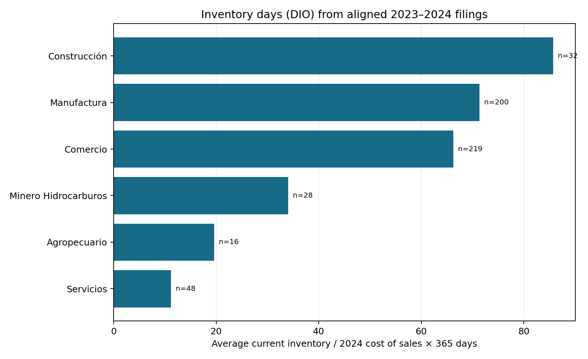
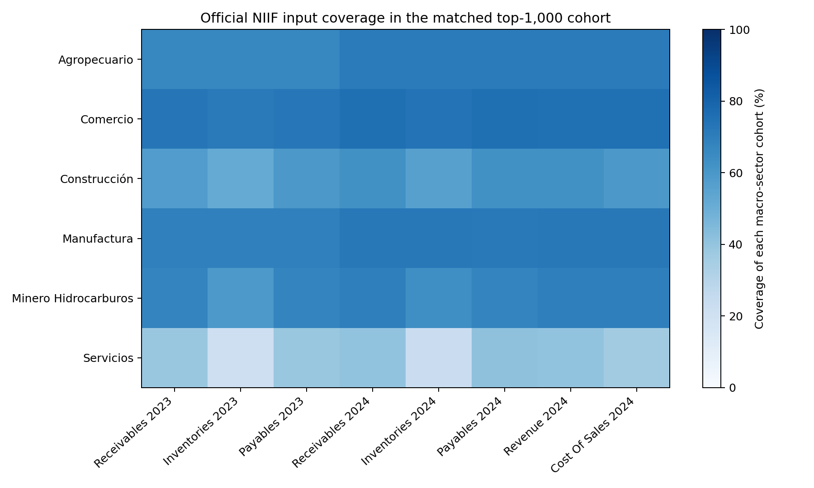

# Supersociedades working-capital input coverage

## Executive trailer

Cash-conversion analysis needs aligned balance-sheet stocks and income-statement flows. Supersociedades publishes the three relevant statement tables: annual NIIF position, income, and the 2025 report workbook for the 1,000 largest companies. This companion joins those official sources in memory for the same 2024 cohort and declared NIIF presentation basis, then reports macro-sector coverage for trade receivables, current inventories, trade payables, ordinary revenue, and cost of sales. It also calculates one complete inventory-turnover component, DIO, where both year-end inventory observations and the annual cost-of-sales denominator are available and positive.

The source does **not** distinguish sales to credit customers from total ordinary revenue or purchases from accounting cost of sales. In addition, the receivables and payables concepts include “other accounts.” Those are material definition mismatches for DSO and DPO. The companion therefore does not calculate DSO, DPO, or cash conversion cycle; it uses the observed field coverage and the DIO component to show what public data can support and where the remaining gap begins. Nothing here is a cash forecast, Liquidity-at-Risk estimate, or institutional validation.

## Architecture

```text
Supersociedades 2025 top-1,000 workbook (2024 cohort; macro-sector + reporting basis)
          +
NIIF balance sheet 2023 (beginning stocks) ── NIIF balance sheet 2024 (ending stocks)
          +
NIIF income statement 2024 (revenue + cost of sales)
          ↓ NIT + point-of-entry alignment in memory; latest instance per year/basis
          ↓ aggregate coverage by macro-sector; calculate DIO only for complete cases
Coverage CSV + DIO figure + coverage heatmap + hashes/QA manifest
```

## Sources, vintage, and fields

- Cohort and macro-sector: [Supersociedades 1,000 largest companies, report 2025, financial cut 2024](https://www.supersociedades.gov.co/documents/80312/9178350/Base_1000_empresas_2024.xlsx).
- Balance sheet: [NIIF – Estado de Situación Financiera](https://www.datos.gov.co/Economy-and-Finances/Estados-Financieros-NIIF-Estado-de-Situaci-n-Finan/pfdp-zks5), concept IDs selected by exact official labels: `Cuentas comerciales por cobrar y otras cuentas por cobrar corrientes`, `Inventarios corrientes`, and `Cuentas por pagar comerciales y otras cuentas por pagar corrientes`. Annual cuts are 2023 (taxonomy 369) and 2024 (taxonomy 411).
- Income statement: [NIIF – Estado de Resultado Integral](https://www.datos.gov.co/resource/prwj-nzxa.json), 2024 (taxonomy 411): `Ingresos de actividades ordinarias` and `Costo de ventas`.
- Units: Supersociedades says NIIF reports are submitted in thousands of COP ([official FAQ](https://www.supersociedades.gov.co/web/asuntos-economicos-societarios/preguntas-frecuentes)). Coverage counts and ratios are reported; raw amounts and entity rows are not.
- Cohort NITs are joined only in memory. The runner requires the workbook's reporting basis and `punto_entrada` to match; generic group labels are excluded if they could map to more than one presentation basis. The latest `codigo_instancia` within the aligned NIT/year/basis is retained. Raw responses are hashed but not written to disk.

## What is measured

For each macro-sector, the CSV reports cohort size and available counts/coverage for each selected balance-sheet and income-statement concept by year. `all_selected_source_fields_present` means the selected public fields are present; it does not mean all fields needed for a valid cash conversion cycle are present.

For complete cases, the DIO component is calculated as:

```text
DIO = ((current inventory at 2023 year-end + current inventory at 2024 year-end) / 2)
      / 2024 cost of sales × 365
```

The 2023 and 2024 stocks, 2024 cost-of-sales flow, cohort, and NIIF presentation basis are aligned. The sector output is the median entity DIO with a complete-case count and cohort coverage. Cases with missing values, conflicting filing values, non-positive average inventory, or non-positive cost of sales do not enter DIO statistics. This DIO is a stock-to-flow accounting measure, not observed inventory depletion.

## Why CCC is not calculated

| Component | Standard denominator | Public field available | Gap |
|---|---|---|---|
| DSO | Credit sales | Incomes of ordinary activities | Total revenue does not isolate credit sales; receivables also include other receivables. |
| DIO | Cost of sales | Cost of sales | Supported as a complete accounting component when the matched inventory stocks and positive cost are present; see output coverage. |
| DPO | Supplier purchases | Cost of sales | Cost of sales is not purchases; CxP also includes other payables. |

As a result, adding these fields into a cash conversion cycle would combine unmatched definitions. This companion does not fill that gap with a synthetic ratio or an unvalidated purchases estimate.

## Governance and limits

This is a descriptive public-data application to a revenue-selected 1,000-company cohort. Coverage is incomplete and may vary by macro-sector. The in-memory matching and latest-instance rule are reproducible analytical choices, not an authorized institutional linkage or independent financial-statement audit. The account labels do not isolate pure trade balances; the statements are annual and reveal neither collections nor payments dates. DIO does not estimate cash timing, shortfalls, operating liquidity buffers, or risk capital.

For exact DSO/DPO/CCC, obtain authorized, same-perimeter credit-sales and supplier-purchases fields (or validated transaction data), detailed trade-only receivable/payable balances, statement amendments and versions, and interim dates. For forecasting, add dated realized receipts/payments, opening cash, drawable facilities, forecast vintages, and shortfall outcomes; reconcile to bank/ERP source records and establish independent out-of-time validation criteria before operational use.

## Reproduction

Requires Python 3.10+ and network access to official Supersociedades and Datos Abiertos endpoints:

```bash
python3 -m venv .venv
source .venv/bin/activate
pip install -r 03-financial-risk/07-financial-and-construction-risk-lab/01-corporate-financial-risk/03-working-capital-liquidity-forecast/observed-supersociedades-working-capital-coverage/requirements.txt
python3 03-financial-risk/07-financial-and-construction-risk-lab/01-corporate-financial-risk/03-working-capital-liquidity-forecast/observed-supersociedades-working-capital-coverage/build_coverage.py
```

The runner writes aggregate `input_coverage_by_sector.csv`, `input_coverage_heatmap.png`, `median_inventory_days_dio.png`, and `source_quality_manifest.json`. It has explicit timeouts/retries and fails on duplicate cohort identifiers or a non-1,000-row workbook. Re-run and compare source hashes and QA before interpreting an update.




