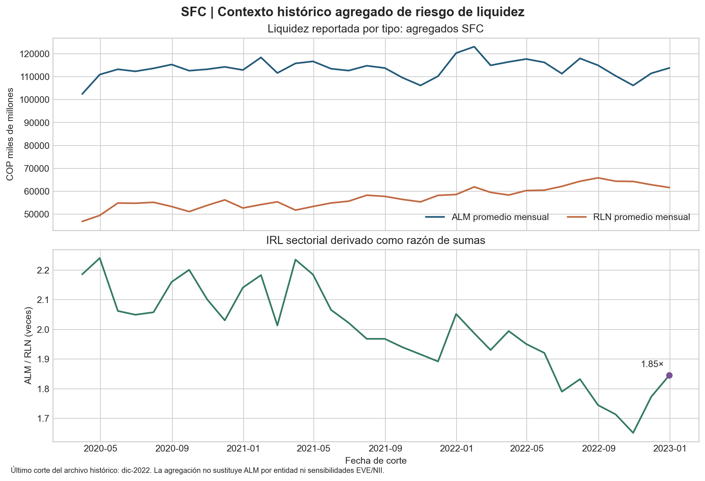

# ALM corporativo y brecha de duración

**Estado:** especificación de investigación más companion de liquidez con fuente oficial; no es modelo de ALM calibrado.
**Alcance observado:** contexto histórico del IRL agregado de establecimientos de crédito en Colombia, marzo de 2020–diciembre de 2022.

## Caso ejecutivo

Un responsable de tesorería necesita distinguir una señal pública de liquidez del análisis de balance que requiere para gestionar vencimientos, fondeo y riesgo de tasa. Este companion muestra qué puede responder una fuente supervisora agregada: cómo evolucionan, por tipo de establecimiento de crédito, los activos líquidos de mercado promedio (ALM) y el requerimiento de liquidez neto promedio (RLN), y qué relación resulta al combinar esos componentes. Usa el archivo histórico de IRL publicado por la Superintendencia Financiera de Colombia (SFC), conserva solo los tres agregados por tipo —bancos, compañías de financiamiento y cooperativas financieras— y calcula para el conjunto una razón de sumas, `Σ ALM / Σ RLN`. Esta opción pondera implícitamente por el requerimiento de liquidez y evita promediar ratios heterogéneos como si cada tipo tuviera el mismo tamaño. El corte de diciembre de 2022 reporta ALM promedio mensual de COP 113.795 miles de millones y RLN de COP 61.657 miles de millones; la razón sectorial derivada es 1,85 veces. La serie sirve para contextualizar el indicador y para demostrar trazabilidad desde una publicación oficial hasta una agregación reproducible. No describe la liquidez actual de 2026: el archivo histórico disponible termina en 2022. Tampoco estima el balance de una empresa o entidad individual, duración gap, valor económico del patrimonio (EVE), ingreso neto por intereses (NII), salidas bajo estrés o efectividad de coberturas. Para esas decisiones se requieren flujos contractuales fechados, tasas de reprecio, comportamiento de clientes, curvas, coberturas, escenarios y resultados propios. El uso responsable de este producto es orientar qué datos y validaciones pedir, no fijar límites operativos ni declarar que una posición es segura.

## Flujo de datos y cálculo




## Reproducción y datos

Desde la raíz del repositorio, instalar dependencias y ejecutar con el snapshot versionado:

```bash
pip install -r 03-financial-risk/07-financial-and-construction-risk-lab/01-corporate-financial-risk/04-asset-liability-management/observed-sfc-liquidity/requirements.txt
python3 03-financial-risk/07-financial-and-construction-risk-lab/01-corporate-financial-risk/04-asset-liability-management/observed-sfc-liquidity/run_observed_irl.py
```

Para volver a descargar y verificar íntegramente el linaje oficial: añadir `--verify-source` al comando del runner. Esta opción descarga el XLSX de la SFC en memoria, comprueba su SHA-256, extrae en memoria únicamente la hoja `Por Tipo` (fila de encabezado 5; descarta filas sin fecha; convierte fechas a `YYYY-MM-DD`; conserva fecha, tipo y ALM/RLN/IRL; serializa con seis decimales) y compara el hash resultante con el CSV category-level preservado. No escribe el libro fuente ni procesa o guarda la hoja `Por Entidad`; falla si cambia el archivo fuente o la extracción. Requiere conexión de red y `curl` con la verificación TLS del sistema habilitada. El comando sin `--verify-source` sigue siendo offline y se reproduce con los archivos versionados.

El runner valida el hash SHA-256 del CSV de entrada, esquema, finitud y signo de valores, unicidad fecha/tipo, presencia de tres categorías por mes y continuidad mensual. También comprueba que cada IRL de categoría coincida con ALM/RLN dentro del redondeo de publicación. Produce `results/sfc_irl_sector_monthly.csv`, `results/summary.json` y `results/sfc_irl_aggregate_context.png`. El CSV de entrada tiene 102 filas agregadas por tipo, de marzo de 2020 a diciembre de 2022; no contiene filas ni nombres de entidades. Sus unidades de origen son miles de COP. El valor mostrado en COP miles de millones divide los datos de origen por 1.000.000.

La fuente es el [histórico de IRL de la SFC](https://www.superfinanciera.gov.co/publicaciones/10108220/informes-y-cifrascifrasestablecimientos-de-creditoinformacion-periodicamensualindicadores-de-riesgo-de-liquidez-indicador-de-riesgo-de-liquidez-irl-10108220/) (opción “Histórico IRL”, libro Excel, hoja “Por Tipo”; descarga registrada en `data/source_manifest.json`). El SHA-256 del libro consultado el 11 de noviembre de 2026 fue `52b24483f73b7a7402b26708826b417d5169ec2604c2aaacb5007a5ba72296e0`; la huella del extracto agregado conservado es `6ea7719b51d23faa4a5c5bfff2ab1893e082f10597645121f0dc0365f6b2d275`. Se preserva el extracto sin datos de entidad para facilitar reproducción y revisión; el manifiesto identifica la hoja, fila de encabezado, fuente, periodo y proceso de extracción.

## Registro de decisiones de diseño

| Decisión | Razonamiento y efecto |
|---|---|
| Usar el extracto “Por Tipo” | Conserva datos observados y agregados por SFC, sin transportar filas por institución al proyecto. Se pierde heterogeneidad dentro de cada categoría. |
| Derivar IRL sobre las sumas ALM/RLN | Un promedio simple de ratios otorgaría igual peso a tipos con tamaños muy distintos. El cociente de sumas da una vista agregada transparente, no un indicador regulatorio oficial del sistema. |
| Mantener las fechas como fueron reportadas | El archivo contiene una fecha de octubre de 2022 que no cae en el último día del mes; validamos continuidad por mes calendario sin reescribir la fecha de observación. |
| Fijar el snapshot histórico | El archivo descargable reproducible termina en diciembre de 2022. La página de cifras más recientes abre un informe Power BI dinámico; se evita mezclar ese canal con el extracto fijo hasta contar con una exportación estable, auditable y versionada. |
| No calcular EVE/NII | Sin activos y pasivos fechados, reprecio, comportamiento, curvas y coberturas, la ecuación de gap de duración sería un supuesto sin identificación empírica. |

## Límites, gobierno y trazabilidad regulatoria

El IRL es una métrica supervisora de liquidez de horizonte corto. Este gráfico describe únicamente una serie sectorial histórica; no sustituye el IRL oficial vigente ni representa una entidad o empresa. El agregado oculta dispersión entre entidades y no implica un umbral interno de apetito de riesgo. El corte termina en 2022, no se actualiza automáticamente y no se usa para afirmar condiciones vigentes del mercado.

**MRM y validación independiente.** Antes de adaptar el cálculo a decisiones institucionales, el dueño de ALM debe confirmar población cubierta, definición y unidad de ALM/RLN, calendario y tratamiento de revisiones, denominador y método de agregación. Un validador independiente debe revisar la extracción y reconciliación con estados regulatorios, invariantes y escenarios extremos, sensibilidad de supuestos conductuales, curvas y fechas de reprecio, backtesting de EVE/NII frente a resultados observados, estabilidad temporal, documentación de limitaciones y criterios de aceptación. La validación debe fijar tolerancias de reconciliación y límites con el comité competente. Ninguna de esas pruebas institucionales está realizada aquí.

**Trazabilidad de marcos.** La decisión de separar datos fuente, transformación, métrica y límites facilita controles de gobierno de modelo y es coherente con prácticas de gestión integral de riesgo (ISO 31000/COSO ERM). El uso del IRL público ayuda a contextualizar liquidez y no demuestra cumplimiento de Basilea III/NSFR ni de LCR: no se reproduce la población, granularidad, ponderaciones, exclusiones o escenarios regulatorios. IFRS 9 no se aplica a este resumen de liquidez; el indicador tampoco permite valorar coberturas o pérdidas crediticias esperadas. Estas referencias explican el alcance y controles que faltarían, no una certificación o declaración de cumplimiento.

## Especificación de investigación pendiente

El modelo futuro de gap deberá contrastar una base determinística con escenarios de tasa, moneda y liquidez; declarar horizonte, unidad, filtración de información y dependencias; y evaluar convergencia, sensibilidad de supuestos, desempeño fuera de muestra y error de valoración. Véase [DATA_GAP.md](DATA_GAP.md) para el contrato mínimo de datos.
