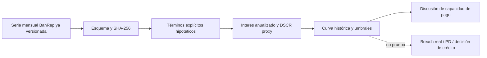
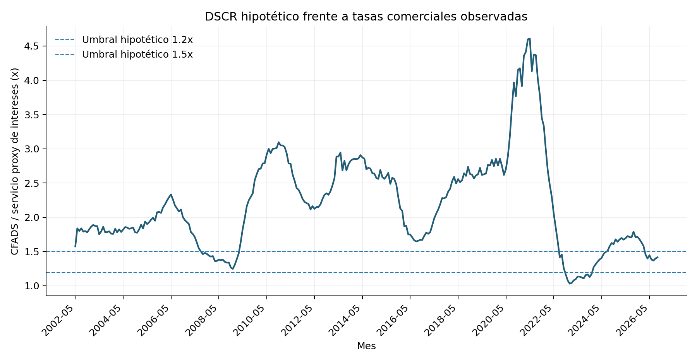
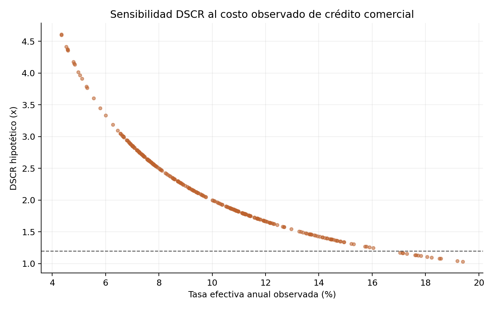

# Sensibilidad DSCR con tasa comercial observada

## Trailer ejecutivo

Una empresa con deuda próxima a vencimiento necesita entender cómo cambios en el costo de refinanciación pueden comprimir su cobertura de servicio de deuda antes de negociar condiciones o revisar límites. Este companion toma la serie mensual observada de tasa efectiva anual de crédito comercial preferencial/corporativo de BanRep y la aplica a un principal y un flujo disponible para servicio de deuda (CFADS) hipotéticos. El resultado muestra cómo habría variado una cobertura simplificada de intereses si COP 10.000 millones se hubieran financiado a cada tasa histórica, suponiendo COP 2.000 millones de CFADS anual. La serie cubre mayo de 2002 a septiembre de 2026; en el último mes observado la tasa fue 14,13% EA y el cociente hipotético CFADS/interés anualizado fue 1,42x.

La salida es útil para dimensionar sensibilidad y discutir cuánto margen de caja consumiría un escenario de tasas elevadas. También permite calcular el umbral de tasa que lleva un covenant ilustrativo a una cobertura determinada. No describe una obligación, cotización, spread, amortización ni covenant firmado por un emisor. El servicio de deuda se simplifica como principal por tasa y excluye amortización, fees y calendario; los meses por debajo de un umbral son conteos descriptivos del escenario, no breaches observados ni probabilidades de incumplimiento. Para una decisión real hacen falta deuda y CFADS conciliados por periodo, documentación contractual y resultados de refinanciación, con validación independiente.

## Arquitectura



## Evidencia observada y resultados

La fuente subyacente es la serie BanRep 15129, descrita y documentada en el companion de [costo comercial de refinanciación](../../03-credit-spread-and-refinancing-risk/observed-banrep-commercial-credit-cost/README.md). Se usa su snapshot CSV y manifiesto de fuente ya versionados; este runner calcula y guarda el hash de entrada. Son 293 observaciones mensuales entre 2002-05 y 2026-09. El escenario emplea tasa efectiva anual observada, deuda hipotética de COP 10.000 millones, CFADS anual hipotético de COP 2.000 millones, deuda bullet interest-only y umbrales ilustrativos DSCR 1,2x y 1,5x.





El runner deja [sensibilidad mensual](results/monthly_sensitivity.csv), [resumen](results/summary.json) y [manifiesto](results/manifest.json). El valor de tasa de equilibrio para el umbral 1,2x se obtiene algebraicamente bajo este escenario; no es una recomendación de covenant contractual.

## Reproducción

```bash
cd 03-financial-risk/07-financial-and-construction-risk-lab/01-corporate-financial-risk/04-debt-refinancing-and-covenant-risk/observed-banrep-dscr-sensitivity
python3 -m venv .venv && source .venv/bin/activate
pip install -r requirements.txt
python build_sensitivity.py
```

## Registro de decisiones y gobierno

- Se reutiliza el snapshot oficial BanRep ya preservado junto a su linaje, evitando una segunda descarga divergente.
- Se fija una deuda interest-only para aislar la sensibilidad de tasa; esta simplificación sobrestima o subestima cobertura cuando la deuda amortiza, según su perfil.
- Los umbrales son ejemplos de covenant, no se atribuyen a contratos observados.
- No se reporta frecuencia/probabilidad de breach como métrica de riesgo: cada mes histórico alimenta un supuesto hipotético, sin emisor ni contrato observable.
- Para gestión de riesgo de crédito alineada con Basilea y gobierno tipo ISO 31000/COSO ERM, los términos y eventos deben ser identificables, fechados y aprobados por la institución. IFRS 9 no se valida con esta sensibilidad porque faltan exposición contractual, default, flujos de recuperación y escenarios prospectivos enlazados.

## Limitaciones y validación pendiente

No hay spreads corporativos, deuda por emisor, calendarios de amortización, garantías, CFADS realizado, covenants firmados, dispensas, breach/cure, ofertas de refinanciación ni tasas contratadas. Por tanto, no estima probabilidades de breach, rollover, PD o pérdida, no hace backtesting y no es un sustituto de un modelo interno aprobado.

Antes de uso institucional se requiere: reconciliar deuda y CFADS con contabilidad; reconstruir DSCR contractual independientemente; definir outcomes y censura; evaluar cobertura en cohortes de vencimiento fuera de muestra; probar shocks de tasa, spread, refinanciación y CFADS; medir calibración/estabilidad; y obtener validación independiente con criterios de aceptación preestablecidos.

**Estado:** aplicación reproducible de tasa pública a términos hipotéticos. **Validación de emisor, covenant o pérdida:** pendiente.
