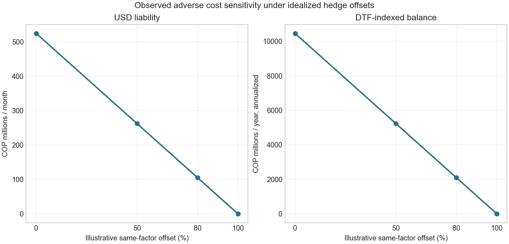

# Escenarios de cobertura sobre factores observados

## Resumen ejecutivo

Una tesorería necesita estimar cuánto podría variar el costo en pesos de una obligación en dólares o de un saldo indexado a una tasa local, y cuánto de ese movimiento neutralizaría una cobertura. Este caso aplica cuatro proporciones ilustrativas de cobertura (0%, 50%, 80% y 100%) a choques históricos de TRM y DTF del Banco de la República, sobre dos posiciones hipotéticas: una obligación constante de USD 1 millón y un saldo DTF de COP 100.000 millones. La muestra mensual común va de marzo de 2013 a septiembre de 2026. En septiembre de 2026, el cambio de la TRM implicó COP 138,44 millones de revaloración mensual sin cobertura; una compensación ideal del 80% dejaría COP 27,69 millones de sensibilidad. El cambio interanual de DTF fue +1,4403 puntos porcentuales, equivalente a COP 1.440,33 millones de mayor costo anualizado sin cobertura y COP 288,07 millones bajo esa misma compensación ideal del 80%. El ejercicio convierte choques observados en magnitudes de exposición y permite discutir materialidad y necesidades de información para una evaluación de hedge. La compensación se supone lineal, perfecta y gratuita: los resultados no son precios de derivados, hedge ratios recomendados, desempeño de cobertura ni optimización validada.

## Arquitectura

```text
Snapshot TRM BanRep serie 1 ──→ TRM de cierre mensual ──→ cambio en COP de USD 1m ─┐
                                                                                  ├→ malla 0/50/80/100%
DTF mensual derivada Atlas ────→ delta interanual DTF ──→ cambio anualizado COP 100bn ┘
     → residual = cambio de costo × (1 − proporción ilustrativa cubierta)
     → resumen por factor + CSV + gráfica + QA y hashes
```



## Resultados observados y definición

Las métricas se mantienen separadas por factor. Para FX, el cambio es la diferencia entre dos valuaciones mensuales consecutivas de la obligación USD 1m usando el último TRM publicado de cada mes. Para DTF, el cambio es el saldo constante × diferencia de la tasa efectiva anual frente al mismo mes del año previo; se presenta anualizado, no como flujo mensual observado. En ambos casos el residual hipotético aplica `choque × (1 − ratio)`.

En la ventana común, el percentil 95 del cambio de costo sin cobertura fue COP 218,12 millones mensuales para FX y COP 6.890,82 millones anuales, anualizados, para DTF. Con offset ideal del 80%, dichos valores mecánicamente se reducen a COP 43,62 millones y COP 1.378,16 millones, respectivamente. La malla reduce mecánicamente la volatilidad y el choque al multiplicarlos por una constante; no prueba que un derivado real replique exactamente TRM/DTF ni incorpora su precio.

## Registro de decisiones y trade-offs

| Decisión | Motivo | Consecuencia / límite |
|---|---|---|
| Reutilizar los factores de mercado publicados y versionados en el caso vecino de exposición FX/tasas | Mantiene linaje y ventana observada reproducibles sin duplicar datos | DTF procede de derivado del Atlas en Drive; los bytes SDMX originales no están versionados en el repositorio |
| Usar una malla fija de 0%, 50%, 80% y 100% | Permite comparar sensibilidad de forma legible para un comité | No es un proceso de optimización; no hay función de utilidad, restricciones ni costos de hedge |
| Aplicar offset perfecto y lineal del mismo factor | Aísla la aritmética de cobertura sobre el factor observable | Omite basis, cross-currency basis, tenor mismatch, convexidad, riesgo de contraparte, colateral, liquidez y costos |
| Mostrar FX y DTF por separado | No hay exposición conjunta ni modelo de dependencia | No se estima pérdida conjunta ni diversificación entre factores |
| Mantener nocionales constantes e hipotéticos | Hace explícita la escala en unidades monetarias | No representa una empresa, sus vencimientos, flujos proyectados o posición neta |

## Gobierno, validación y alineación regulatoria

La aplicación es una sensibilidad descriptiva, no un modelo de decisión. La gobernanza tipo MRM para cualquier siguiente versión exige: confirmación independiente de posiciones, contratos y calendario; reconciliación de precios de hedge ejecutables; pruebas de robustez con basis, costos, colateral, renovación y desfases de tenor; backtest fuera de muestra contra P&L/flujo observado; benchmark sin cobertura y estrategia vigente; y aprobación de criterios de aceptación por Tesorería y Riesgo de Modelo. Criterio mínimo para promoverla: resultados reproducidos por un revisor independiente, cobertura contable y económica diferenciadas, y error de hedge medido dentro de tolerancia institucional preaprobada. Aquí no existen esas observaciones, así que no se puede declarar eficacia ni aceptación.

La cadena de fuente, supuesto, choque, compensación y límite hace el análisis trazable y susceptible de challenge, en línea con principios de ISO 31000 y COSO ERM. No se declara cumplimiento. Si se buscara contabilidad de coberturas IFRS 9, harían falta documentación contemporánea de designación, instrumento y partida cubierta, relación económica, ratio y fuente de inefectividad conforme a la política contable aplicable. Basilea no valida una cobertura de tesorería corporativa y no se invoca como certificación de este ejercicio.

## Reproducir y linaje

Desde esta carpeta:

```bash
python3 -m venv .venv && source .venv/bin/activate
pip install -r requirements.txt
python3 run_hedge_scenarios.py
```

Requiere Python 3, pandas, NumPy y Matplotlib. El runner vuelve a ejecutar el companion observado vecino, verifica los hashes congelados de la serie BanRep TRM y el derivado DTF, valida el calendario y la ausencia esperada de datos, genera ocho filas de escenarios, comprueba que 0% reproduce la sensibilidad base y 100% deja residuo cero bajo el supuesto ideal, y escribe:

- `results/hedge_ratio_sensitivities.csv`: estadísticas por factor y proporción.
- `results/summary.json`: ventana, posiciones, métricas, supuestos y SHA-256 de insumos.
- `results/qa_manifest.json`: controles ejecutados.
- `figures/hedge_ratio_sensitivity.png`: comparación de la mayor variación adversa observada, con ejes separados para respetar sus unidades.

SHA-256 TRM: `d5068f3801b18a5530d291d6a2d0587e5ceb580d52879de5ae363168999edf77`; DTF derivada: `56e4e436cd7add0aac50dd8e1c29007fa173ed8e07e4b484633d19faa33c79ec`; CSV alineado generado por el companion base: `67b58ed41b2310d27a74ff8cfc6aa54cdd3d307180e5b9bcab51cbfdd1756b14`. La cobertura y limitaciones del dato están en [Exposición cambiaria y de tasas](../../02-fx-interest-rate-exposure/README.md) y [Tesorería y ALM](../../../../../04-quant-strategy-and-products/treasury-and-alm/README.md). Para fundamentos metodológicos de tasas y TRM, consultar el [Banco de la República](https://www.banrep.gov.co/es/estadisticas-economicas/series-historicas/tasas-interes).

## Limitaciones y datos faltantes

No se observan exposición real, trades, cotizaciones de derivados, tarifas, colaterales, efectividad contable, forecasts de flujo ni resultados posteriores. La TRM no es un forward ejecutable; la DTF no modela una curva por tenor ni incluye spread del prestatario. La sensibilidad histórica no es pronóstico, VaR, CVaR ni recomendación de ratio. Para validar una política hacen falta el contrato de cada exposición, flujo neto por fecha, posiciones de hedge, precios all-in, contraparte y colateral, estrategia benchmark, tratamiento contable, tolerancia de basis y P&L/flujo realizado.
