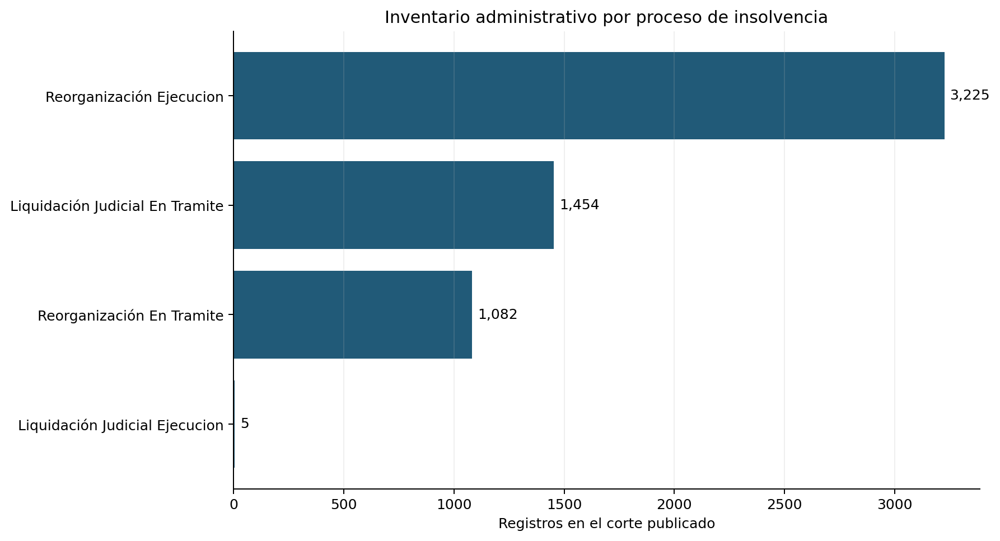

# Contexto público de procesos de insolvencia empresarial

## Trailer ejecutivo

Cuando una empresa evalúa crédito comercial, anticipos o límites para terceros, necesita entender el entorno de insolvencia en el que operan sus contrapartes. Los registros públicos de procesos concursales pueden aportar contexto sobre los procedimientos que atiende la autoridad y los sectores presentes en el corte. Este companion convierte la base mensual de insolvencia de la Superintendencia de Sociedades en agregados reproducibles por proceso y macrosector, preservando la fuente y el hash de descarga. En el corte publicado el 6 de noviembre de 2026 se identifican 5.767 filas con número de registro único; 3.225 aparecen como reorganización en ejecución, 1.454 como liquidación judicial en trámite y 1.082 como reorganización en trámite. La salida facilita una conversación de riesgo sobre composición del inventario administrativo y puede orientar preguntas para diligencia, concentración sectorial o solicitudes de datos internos.

El alcance termina ahí: el archivo no vincula un registro con una exposición de nuestra organización, una fecha de incumplimiento definida por acreedor, una recuperación ni una pérdida. Por tanto, estos conteos no estiman probabilidad de default, PD, LGD, EAD, tasas de transición, severidad o reservas, y no validan el modelo de crédito de contrapartes. El uso institucional exige enlazar de forma autorizada las exposiciones y outcomes internos, definir default y horizonte, controlar sesgo de selección y leakage, y someter el modelo a validación independiente antes de apoyar límites o decisiones de crédito.

## Flujo


## Resultado del corte

Fuente consultada: [Informes de Procedimientos de Insolvencia](https://supersociedades.gov.co/web/procedimientos-de-insolvencia/informes), archivo “Base de Datos Insolvencia – Corte Noviembre 2026” (generado el 6 de noviembre de 2026). La base contiene 5.767 filas, todas con número de registro presente y único en este corte. Se observan 710 filas sin activos y 771 sin pasivos reportados. Se encontró un valor de `PROCESO` fuera de las cuatro etiquetas procesales esperadas; se conserva en el agregado CSV y se excluye del gráfico de categorías procesales conocidas. El archivo informa montos, pero esta entrega conserva la unidad del origen sin asumir moneda ni escala no documentada aquí.



Archivos reproducibles: [conteos por proceso](results/by_process.csv), [conteos por macrosector](results/by_macrosector.csv), [resumen y control de calidad](results/summary.json), [manifiesto SHA-256](results/manifest.json). Ninguna tabla de resultados incluye nombres, NIT, ciudades, números de expediente ni observaciones de fila.

## Reproducción

```bash
cd 03-financial-risk/07-financial-and-construction-risk-lab/01-corporate-financial-risk/06-counterparty-credit-exposure/observed-supersociedades-insolvency-context
python3 -m venv .venv && source .venv/bin/activate
pip install -r requirements.txt
python build_companion.py
```

El programa descarga el archivo del portal oficial, verifica el esquema esperado, calcula SHA-256 y procesa identificadores solo en memoria para comprobar duplicados. También puede ejecutarse con un archivo ya descargado usando `python build_companion.py --xlsx /ruta/al/archivo.xlsx`. Si el esquema cambia, se detiene sin publicar resultados. El XLSX no se guarda dentro del repositorio.

## Registro de decisiones

| Decisión | Motivo y coste |
|---|---|
| Agregar por proceso y macrosector | Permite describir composición sin publicar filas identificables; pierde la posibilidad de inspeccionar trayectorias individuales. |
| Procesar NIT, nombre y número de registro solo en memoria | Necesario para controlar unicidad sin convertir el repositorio en un espejo de datos personales o empresariales. |
| No calcular tasas, proporciones de default ni scores | El corte es inventario de procesos y no contiene población de contrapartes expuestas ni outcomes de crédito. |
| Detenerse ante cambios de esquema | Evita que un cambio de columnas altere silenciosamente el significado de los agregados. |
| Mantener valores anómalos en tabla, excluirlos del gráfico de estados conocidos | Conserva trazabilidad del origen y evita representar una categoría desconocida como estado procesal válido. |

## Gobierno del modelo, uso regulatorio y limitaciones

Este companion es una estadística descriptiva de una fuente supervisora, no un modelo ni una validación. No debe alimentar una decisión de originación, límite, provisión o capital. Como principio compatible con gobierno de riesgo de crédito de Basilea y gestión de riesgo de ISO 31000/COSO ERM, la evidencia debe tener población, definición de evento, horizonte y trazabilidad apropiados para la decisión. La base pública no satisface ese contrato de datos. Tampoco constituye evidencia para medición de pérdidas crediticias esperadas bajo IFRS 9: faltan exposición contractual propia, incumplimientos, recuperaciones y escenarios prospectivos ligados a la cartera.

Para convertir el diseño de PD/LGD/EAD en aplicación institucional se requiere, como mínimo: (1) panel autorizado de saldos, vencimientos, pagos, garantías, mora y recuperaciones; (2) definición de default, cure y write-off aprobada por política; (3) segmentación y evaluación de representatividad; (4) validación temporal fuera de muestra, discriminación, calibración, estabilidad y backtesting; (5) pruebas de sensibilidad, estrés y escenarios adversos; (6) reconciliación con contabilidad; y (7) validación independiente de supuestos, código, datos y resultados con criterios de aceptación predefinidos. No se reporta backtesting porque no existe un target enlazado.

### Riesgos de interpretación

- El inventario de procedimientos no equivale a todos los incumplimientos comerciales: los procesos concursales son una población seleccionada por acceso y elegibilidad legal.
- El corte mensual no constituye cohortes ni una serie de transiciones entre estados.
- Una empresa en reorganización no implica que una obligación concreta haya incumplido ni cuantifica recuperación.
- Los registros y montos agregados pueden reflejar campos faltantes, revisiones y convenciones de reporte de la fuente.
- El contexto nacional no representa automáticamente la mezcla de clientes, proveedores o contratistas de una entidad.

**Estado:** companion público reproducible de contexto observado. **Aplicación a exposición institucional:** pendiente. **Validación PD/LGD/EAD:** no realizada.
