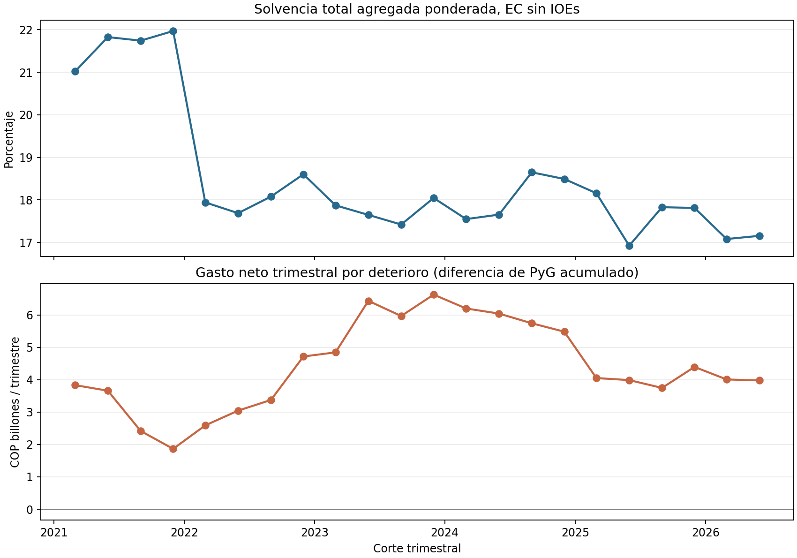

# Contexto oficial de solvencia y deterioro agregado

## Caso ejecutivo

Un comité de riesgo necesita distinguir el colchón regulatorio observado de las pérdidas contables del periodo antes de discutir capital económico. Este companion construye ese contexto con dos fuentes públicas de la Superintendencia Financiera: componentes de solvencia individual por entidad y la serie de resultados de “Todos los EC sin IOEs”. Para cada trimestre de marzo de 2021 a junio de 2026, agrega patrimonio técnico y los componentes ponderados de riesgo de las entidades con registros completos, y los pone al lado del gasto neto por deterioro acumulado en el año reportado en el estado de resultados. En junio de 2026, la solvencia total agregada ponderada fue 17,16%, el patrimonio técnico sumó COP 132,75 billones, el deterioro neto acumulado en el año fue COP 7,99 billones y la diferencia frente a marzo fue COP 3,98 billones en el segundo trimestre. Esta diferencia es flujo contable derivado, no pérdida evento a evento. La lectura ejecutiva es acotada: solvencia regulatoria y deterioro contable describen dimensiones distintas de la capacidad y el desempeño del sistema; ayudan a contextualizar una discusión de resiliencia, pero no miden la distribución de pérdidas extremas de una compañía. No se deriva VaR, ES, capital económico, dependencia ni recomendación de capital.

## Arquitectura

```text
SFC Datos Abiertos: solvencia individual por entidad
  → filtrar cortes trimestrales y entidades del perímetro EC sin IOEs
  → verificar componentes y recalcular ratios individuales
  → sumar patrimonio técnico / sumar denominador ponderado por riesgo
                                                  ┐
SFC Indicadores Gerenciales: EC sin IOEs, PyG     ├→ unir en cierres trimestrales
  → extraer DETERIORO NETO DE RECUPERACION-DR.    ┘  → CSV + QA/hash + gráfica
```



## Datos, definición y QA

- Solvencia individual: dataset SFC en Datos Abiertos, ID `x586-r5d2`. Se seleccionan cortes trimestrales 2021-03 a 2026-06, UC 14, columna 5, y tipos de entidad 1, 2, 4 y 32. Se excluye el tipo 22 para empatar con el perímetro del total de establecimientos de crédito sin IOEs del reporte de resultados.
- Componentes: renglón 20, patrimonio técnico; 25, activos ponderados por riesgo de crédito; 30, importe ponderado por riesgo de mercado; 32, importe ponderado por riesgo operacional; y 60, relación total de solvencia reportada. La relación agregada se calcula como suma del patrimonio técnico dividida por la suma de 25+30+32. No es el promedio simple de ratios institucionales.
- Pérdida/provisión contable: la hoja PyG del archivo SFC “Total Entidades Establecimiento de Crédito” contiene la línea `DETERIORO NETO DE RECUPERACION-DR.` en COP millones. El snapshot conserva sus importes mensuales acumulados en el año; el runner obtiene el flujo contable del trimestre por diferencia de importes acumulados entre cierres trimestrales y reinicia la base en cada primer trimestre. La diferencia sigue siendo un gasto neto de deterioro/reversiones agregado, no una muestra de eventos de pérdida.
- También se conserva `GANANCIAS (EXCEDENTES) Y PÉRDIDAS` como resultado neto acumulado del periodo, para evitar leer el gasto por deterioro sin contexto de resultado. Ninguna de las dos líneas es pérdida económica realizada ni distribución de pérdidas de cola.
- Para minimizar datos locales, la respuesta de solvencia de nivel entidad se procesa en memoria y no se guarda. El repositorio conserva solamente `sfc_solvency_aggregate_quarterly.csv`: 22 filas trimestrales de sumas, conteos, ratios agregados y QA; no contiene nombres, códigos, IDs de filas ni observaciones de entidad. El hash de respuesta API se conserva en el manifiesto para trazabilidad.
- El runner offline verifica SHA-256 de los snapshots agregados, cobertura del join y valores finitos. La corrida de extracción en memoria recalculó los ratios por entidad: máximo desacuerdo con el dato reportado 0,0094 puntos porcentuales. El agregado de septiembre de 2024 es 18,649%, consistente con el 18,6% publicado por el Banco de la República para los establecimientos de crédito en su reporte de estabilidad financiera. Se puede volver a comprobar contra la API con `python3 run_context.py --verify-source`; esa opción requiere red, verifica la huella del response capturado, procesa las filas en memoria y las descarta al terminar.
- En 5 registros entidad-trimestre faltaba al menos un componente requerido; se excluyen de ese trimestre y se informa el número de entidades incluidas. La salida cubre 22 cierres trimestrales, 2021-03 a 2026-06.

## Reproducibilidad

Desde esta carpeta:

```bash
python3 -m venv .venv && source .venv/bin/activate
pip install -r requirements.txt
python3 run_context.py
```

El proceso offline usa snapshots agregados versionados bajo `data/` y reconstruye `results/quarterly_capital_and_impairment_context.csv`, `results/summary.json`, `results/qa_manifest.json` y `figures/solvency_and_impairment_context.png`. El archivo `data/source_manifest.json` fija URLs, parámetros, fechas, huellas y el manejo efímero del response de solvencia; `results/qa_manifest.json` registra los hashes de todas las salidas regeneradas.

SHA-256 del response SFC procesado en memoria: `4da1af109c5f6f767dda5d015fd12ef1825c4dc28ef9ade07bdb46c1e00dd205`. CSV trimestral de solvencia agregada: `9b7360ba104dd336df12a2f06a49f4625c2f545c6f59a2abb60949ac5d25143b`. CSV PyG agregado extraído: `747a5de7bf8df97883f963b4f8bd20bb5e8e3b4a3cecf77ec34429b0ddea0e1f`. Libro PyG SFC del que se extrajo: `7f74655b7cff09c00f1d00b6fe56ed562ea167d3b2b5467781e1df35ee678133`.

## Trade-off log

| Decisión | Razón | Implicación |
|---|---|---|
| Reagregar los componentes de solvencia por entidad, en lugar de promediar ratios | El ratio agregado debe ponderar por los denominadores de riesgo | La cobertura depende de qué entidades reportan todos los componentes en el corte |
| Empatar tipo de entidad con `Todos los EC sin IOEs` | Evita sumar IOEs al P&L cuando el reporte los excluye | El resultado no representa todos los intermediarios vigilados ni todos los conglomerados |
| Usar gasto neto por deterioro como proxy contable de pérdida | Es una línea pública, agregada y repetida del PyG | Incluye deterioros/reversiones contables y no identifica pérdidas realizadas, severidad de cola o evento de riesgo |
| Mostrar solvencia y deterioro en paneles separados | Son métricas de stock/ratio y flujo contable con unidades distintas | No se convierten en una relación causal ni se suman |
| No estimar capital económico desde solvencia | El ratio regulatorio no identifica la distribución de pérdidas ni su dependencia | La especificación EC=VaR−E[L] permanece sin implementación/calibración |

## Gobierno del modelo y límites

Este artefacto es contexto sectorial, no modelo institucional. No se ha calibrado una función de pérdida ni se ha estimado PD, LGD, severidad operativa, exposición económica o dependencia entre factores. El gasto neto por deterioro es un rubro contable acumulado, no un registro de pérdidas evento a evento. El patrimonio y el ratio agregados reflejan el perímetro regulatorio y el reporte del supervisor, no el capital disponible de una empresa.

Para cerrar la brecha de capital económico se requieren datos propios de pérdidas y exposiciones por unidad, taxonomía y factor común; severidad, recuperación, horizonte, controles/mitigaciones, cambios de perímetro y resultados fuera de muestra. La gobernanza MRM futura debe exigir conciliación con el mayor contable, pruebas de cobertura de cola, sensibilidad a dependencia y agregación, stress/reverse stress, backtesting donde sea posible, revisión independiente y criterios de aceptación predefinidos. No se hacen claims de cumplimiento de Basilea, IFRS 9 o capital regulatorio; la serie oficial sirve como benchmark contextual únicamente.

## Fuentes oficiales

- [SFC Datos Abiertos: Solvencia Individual](https://www.datos.gov.co/Hacienda-y-Cr-dito-P-blico/Solvencia-Individual/x586-r5d2)
- [SFC: Evolución relación de solvencia y enlaces a datasets históricos](https://www.superfinanciera.gov.co/publicaciones/60947/informes-y-cifrascifrasestablecimientos-de-creditoinformacion-periodicamensualevolucion-relacion-de-solvencia-60947/)
- [SFC: Indicadores gerenciales NIIF, metodología e históricos](https://www.superfinanciera.gov.co/publicaciones/10084493/informes-y-cifrascifrasestablecimientos-de-creditoinformacion-periodicamensualindicadores-gerenciales-niif-10084493/)
- [Banco de la República: Reporte de Estabilidad Financiera, segundo semestre de 2024](https://repositorio.banrep.gov.co/bitstream/handle/20.500.12134/11032/rept-estab-fin.sem2-2024.pdf) — referencia independiente del 18,6% agregado a septiembre de 2024 y límites regulatorios.
