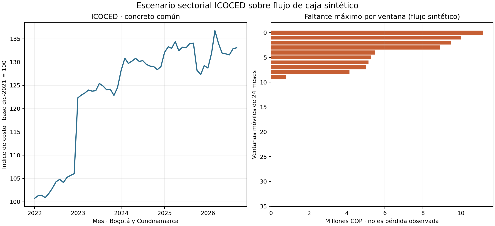

# ICOCED como escenario de costo para un flujo de caja sintético

## Propósito y uso admisible

Este companion conecta el prototipo de cash-flow-at-risk con una entrada oficial de costos. Reproduce trayectorias históricas de ICOCED para concreto común sobre **un perfil sintético de caja** y responde: bajo esos supuestos, ¿cuántas ventanas de costo históricas llevan la caja por debajo del piso configurado y cuál es el faltante máximo?

ICOCED aporta solo el **factor sectorial de costo**. No aporta presupuestos, facturas, preventas, deuda, caja ni resultados por obra. Por ello, las salidas son escenarios ilustrativos de sensibilidad; no estimaciones de pérdidas, probabilidades o cash-flow-at-risk de una obra real.

## Fuente y vintage

Se usa DANE, [ICOCED Anexo 7.2, actualización septiembre de 2026](https://www.dane.gov.co/files/operaciones/ICOCED/anex-ICOCED-sep2026.xlsx), dominio `Bogotá_Cundinamarca AR`, grupo `Materiales`, insumo `Concreto común`. El workbook está en el companion oficial de inflación del mismo repositorio; este subproyecto **no duplica** ni el Excel ni el derivado. Referencias, grano, extracción y SHA-256 del Excel (`c858c338…e4d1b63b`) están en `data/source_reference.json`.

El runner consume el CSV procesado que ese companion ya genera, cuya SHA-256 requerida es `b2e0b7bb52b8b7b588bc7c0bafefc4e54510906694da34a35b3c692de85a4daa`. La selección contiene 57 meses desde enero de 2022 hasta septiembre de 2026. DANE informa un peso de referencia de 2021 de **10,112%** para concreto común en la canasta del índice.

## Supuestos de escenario

El perfil de caja se configura en `scenario_config.json` y todos sus montos son supuestos en millones de COP: caja inicial 10, recaudos de 116 al mes, costo base de 100 al mes, servicio de deuda de 15 al mes y piso de liquidez cero. Sin escalamiento de costos, el saldo terminal sería COP 34 millones y no habría brecha.

Para cada ventana móvil de 24 meses se usa el índice de concreto (I_t) y el peso sectorial publicado (w=0{,}10112):

```text
costo_t = costo_base × ((1 − w) + w × I_t / I_inicio_de_ventana)
caja_t = caja_(t−1) + recaudos_t − costo_t − servicio_deuda_t
faltante_máximo = max_t(max(0, piso_liquidez − caja_t))
```

El peso DANE sirve como referencia de canasta y no representa la participación de concreto en un presupuesto particular. Los demás componentes de costo se mantienen constantes. Se generan 34 ventanas móviles solapadas de 24 meses a partir de los 57 datos observados. Su fracción con faltante es un conteo descriptivo de escenarios solapados, **no una probabilidad**.

## Resultado de esta sensibilidad

La ejecución encuentra que **10 de las 34 ventanas** del índice producen algún faltante bajo el perfil de caja seleccionado; la brecha máxima de caja es **COP 11,15 millones**. La cifra P95 de las ventanas también se guarda, pero no debe leerse como cuantíl probabilístico ni requerimiento de reserva. Si el perfil sintético cambia, cambia el resultado.



La decisión que el ejercicio permite ilustrar es si una caja inicial supuesta aguanta determinadas trayectorias observadas de costo sectorial. No recomienda caja, crédito, precio ni mitigación para un proyecto real.

## Evidencia necesaria por obra

Para convertir esto en una aplicación específica de una obra se requiere un dataset fechado y versionado por obra, con al menos:

- presupuesto vigente por mes y partida, versiones aprobadas y presupuesto base;
- cantidades y materiales del bill of quantities, sustituciones y unidades;
- facturas/órdenes de compra/cotizaciones con fecha, ubicación, proveedor, cantidad, precio, moneda e impuestos;
- hitos de cronograma y avance físico, entregas reales, retrasos y causa codificada;
- preventas/recaudos realizados por periodo, desistimientos y curvas de pago;
- caja inicial, desembolsos y servicio de deuda contractual por fecha;
- modificaciones de alcance, cláusulas de indexación/reajuste y datos de exposición a proveedores.

El proyecto requeriría permisos de uso, linaje y controles de calidad por obra; mapeo de partidas a series ICOCED; evaluación del índice contra precios pagados; calibración con múltiples obras y prueba temporal por obra. Sin ese panel no se estiman pérdida real, probabilidad de falta de caja, sobrecosto, relación causal, capacidad predictiva ni errores de pronóstico.

## Reproducción

Con Python, `pandas`, `numpy` y `matplotlib`, desde esta carpeta:

```bash
python3 build_scenarios.py
```

Se puede indicar explícitamente el derivado ya disponible:

```bash
python3 build_scenarios.py --input "/ruta/icoced_material_series_bogota.csv"
```

El runner valida el hash, las 171 filas del derivado, el dominio, el insumo, los 57 meses, el peso publicado y la positividad del índice. Usa el contrato `Project` del prototipo y recurre la ecuación mensual de caja para cada escenario.

Artefactos generados:

- `results/historical_index_cash_scenarios.csv` — las 34 ventanas y sus brechas de caja;
- `results/scenario_summary.json` — supuesto, fuentes, calidad y resultados;
- `figures/icoced_cashflow_scenarios.png` — la serie sectorial y la sensibilidad de caja.
