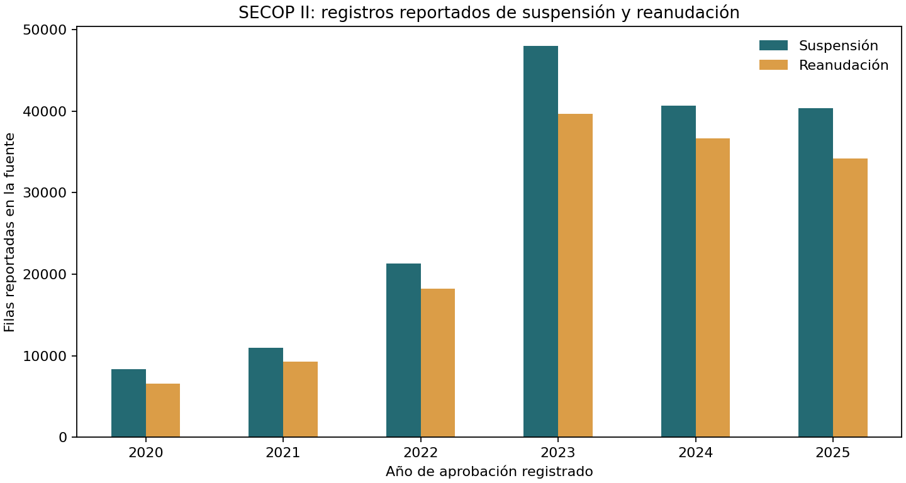

# SECOP II: registros de suspensión y reanudación

## Uso ejecutivo

En contratación pública, las suspensiones y reanudaciones son hitos administrativos que conviene distinguir de un atraso frente al cronograma de obra. Este análisis toma el conjunto oficial de Colombia Compra Eficiente y resume por año de aprobación cuántas filas aparecen como `Suspension` y `Reanudacion`. Entre 2020 y 2025, la fuente reportó 314.437 filas para todos los tipos de contrato. El conteo permite dimensionar el volumen de registros y orientar una futura evaluación de calidad y vinculación; no permite concluir cuántos contratos de obra se suspendieron, cuánto se detuvo cada proyecto ni qué impacto tuvo en costo o entrega.

## Arquitectura

```text
API pública SECOP II — Suspensiones de Contratos
        ↓ agregación en el servidor por año de aprobación y tipo
snapshot anual agregado, sin identificadores ni texto libre
        ↓ huella SHA-256 y QA de cobertura/tipos
tabla + gráfico descriptivo
        ↓
pregunta habilitada: ¿vale la pena construir un join de contratos de obra?
```



## Resultado descriptivo

| Año de aprobación | Filas `Suspension` | Filas `Reanudacion` |
|---:|---:|---:|
| 2020 | 8.385 | 6.582 |
| 2021 | 10.987 | 9.291 |
| 2022 | 21.290 | 18.260 |
| 2023 | 48.001 | 39.672 |
| 2024 | 40.683 | 36.696 |
| 2025 | 40.391 | 34.199 |

Los valores son filas reportadas, no contratos únicos ni suspensiones únicas. Se observaron filas exactamente duplicadas en la fuente para una misma combinación contrato/tipo/fecha; por eso no se interpreta el aumento de conteos como deterioro o incidencia. Los datos no están filtrados a `tipo_de_contrato = Obra`.

## Registro de decisiones

| Decisión | Trade-off |
|---|---|
| Resumir solo por fecha de aprobación y tipo | Evita retener identificadores o justificaciones libres; pierde la secuencia por contrato y no permite duración. |
| No estimar duración ni proporción | No se hizo un enlace evento-contrato completo de obras; las filas pueden duplicarse y faltan denominadores comparables. |
| Mantener el corte 2020–2025 | Permite presentar años calendario cerrados; el reporte de la fuente cambia con cargas y correcciones posteriores. |

## Fuente, trazabilidad y calidad

Fuente primaria: [SECOP II - Suspensiones de Contratos, CCE / Datos Abiertos](https://www.datos.gov.co/Estad-sticas-Nacionales/SECOP-II-Suspensiones-de-Contratos/u99c-7mfm). Colombia Compra Eficiente describe el conjunto como registro de suspensiones y reanudaciones de contratos SECOP II, con frecuencia diaria. El endpoint tiene siete campos: ID de contrato, tipo, fecha de creación, fecha de aprobación, propósito de modificación y fechas de inicio/fin del contrato. Este companion consulta únicamente la agregación por `fecha_de_aprobacion` y `tipo`; no solicita ni conserva IDs ni motivos.

El snapshot agregado y el manifiesto QA están en `results/`. El manifiesto conserva la consulta SoQL, fecha de extracción, cobertura, conteo de filas agregadas, criterios QA y SHA-256 del CSV. La fuente es mutable y las cifras son un corte fechado al 11 de noviembre de 2026. No se calculó el número de eventos únicos, pues la agregación pública devuelve filas crudas y no permite hacer deduplicación exacta sin traer datos por contrato.

## Limitaciones y gobierno

Este resultado **no es un proxy de retraso de construcción**. No está filtrado a obras, no enlaza suspensiones con reanudaciones, no mide días efectivos suspendidos, no observa ruta crítica ni fecha contractual planeada frente a real y no estima costo, pérdida o incumplimiento. Las suspensiones pueden obedecer a causas legales y operativas legítimas. Los registros pueden ser incompletos, repetidos o actualizados retroactivamente. Tampoco se usa texto libre para clasificar motivos.

La ruta de riesgo de cronograma conserva como evidencia sectorial la serie CEED de área paralizada/inactiva; ese indicador tampoco mide atraso contractual individual. Para pasar a una aplicación de obra se necesitarían IDs enlazables y autorización de uso, clasificación de contratos de obra, secuencias de modificación deduplicadas, fecha efectiva de suspensión/reanudación, cronograma base versionado, ruta crítica, terminación real y costos asociados. Toda métrica debería ser validada independientemente y los criterios de aceptación acordados antes de uso decisorio.

## Reproducción

Con Python, `requests`, `pandas` y `matplotlib`, desde esta carpeta:

```bash
python3 build_companion.py
```

El comando verifica el hash del snapshot agregado y regenera resumen JSON y figura. Para refrescar la agregación desde el API oficial:

```bash
python3 build_companion.py --refresh
```

La actualización cambia el snapshot y su manifiesto; conservar la versión anterior antes de reemplazarla si se requiere comparación entre vintages.
