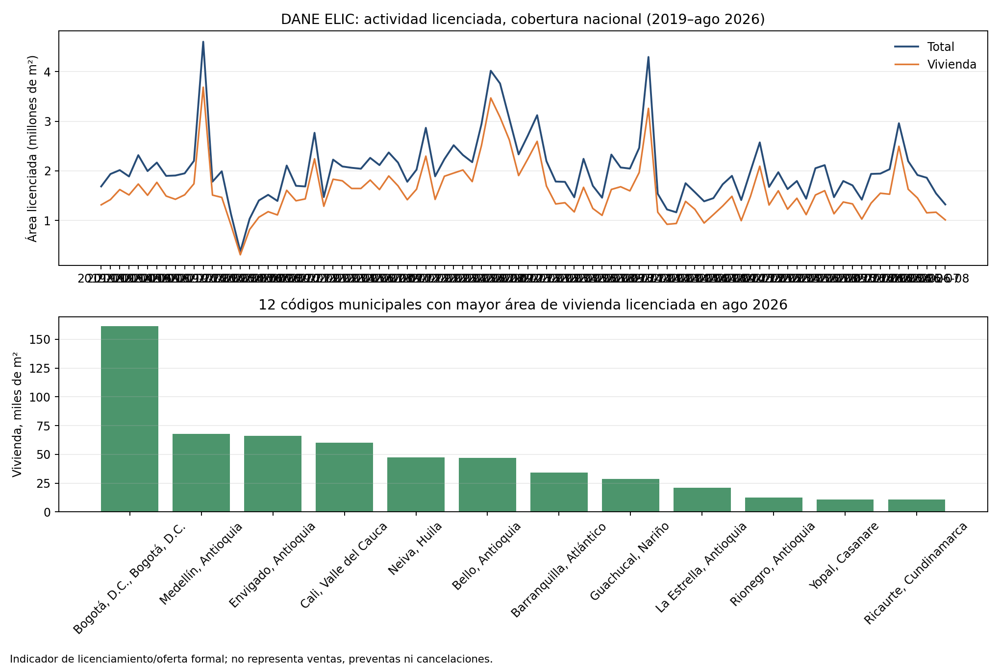

# DANE ELIC: señal observada de licenciamiento y oferta formal

Este companion describe la actividad de construcción formal aprobada que reporta DANE. No mide ventas, preventas, cancelaciones, absorción, demanda ni resultado de una obra. Su uso admisible es contexto de oferta/licenciamiento a nivel municipal y por destino, como insumo exploratorio para formular hipótesis; no es etiqueta ni validación del modelo de preventas.

## Resultado del vintage

El snapshot mensual de agosto de 2026 aporta 92 meses en la serie de cobertura nacional (2019-01 a 2026-08). En agosto, la suma conciliada es 1.322.000 m² de área licenciada: 1.010.109 m² para vivienda (10.483 unidades) y 311.891 m² para destinos no residenciales. En vivienda, 649.706 m² corresponden a apartamentos y 360.403 m² a casas. Bogotá D.C. registra el mayor metraje de vivienda entre los municipios en ese mes (161.581 m²), seguida por Medellín (67.772 m²) y Envigado (66.195 m²).



Los valores son licencias/área aprobada según la clasificación de DANE. No significan que las obras se hayan iniciado, que las unidades se hayan vendido ni que exista demanda efectiva. El conteo de licencias se agrega conforme a la clasificación ELIC, en la que cada licencia con varios destinos o tipos se asigna a la categoría de mayor área según la guía del propio libro.

## Fuente, vintage y procedencia

- Productor: [DANE, Estadísticas de Licencias de Construcción (ELIC)](https://www.dane.gov.co/index.php/estadisticas-por-tema/construccion/licencias-de-construccion).
- Archivo oficial: [Serie tipo base por municipios, agosto 2026](https://www.dane.gov.co/files/operaciones/ELIC/anex-ELIC-SerieTipoBaseMun-ago2026.xlsx).
- Publicación consultada: página de ELIC actualizada el 15 de octubre de 2026; período de referencia agosto 2026.
- SHA-256 del snapshot: `da11bbfcdeafa05c8f16c81c09d351582e20680aef90b4a9e8bd8aa2394e4943`.
- Hoja de datos: `elic` (343.545 filas); hoja `guía` define categorías; hoja `lista municipios` permite mapear DIVIPOLA a nombre de municipio/departamento.
- Grano original: mes, municipio DIVIPOLA, objeto del trámite, clase de suelo, modalidad, destino, tipo de vivienda, VIS/NVIS, estrato. Variables: área aprobada en m², unidades de vivienda aprobadas y licencias.
- Grano derivado: mes×destino; mes×municipio×destino; mes×municipio×tipo de vivienda.
- La nota metodológica del anexo distingue grupos de cobertura 77, 88, 302 y 1000+. El companion los agrega como segmentos de cobertura reportados en cada mes y reconstruye el total nacional. Para análisis temporal se fija el período enero 2019–agosto 2026, cuando DANE informa cobertura nacional. Aun así, la inclusión/codificación territorial puede cambiar; las comparaciones municipales históricas requieren armonizar DIVIPOLA y la cobertura.

## Reproducción

Requisitos: Python 3, `pandas`, `openpyxl` y `matplotlib`. Descargar el anexo oficial y conservar el archivo fuera del repositorio; el raw no se duplica aquí.

```bash
python3 build_companion.py --source-xlsx /ruta/al/anex-ELIC-SerieTipoBaseMun-ago2026.xlsx
```

El runner comprueba el SHA-256 y el esquema, filtra 2019-01 a 2026-08, agrega los grupos de cobertura y crea:

- `monthly_by_destination.csv`: área/unidades/licencias por mes y destino.
- `monthly_by_municipality_destination.csv`: agregados por mes, código y nombre DIVIPOLA y destino.
- `monthly_municipality_housing_type.csv`: vivienda por municipio y tipo (casas/apartamentos).
- `source_and_qa.json`: URL, hash, vintage, grano, filtros y conciliación.
- `elic_supply_signal.png`: tendencia mensual y municipios con mayor metraje residencial en el último mes.

Los controles exigen schema esperado, claves agregadas únicas, 92 meses completos, códigos DIVIPOLA con nombre, no negatividad y conciliación con el boletín DANE de agosto de 2026: 1.322.000 m² total, 1.010.109 m² vivienda y 311.891 m² no vivienda. Los controles de conciliación validan extracción/agregación del snapshot, no la calidad de una licencia individual ni desempeño de obras.

## Brecha restante para preventas y cancelaciones

ELIC no contiene identificadores de proyecto/unidad, reservas, contratos de compraventa, ventas, desistimientos, recaudos, devolución de pagos, inventario disponible ni fechas de entrega. No puede estimar ni validar tasas de conversión, cancelación, ventas netas o pérdida. El análisis de demanda requiere el extracto autorizado de ventas por unidad/proyecto y los criterios de cohorte y horizonte definidos en el [README del proyecto](../README.md). Si se añade ELIC como covariable contextual, debe enlazarse con la geografía y el vintage disponible a la fecha de decisión y probarse incrementalmente contra un baseline sin ELIC.
