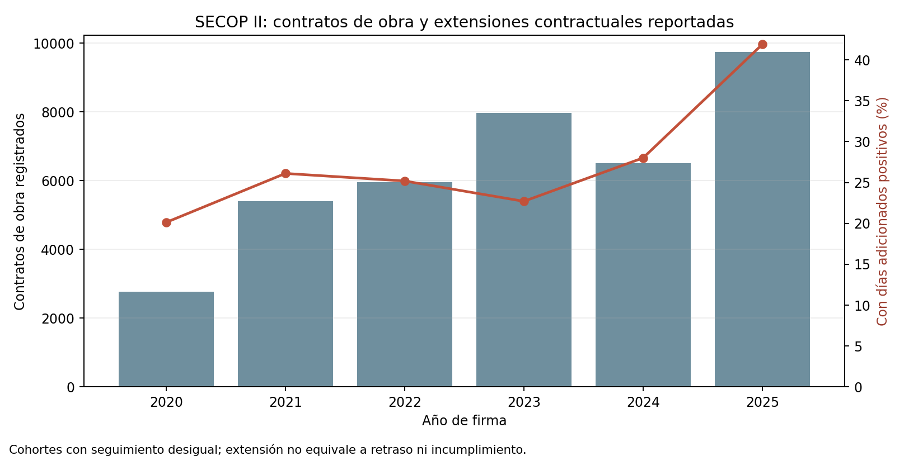

# SECOP II: proxy descriptivo de extensiones en contratos de obra

## Trailer ejecutivo

Un equipo de riesgos de construcción necesita distinguir las señales administrativas tempranas que pueden orientar una revisión de cartera de proyectos de los outcomes que realmente permiten medir pérdida de contratista. Este companion toma un alcance pequeño y auditable: resume los días de extensión contractual registrados para contratos tipo `Obra` de SECOP II, agrupados por año de firma. Usa solo tres campos de la fuente (tipo, fecha de firma y días adicionados), procesa la agregación en el API de Datos Abiertos y conserva respuestas agregadas sin nombres, documentos ni códigos de proveedor.

En el snapshot obtenido el 11 de noviembre de 2026, el API reportó 38.329 contratos firmados de 2020 a 2025 y 11.175 contratos con días de extensión positivos (29,2% del total). Esa cifra describe lo que está registrado en la fuente en este corte. No equivale a retraso frente al cronograma base, incumplimiento, pérdida, insolvencia o baja calidad del contratista: las extensiones pueden ser legítimas y su observación depende de duración, madurez, registro y estado del contrato. Los años recientes tienen menos ventana de seguimiento y no deben compararse como si tuvieran exposición uniforme.

La aplicación habilita una pregunta de monitoreo acotada: ¿qué parte de los contratos de obra registrados tiene tiempo adicionado en la ficha actual, por año de firma? No estima PD/LGD, no califica proveedores y no mide desempeño individual. Para riesgo de contraparte todavía se necesitan datos autorizados de proveedor/contrato, hitos base y reales, causas de modificación, terminación, sanciones validadas, reclamaciones, pagos y pérdida económica, más una revisión independiente.

## Arquitectura

```text
API SECOP II (Datos Abiertos, jbjy-vk9h)
  ├─ tipo_de_contrato = 'Obra' + fechas de firma 2020–2025
  └─ solo agregados anuales (conteos y suma de dias_adicionados)
        ↓
Snapshots JSON agregados, sin IDs ni campos de proveedor
        ↓
Conciliación anual: todos los contratos vs. días adicionados > 0
        ↓
CSV de métricas + gráfico de contexto + manifiesto con SHA-256
        ↓
Decisión habilitada: definir revisión de extensión administrativa,
no emitir score ni decisión adversa sobre un contratista
```

## Registro de decisiones y trade-offs

| Decisión | Trade-off | Razón |
|---|---|---|
| Usar los contratos oficiales SECOP II tipo `Obra` | Cubre contratación pública registrada, no contratos privados | Es una fuente primaria nacional, diaria y con campos explícitos de firma y días adicionados. |
| Consultar solo agregados por API | No conserva el detalle de cada contrato para segmentaciones posteriores | Evita descargar identificadores de proveedores/personas y reduce exposición de datos; el agregado responde la pregunta descriptiva definida. |
| Definir positividad como `dias_adicionados > 0` | No separa la causa ni el tipo de modificación | El campo registra extensión acumulada en días; no se reetiqueta como retraso o incumplimiento. |
| Agrupar por año de firma, 2020–2025 | Cohortes con distinta madurez y duración | Mantiene una tabla sencilla que se puede auditar; las comparaciones interanuales quedan expresamente limitadas. |
| Excluir valores monetarios | Se pierde una medida de tamaño económico del cambio | El campo de valor vigente no permite inferir por sí solo el valor inicial ni la adición incremental; no se calcula crecimiento contractual. |
| No calcular concentración por proveedor | No cuantifica dependencia o concentración de contraparte | Los campos de proveedor pueden identificar personas naturales; primero se requieren autorización, minimización, anonimización y un diseño de agregación aprobado. |

## Fuente, extracción y QA

Fuente primaria: [SECOP II - Contratos Electrónicos, CCE/Datos Abiertos](https://www.datos.gov.co/Gastos-Gubernamentales/SECOP-II-Contratos-Electr-nicos/jbjy-vk9h). Colombia Compra Eficiente identifica el conjunto como público y de actualización diaria en su [portal de datos abiertos](https://www.colombiacompra.gov.co/archivos/conjunto-datos-abier/contratos-electronicos). En el catálogo API, el campo `dias_adicionados` se describe como “días adicionados al contrato electrónico”; CCE explica que es el conteo de días calendario agregados frente a la fecha de terminación contractual que existía al firmar ([nota de SECOP II](https://www.colombiacompra.gov.co/wp-content/uploads/2024/09/act_secopii_21sep.pdf)).

- Corte de consulta: 2026-11-11; respuesta del API limitada a grupos anuales.
- Filtro: `tipo_de_contrato='Obra'`; `fecha_de_firma` desde 2020-01-01 inclusive hasta 2026-01-01 exclusive.
- Esquema fuente usado: `tipo_de_contrato`, `fecha_de_firma`, `dias_adicionados`.
- Filas de salida: 6 años de firma. No se descargaron contratos individuales.
- Integridad: conteo anual de contratos con días de extensión no excede total anual; suma anual de días coincide entre agregación de todos los contratos y agregación `dias_adicionados > 0`.
- Total de ventana: 38.329 contratos; 11.175 con días de extensión positivos; 1.102.493 días acumulados.
- SHA-256 de las respuestas agregadas y parámetros completos: `results/source_and_qa.json`.
- El registro de licencia en el portal de Datos Abiertos está vacío. El artefacto conserva agregados y atribución; no afirma términos de reutilización más amplios.

### Resultado descriptivo

| Año de firma | Contratos | Con días adicionados positivos | Proporción | Días adicionados reportados |
|---:|---:|---:|---:|---:|
| 2020 | 2.763 | 556 | 20,1% | 66.036 |
| 2021 | 5.401 | 1.410 | 26,1% | 160.099 |
| 2022 | 5.960 | 1.501 | 25,2% | 124.413 |
| 2023 | 7.965 | 1.808 | 22,7% | 160.645 |
| 2024 | 6.502 | 1.821 | 28,0% | 160.240 |
| 2025 | 9.738 | 4.079 | 41,9% | 431.060 |



El aumento de la tasa de 2025 no se interpreta como deterioro: el seguimiento, duración, madurez contractual y cobertura de registro difieren entre cohortes. El agregado no identifica si el tiempo fue solicitado por entidad, contratista o por una causa externa.

## Limitaciones y gobierno

Este companion **no es un modelo de contraparte** y no produce score, PD, pérdida, alerta de incumplimiento ni recomendación de adjudicación. Una adición puede obedecer a una modificación aprobada y a causas legítimas. El campo de días es una condición administrativa reportada, no el delta entre cronograma base y fecha real de terminación.

Quedan fuera: identificadores y nombres de proveedores, puntajes de concentración, montos incrementales, duración contractual comparable, hitos planeados/ejecutados, suspensiones justificadas, causas de prórroga, sanciones confirmadas, pagos, reclamaciones y pérdidas. No se descargaron datos personales. El API contiene otras columnas identificables y el uso de ellas requeriría una revisión de privacidad, minimización, licencia y finalidad específica.

Para subir de proxy descriptivo a validación empírica se requieren contratos enlazables con pseudónimo autorizado, calendario base versionado, cambios con tipo/causa/aprobación, hitos medidos, fecha real de entrega, controversias/sanciones verificadas, pagos y pérdidas netas. Se debería fijar horizonte, tratamiento de censura, comparación por tipo/entidad/tamaño, holdout temporal y validación independiente antes de cualquier decisión operacional. Las extensiones no son labels de default.

## Reproducción

Requiere Python 3 y `matplotlib`; el procesamiento de snapshots usa únicamente la biblioteca estándar.

```bash
python3 03-financial-risk/07-financial-and-construction-risk-lab/02-construction-enterprise-risk/04-contractor-counterparty-risk/observed-secop-works-extension-proxy/build_proxy.py
```

El comando regenera CSV, gráfico y QA JSON desde los dos snapshots de agregados incluidos. Para reconsultar SECOP II y reemplazar dichos snapshots:

```bash
python3 03-financial-risk/07-financial-and-construction-risk-lab/02-construction-enterprise-risk/04-contractor-counterparty-risk/observed-secop-works-extension-proxy/build_proxy.py --refresh
```

La segunda opción contacta el API público y sobreescribe dos respuestas agregadas; nunca solicita campos ni filas de proveedores.
