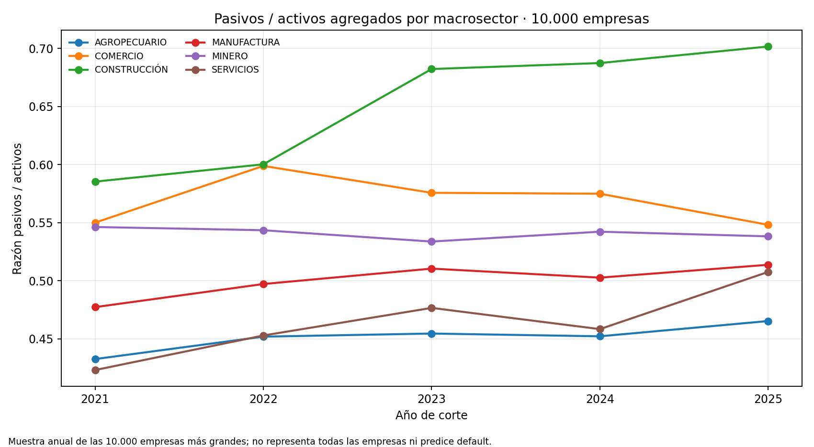

# Supersociedades: perfil financiero sectorial de grandes empresas

## Trailer ejecutivo

La revisión de riesgo corporativo necesita contexto financiero observado para entender cómo varía el apalancamiento contable entre sectores. Este companion resume cinco cortes anuales (2021–2025) de las 10.000 empresas más grandes reportadas por Supersociedades, con balances expresados por la fuente en billones de pesos. La salida agrupa por macrosector y año; no conserva NIT ni razón social. Permite comparar pasivos frente a activos agregados, la distribución de ratios empresariales y la proporción de empresas que reportan pérdidas dentro de esa muestra.

La decisión que habilita es de priorización analítica: identificar sectores y años que ameritan una revisión más detallada y definir qué variables deberían solicitarse en un análisis autorizado de contraparte. No estima probabilidad de default ni mide salud del universo empresarial. La muestra anual selecciona las 10.000 empresas de mayor tamaño y cambia entre cortes; sus cifras redondeadas tampoco permiten modelar correctamente empresas con patrimonio cercano a cero. Para una evaluación de contratistas hacen falta estados financieros enlazables bajo finalidad y permisos aprobados, identidad empresarial protegida, cronogramas y resultados contractuales verificados, eventos de incumplimiento y pérdidas netas.

## Arquitectura

```text
API Datos Abiertos / Supersociedades (6cat-2gcs)
  → campos financieros seleccionados; sin NIT ni razón social
  → parseo de valores COP en billones
  → razones contables por fila y agregación por año × macrosector
  → CSV agregado + gráfico + manifiesto SHA-256
  → contexto sectorial para priorizar revisión; sin score de proveedor
```

## Registro de decisiones

| Decisión | Alternativa descartada | Motivo |
|---|---|---|
| Agrupar por año y macrosector | Publicar o conservar perfiles empresariales individuales | Evita replicar identificadores de sociedades y responde una pregunta contextual sectorial. |
| Reportar pasivos/activos ponderado por activos y mediana de ratios por firma | Un único promedio de ratios individuales | La razón de sumas describe el apalancamiento agregado; la mediana muestra la empresa típica de la muestra. Son estadísticas distintas. |
| Mostrar pérdida contable como proporción descriptiva | Llamarla default o deterioro crediticio | Un resultado neto negativo no es incumplimiento y puede reflejar condiciones contables o sectoriales. |
| Mantener solo las cifras y campos publicados | Reconstruir razones con mayor precisión | La fuente entrega COP billones redondeados a dos decimales; una precisión adicional sería ficticia. |

## Fuente, resultado y límites

- Fuente primaria: [10.000 Empresas más Grandes del País](https://www.datos.gov.co/Comercio-Industria-y-Turismo/10-000-Empresas-mas-Grandes-del-Pa-s/6cat-2gcs), propietaria Supersociedades. La ficha indica que todas las cifras se presentan en billones de pesos. El conjunto contiene cinco cortes, 2021–2025, con 10.000 filas por corte.
- La entidad también ofrece [consulta SIIS de estados financieros históricos](https://www.supersociedades.gov.co/tramites-opa-y-consulta-de-informacion/-/asset_publisher/ltml/content/siis-consulta-de-estados-financieros-hist%C3%B3ricos-1), sin costo, para sociedades vigiladas/controladas y una muestra de inspeccionadas que reportan bajo NIIF 1/2; los valores allí se expresan en miles de pesos. Este companion usa exclusivamente la tabla abierta de las 10.000 empresas, no el reporte masivo SIIS.
- Consulta: 11 de noviembre de 2026. El manifiesto conserva el SHA-256 y los bytes del JSON que contiene únicamente siete campos financieros seleccionados; el snapshot empresarial crudo se mantiene fuera del repositorio.
- Se observan los cambios de composición de la muestra anual; no se sigue una cohorte fija de empresas. La clasificación sectorial corresponde a macrosectores amplios, no identifica necesariamente contratistas de construcción.
- No se infiere default, PD, LGD, liquidez, solvencia regulatoria ni desempeño de proveedor. No hay enlace a SECOP, proyectos, sanciones o pérdidas. La metadata del catálogo no explicita términos de licencia/reutilización.



## Reproducibilidad

Requiere Python 3, pandas y matplotlib. Descarga solo los campos financieros descritos, no nombres ni NIT:

```bash
curl -L --fail --silent --show-error 'https://www.datos.gov.co/resource/6cat-2gcs.json?$select=a_o_de_corte,macrosector,ingresos_operacionales,ganancia_p_rdida,total_activos,total_pasivos,total_patrimonio&$limit=50000' -o /ruta/local/empresas_10k_financial_fields.json
python3 03-financial-risk/07-financial-and-construction-risk-lab/02-construction-enterprise-risk/04-contractor-counterparty-risk/observed-supersociedades-corporate-financial-proxy/build_proxy.py --input /ruta/local/empresas_10k_financial_fields.json
```

El runner valida 50.000 filas, esquema y años; genera CSV sectorial, gráfico y manifiesto sin identificadores empresariales. Una nueva descarga puede cambiar el snapshot porque el recurso se actualiza; compara SHA y corte antes de interpretar diferencias.

## Uso y gobierno

El artefacto es una estadística descriptiva de una muestra empresarial. No debe alimentar decisiones individuales de crédito ni reemplaza un análisis de solvencia o estados auditados. Para uso institucional se requiere revisión de finalidad, derechos de uso, definiciones contables, emparejamiento autorizado, evaluación de calidad y revisión independiente. Si se construyera un modelo, su validación requeriría outcomes fechados y validados, ventana temporal, pruebas de robustez, backtesting y criterios de aceptación aprobados antes de uso.
