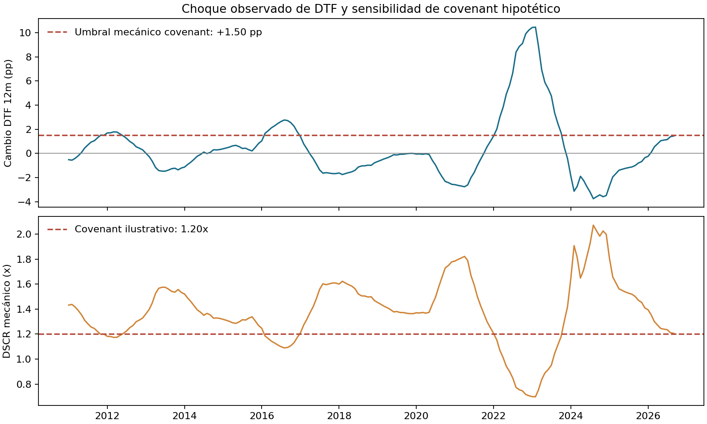

# Sensibilidad observada de DTF para un covenant hipotético

## Trailer ejecutivo

Cuando una obra tiene deuda a tasa variable, un comité de crédito necesita saber cuánto espacio queda antes de que un covenant de cobertura se acerque a su umbral. Esta aplicación combina cambios interanuales observados de la DTF mensual del Banco de la República con un balance, un CFADS, un servicio de deuda y un DSCR de covenant **explícitamente hipotéticos**. La sensibilidad permite ilustrar cómo un choque de tasa podría consumir holgura financiera bajo una transmisión mecánica de 100% al saldo expuesto. En septiembre de 2026, el cambio DTF frente a septiembre de 2025 fue +1,44 puntos porcentuales; sobre COP 100.000 millones repriciados completamente, equivale a COP 1.440 millones anualizados. Con CFADS de COP 15.000 millones, servicio base de COP 11.000 millones y umbral DSCR de 1,20x, el DSCR mecánico resultante es 1,21x y deja cerca de COP 60 millones de holgura anualizada. Esto habilita una conversación de sensibilidad y una lista de datos que pedir al patrocinador; no estima la probabilidad de incumplimiento ni evalúa una obra real.

## Flujo y arquitectura

```text
DTF mensual observada (derivado del Atlas BanRep)
        ↓ validar hash, calendario y mes completo
cambio de tasa frente a 12 meses antes
        ↓ transmitir 100% del cambio al saldo hipotético
interés incremental → servicio de deuda → DSCR y holgura
        ↓
CSV + resumen JSON + gráfico para discusión de covenant
```

## Registro de decisiones

| Decisión | Alternativa descartada | Justificación y costo |
|---|---|---|
| Usar el cambio interanual de DTF mensual | Pronosticar la tasa o convertirla en una distribución de shocks | Mantiene el ejercicio ligado a un cambio observado; no atribuye frecuencia futura ni probabilidades. |
| Mantener balance, CFADS, servicio base y covenant como parámetros hipotéticos visibles | Inferir estructura de deuda de la DTF | La serie pública no contiene exposición, calendario de repricing ni cobertura de una obra. El resultado depende directamente de estos supuestos. |
| Transmitir 100% del choque sobre todo el saldo | Modelar spreads, topes, pisos, amortización, coberturas y ventanas de revisión | Produce una cota/sensibilidad transparente. Puede sobrestimar o subestimar el efecto real. |
| Reportar DSCR mecánico y holgura monetaria | Etiquetar breach o estimar PD | No existe resultado contractual observado para calibrar un modelo de incumplimiento. |

El límite positivo de tasa compatible con el covenant se obtiene de `CFADS / DSCR_min - servicio_base`; luego se expresa como proporción del saldo expuesto. En este ejemplo es +1,50 pp. No se añade de nuevo la tasa base: se transmite únicamente el cambio interanual observado.

## Resultado y alcance

La muestra cerrada cubre 2010-01 a 2026-09 (201 meses). Para septiembre de 2026: DTF observada 10,20% EA; cambio en 12 meses +1,4403 pp; interés incremental mecánico +COP 1.440,3 millones/año; DSCR ilustrativo 1,206x; holgura ilustrativa aproximada COP 59,7 millones/año. Los cálculos se redondean en el texto y el CSV conserva precisión.



La serie de entrada es el derivado mensual del Atlas Económico, preparado desde respuestas SDMX del Banco de la República. El README de [Tesorería y ALM](../../../../../04-quant-strategy-and-products/treasury-and-alm/README.md) documenta la fuente original, el identificador de Drive, su hash disponible para el derivado y la limitación de que el original de Drive no está preservado localmente. Este companion valida el hash del derivado (`56e4e436cd7add0aac50dd8e1c29007fa173ed8e07e4b484633d19faa33c79ec`), los meses únicos y continuos, y que cada mes tenga observaciones iguales a sus días calendario. Octubre de 2026 queda fuera por estar parcial.

## Limitaciones, gobierno y uso

Este análisis no es una valoración crediticia, un pronóstico de tasas, una medición de DSCR histórico ni un modelo validado de incumplimiento. La DTF es una referencia de captaciones CDT a 90 días; una financiación de proyecto puede usar IBR u otra tasa, tener spread, períodos de reset, coberturas, topes, pisos, amortización, comisiones y definiciones contractuales distintas. CFADS y servicio de deuda también tienen definiciones contractuales y calendarios que aquí no existen. La tasa observada no se interpreta como escenario futuro probable.

Para una aplicación institucional, se requiere enlazar el contrato de crédito y su definición de DSCR, deuda y calendario de repricing, proyección aprobada de CFADS, coberturas, presupuesto y programa de obra. Un dueño del modelo independiente debe revisar unidades, transmisión de shocks, escenarios adversos, sensibilidad y conciliación con reportes financieros; los criterios de aceptación y límites deben fijarse antes de evaluar. Sin esa evidencia no se debe utilizar el resultado en originación, seguimiento, modificación de límites ni decisiones adversas. Alineación de diseño: sensibilidad y comunicación de escenarios conforme a prácticas de gestión de riesgo de ISO 31000 / COSO ERM; no implica certificación ni cumplimiento regulatorio.

## Reproducción

Desde la raíz del repositorio, con Python, pandas y matplotlib:

```bash
python3 03-financial-risk/07-financial-and-construction-risk-lab/02-construction-enterprise-risk/05-project-finance-covenants/observed-dtf-covenant-sensitivity/build_application.py
```

El runner lee el CSV DTF conservado en Tesorería y genera `results/dtf_covenant_sensitivity.csv`, `results/summary.json` y la figura. Balance, CFADS, servicio base y covenant se declaran al inicio del script para que el caso didáctico se pueda modificar deliberadamente; no son datos observados.
