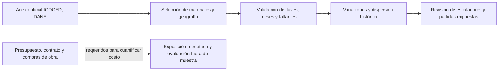

# Riesgo de inflación de materiales

## Resumen ejecutivo

Cuando el presupuesto de una obra se fija antes de comprar sus principales insumos, los cambios de costo pueden reducir el margen, presionar contingencias y volver insuficiente una cláusula de reajuste. La decisión práctica es identificar qué partidas requieren seguimiento, cobertura o negociación contractual con suficiente anticipación. Esta investigación propone medir la exposición de materiales mediante cantidades, precios, fechas de compra y condiciones contractuales; la relación económica de partida es `DeltaCost = sum_i quantity_i × deltaPrice_i`.

La señal pública de DANE ICOCED aporta un punto de referencia observable para esa conversación. Entre enero de 2022 y septiembre de 2026, en Bogotá y Cundinamarca, los índices cambiaron −4,31% para acero corrugado, +26,82% para cemento y +32,10% para concreto común. Si se mantienen fijas las ponderaciones de referencia de 2021 y se normalizan solo estos tres insumos, el cambio ponderado descriptivo es +19,25%. Este cálculo sirve para priorizar revisión de partidas y escaladores; no estima el sobrecosto de una obra ni la variación del basket completo.

La capacidad de decisión que se busca habilitar es concreta: contrastar el escalador contractual y el calendario de compras con señales históricas por insumo, y someter a sensibilidad las partidas expuestas. La evidencia actual valida que hay trayectorias oficiales diferenciadas para tres materiales en un dominio geográfico, pero no valida la ecuación de pérdida, los parámetros estocásticos ni la eficacia de una cobertura. El caso permanece en investigación y requiere costos observados de obra antes de cualquier afirmación de desempeño.

## Evidencia observada disponible

La aplicación oficial del laboratorio hermano [Inflación de materiales y suministro](../06-materials-inflation-and-supply-chain/README.md) extrae 57 observaciones mensuales por insumo desde la hoja `Anexo 7.2` del ICOCED de DANE. Consulta el [informe con resultados y método](../06-materials-inflation-and-supply-chain/results/official_report.md), las [trayectorias del índice](../06-materials-inflation-and-supply-chain/figures/icoced_indices.png), la [dispersión mensual](../06-materials-inflation-and-supply-chain/figures/icoced_volatility.png) y el [manifiesto de fuente y calidad](../06-materials-inflation-and-supply-chain/results/manifest.json).

| Insumo | Peso DANE, base 2021 | Cambio del índice, ene-2022 a sep-2026 | Implicación para revisar |
|---|---:|---:|---|
| Acero corrugado | 7,878% | −4,31% | Comparar el índice con cotizaciones y cláusulas de acero; el movimiento neto oculta variación mensual. |
| Cemento | 7,357% | +26,82% | Revisar periodicidad de reajuste, inventario y fecha de compra. |
| Concreto común | 10,112% | +32,10% | Revisar exposición presupuestal, ubicación, cotizaciones y sustitución técnicamente admisible. |

El +19,25% es un promedio de las tres trayectorias, ponderado con pesos de referencia de 2021 y renormalizado sobre esos tres materiales. No es una contribución oficial al ICOCED, porque se omiten los demás insumos y no se modela el cambio de cantidades, mezcla ni precios de la obra.

## Flujo de análisis



## Registro de decisiones

| Elección | Razón y coste de la elección |
|---|---|
| Usar ICOCED por insumo en vez de construir un índice propio | Conserva la metodología y cobertura publicadas por DANE; no entrega un índice único que represente el presupuesto de una obra. |
| Limitar esta edición a Bogotá y Cundinamarca | Evita mezclar dominios geográficos; no se debe transferir automáticamente a proyectos en otras zonas. |
| Usar desviación estándar y percentiles históricos como descriptivos | Permite comparar dispersión observada sin atribuir probabilidades futuras a una muestra corta. |
| Separar señal pública de pérdida de proyecto | Evita presentar índices de costo como facturas, impacto monetario, sobrecosto o evidencia de causalidad. |

## Limitaciones y gobierno del modelo

Este análisis es una aplicación descriptiva con fuente pública y no una implementación calibrada. No estima costos de compra, sobrecostos, retrasos, correlación condicional, pérdidas ni efecto de mitigaciones. El ICOCED mide cambios de costos de una canasta representativa con base diciembre de 2021 = 100; no es una cotización ni necesariamente replica el basket, contrato, proveedor o ubicación de una obra particular. La muestra observada termina en septiembre de 2026 y puede recibir revisiones o nuevas publicaciones.

Antes de uso decisorio cuantitativo se requieren presupuesto versionado y desagregado, cantidades, contratos y fórmulas de reajuste, cotizaciones y facturas, fechas de compra, ubicación, cronograma y resultados históricos de obras. Una validación independiente debe documentar: (1) correspondencia entre partidas e insumos y tratamiento de faltantes; (2) estabilidad de ponderaciones, geografías y rezagos; (3) comparación de índices con costos efectivamente pagados; (4) backtesting temporal fuera de muestra contra un baseline contractual determinista; (5) sensibilidad a shocks, sustituciones y errores de medición; y (6) criterios de aceptación definidos antes del análisis, como tolerancia de error monetario y cobertura de intervalos acordada por el dueño de riesgo. No se fija un umbral universal sin datos ni apetito de riesgo institucional.

El diseño apoya trazabilidad y asignación explícita de responsabilidades coherentes con prácticas de gestión de riesgos (ISO 31000/COSO ERM); esa correspondencia metodológica no constituye certificación ni cumplimiento regulatorio. Basilea e IFRS 9 no se invocan como requisitos directos de este cálculo de costos de construcción. No se autoriza uso productivo sin revisión independiente, linaje reproducible y aprobación de gobierno institucional.

## Reproducción

Desde [`06-materials-inflation-and-supply-chain`](../06-materials-inflation-and-supply-chain/README.md), ejecutar:

```bash
python3 scripts/run_official_application.py
```

El runner usa el snapshot versionado de DANE y requiere Python con `openpyxl`, `pandas` y `matplotlib`. Regenera serie extraída, resumen, manifiesto SHA-256, figuras e informe. Los resultados se reproducen con esa versión del archivo; una publicación posterior requiere actualizar deliberadamente corte y hash.

## Especificación pendiente

La extensión estocástica deberá definir unidades, fecha de información, horizonte, target, dependencia entre materiales, pass-through contractual y benchmark antes de estimar parámetros. La referencia determinista será la fórmula contractual vigente aplicada a cantidades y precios observados. Cualquier mejora deberá demostrar menor error fuera de muestra o una decisión de cobertura superior bajo criterios preacordados, con intervalos de incertidumbre y revisión independiente.
