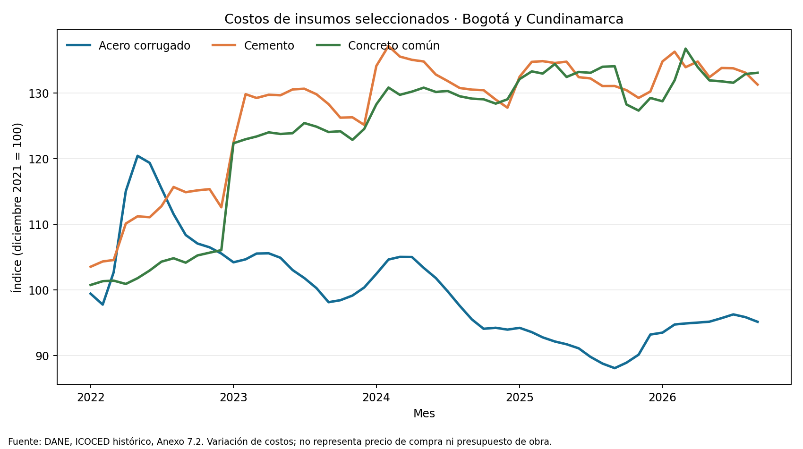
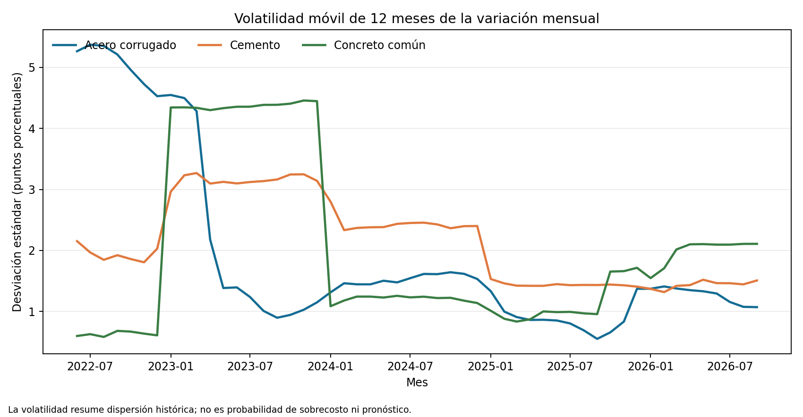

# Lectura oficial ICOCED: insumos materiales en Bogotá y Cundinamarca

**Corte de serie:** 2022-01 a 2026-09. **Grano:** insumo × dominio geográfico × mes. **Observaciones:** 171.

Esta aplicación convierte la serie oficial de costos del DANE en una señal externa para revisar escaladores, cláusulas de reajuste y sensibilidad de presupuestos. No valida una pérdida ni calcula el impacto sobre una obra específica.

## Resultados

| Insumo | Peso base 2021 (%) | Cambio del índice desde primer mes (%) | Desv. estándar mensual (pp) | P95 mensual (%) | Máximo mensual (%) |
|---|---:|---:|---:|---:|---:|
| Acero corrugado | 7.878 | -4.31 | 2.310 | 3.654 | 12.041 |
| Cemento | 7.357 | 26.82 | 2.202 | 5.456 | 8.750 |
| Concreto común | 10.112 | 32.10 | 2.346 | 2.578 | 15.370 |

## Lectura para decisión

Las series permiten identificar insumos con mayor dispersión histórica y orientar una revisión de coberturas, escalación contractual o frecuencia de actualización presupuestal. El uso operativo requiere mapear cantidades y fechas de compra del proyecto a estos índices, y verificar el contrato y la geografía aplicable. Los percentiles históricos son escenarios descriptivos; no deben presentarse como probabilidades futuras.

## Calidad, linaje y límites

El snapshot oficial contiene dimensiones 19,955 × 1,135; la extracción retuvo 171 filas de la selección. Claves duplicadas en las series: 0. Celdas mensuales ausentes o no numéricas omitidas: 0. No se imputaron observaciones.

SHA-256 del Excel: `c858c33819bbc2fc6db3e80aa971be07991e06aa2914330f7ae0da95e4d1b63b`. Fuente DANE: https://www.dane.gov.co/files/operaciones/ICOCED/anex-ICOCED-sep2026.xlsx

ICOCED reemplazó el ICCV tras el rediseño de 2021 y expresa variaciones de costo con base diciembre de 2021 = 100. El índice no es un nivel de precio, una cotización, ni el costo total de construcción. El basket del DANE, sus ponderaciones y la cobertura geográfica no representan necesariamente un proyecto o empresa.

## Figuras

## Reproducción

Desde esta carpeta: `python3 scripts/run_official_application.py`. Requiere `openpyxl`, `pandas` y `matplotlib`; usa el snapshot local y genera las series, el manifiesto, resumen y figuras.
