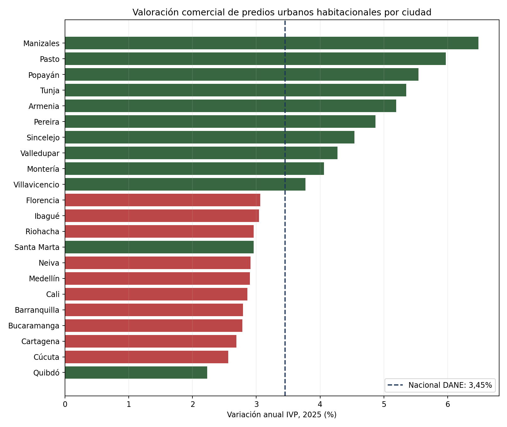

# DANE IVP: variación observada del valor comercial residencial

## Uso ejecutivo

La adquisición de suelo y la valoración residual dependen del valor de salida esperado, pero una referencia pública de vivienda no equivale al precio de un lote. Este companion incorpora el **Índice de Valoración Predial (IVP) del DANE** para comparar la variación anual del valor comercial de predios urbanos habitacionales en 22 ciudades entre 2024 y 2025. Sirve como contexto de mercado para discutir supuestos de valorización y escenarios; no estima el valor residual de un proyecto.

La variación nacional reportada por DANE en 2025 fue 3,45%. Entre ciudades, el IVP varió de 2,23% en Quibdó a 6,48% en Manizales. Diez ciudades superaron el promedio nacional. El cambio entre 2024 y 2025 no fue uniforme: la serie derivada muestra cambios en puntos porcentuales, no rendimientos acumulados ni precios de venta.



## Fuente, diseño y trazabilidad

- Productor: [DANE, boletín técnico IVP 2025](https://www.dane.gov.co/files/operaciones/IVP/bol-IVP-2025.pdf), Tabla 1 (variación anual total y por ciudad, 2024–2025).
- Serie histórica y cobertura: [página oficial DANE del IVP](https://www.dane.gov.co/index.php/estadisticas-por-tema/precios-y-costos/indice-de-valoracion-predial-ivp).
- Unidad de observación: predios urbanos con destino económico habitacional; resultados anuales por ciudad.
- La cobertura del IVP comprende 22 ciudades y excluye Bogotá. Los valores de las 22 ciudades fueron transcritos de la tabla oficial y versionados en `city_variations_2024_2025.csv`; `results/source_quality_manifest.json` registra SHA-256, corte y controles. La cifra nacional de 3,45% es reportada por DANE; no se reconstruye como promedio simple de ciudades.

## Interpretación y limitaciones

El IVP sigue la variación promedio de valores comerciales de predios habitacionales muestreados. **No es un índice de suelo vacante, valor unitario de terreno, oferta publicada, precio de transacción ni métrica de absorción.** Tampoco captura características, norma, edificabilidad, costos de urbanismo, obligaciones ni calendario de un lote. El índice es contexto del valor del activo residencial construido y puede apoyar escenarios de salida/collateral, con cobertura distinta de IPVN.

Por tanto, el companion no valida aplicación específica del modelo residual. La valoración de un lote requiere comparables de terreno en microzona, área, uso permitido, edificabilidad, cargas urbanísticas, fecha de observación y condiciones de transacción; para validar el residual se requieren adquisiciones y ventas autorizadas enlazadas con presupuestos y resultados de proyectos.

## Reproducción

Requisitos: Python 3 y `matplotlib`.

```bash
python3 run_companion.py
```

Genera `results/ivp_city_changes_2024_2025.csv`, el manifiesto QA y `figures/ivp_city_variation_2025.png`. El runner valida 22 ciudades únicas, rango reportado (2,23%–6,48%) y conserva explícita la distinción entre cifra nacional oficial y promedio municipal simple.
