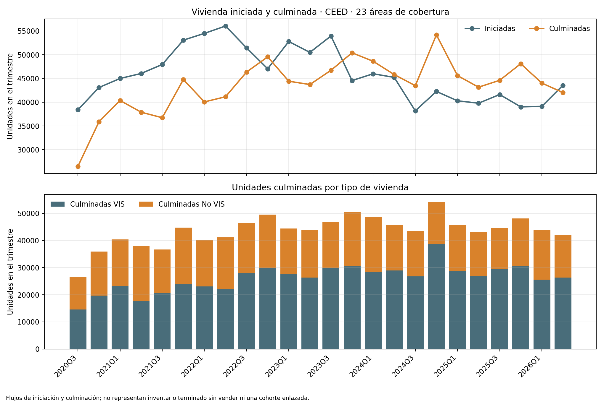

# CEED DANE: flujo de vivienda iniciada y culminada

## Trailer ejecutivo

El riesgo de inventario inmobiliario requiere distinguir las unidades que entran al mercado de las que están disponibles, se venden o permanecen sin vender. El Censo de Edificaciones (CEED) de DANE permite observar una parte concreta de ese ciclo: flujos trimestrales de vivienda iniciada y culminada, desagregados entre VIS y No VIS. Este companion procesa el anexo agregado del II trimestre de 2026 y construye una serie de 24 trimestres, desde 2020-III hasta 2026-II, para las 23 áreas de cobertura del CEED.

En 2026-II se reportaron 43.565 unidades iniciadas y 42.037 culminadas; 26.306 de las culminadas fueron VIS y 15.731 No VIS. Las culminaciones trimestrales bajaron 2,6% frente a 2025-II y el acumulado de cuatro trimestres disminuyó 4,1% frente a los cuatro anteriores. La razón culminadas/iniciadas de 0,965 es solo una comparación de dos flujos del mismo trimestre: **no** es tasa de venta ni variación de inventario, porque las unidades que culminan no necesariamente pertenecen a la misma cohorte que las iniciadas.

La señal permite contextualizar cuánto producto residencial llega a culminación en las áreas cubiertas y orientar escenarios agregados de nueva oferta. No observa unidades disponibles sin vender, precios por proyecto, descuentos ni tiempo en mercado. Por eso no estima absorción, elasticidad ni riesgo de inventario individual. Para esas decisiones se requieren unidades en oferta y ventas por obra/proyecto, precios y fechas de entrada/salida, con autorización de datos y evaluación independiente.

## Arquitectura

```text
DANE · anexo CEED II trimestre 2026
  → tablas trimestrales de iniciación y culminación (VIS / No VIS)
  → conciliación cruzada entre anexos M y O
  → serie de flujos por trimestre + variación interanual
  → CSV agregado, gráfico y manifiesto de origen/hash
  → contexto de oferta culminada; sin proxy de unidades sin vender
```

## Registro de decisiones

| Decisión | Alternativa descartada | Justificación |
|---|---|---|
| Usar unidades iniciadas y culminadas por trimestre | Llamarlas inventario disponible | Son flujos de producción; el inventario es un saldo que requiere ventas y bajas por periodo. |
| Comparar VIS y No VIS | Mezclar ambas tipologías en una sola curva | Conserva diferencias de composición del producto, sin inferir precios o velocidad de venta. |
| Conciliar culminaciones de Anexo M con Anexo O | Confiar solo en una tabla | Las dos tablas agregadas del mismo workbook deben coincidir para cada uno de los 24 periodos. |
| Mantener cobertura del CEED | Extrapolar a todo el país | El universo reportado corresponde a áreas urbanas/metropolitanas incluidas en el operativo, no a cobertura nacional total. |

## Fuente, resultados y límites

- Fuente: [Censo de Edificaciones CEED, DANE](https://www.dane.gov.co/index.php/estadisticas-por-tema/construccion/censo-de-edificaciones); archivo [anex-CEED-IItrim2026.xlsx](https://www.dane.gov.co/files/operaciones/CEED/anex-CEED-IItrim2026.xlsx), anexos M y O. El CEED se actualiza trimestralmente; el anexo corresponde al II trimestre de 2026.
- SHA-256 del workbook procesado: `fdc1661d5979136c0d0df622b85fcca40fc82e516921e0b879710b143e65e625`. El workbook completo no se incluye en el repositorio.
- El runner verifica periodos, sumas VIS/No VIS, total de unidades y conciliación independiente entre ambos anexos antes de escribir la serie.
- El catálogo de microdatos del CEED documenta que la operación hace seguimiento a unidades culminadas hasta que se venden y recoge ventas/precios por unidad; esa información microdata no se usó aquí. El presente companion usa solo el workbook agregado publicado.
- Se conserva la atribución de fuente: **Fuente: Departamento Administrativo Nacional de Estadística: www.dane.gov.co.** Los términos de redistribución específicos del workbook agregado no están explícitos en la página de publicación; no se almacena el archivo fuente ni el microdato.
- Este anexo M/O de flujos no observa unidades culminadas por vender, velocidad de absorción, cambios de precio, incentivos comerciales ni outcomes de proyecto. El saldo de unidades culminadas sin vender sí está disponible en otra serie pública CEED; véase el [companion de inventario terminado](../observed-dane-ceed-unsold-completed-stock/README.md).



## Gobierno y reproducibilidad

El uso es descriptivo. No combinar este flujo con el IPVN como si fueran observaciones independientes: ambos proceden de la operación CEED. Tampoco inferir nacionalidad completa, exceso de oferta o deterioro crediticio a partir del flujo aislado. Para validar un modelo de inventario se necesitan stocks por proyecto, aperturas y cierres de oferta, ventas netas, desistimientos, precio vigente, fecha de observación y tipología, además de backtesting temporal y aceptación independiente.

Requiere Python 3, pandas, openpyxl y matplotlib. Descarga el anexo oficial fuera del repositorio y regenera los resultados:

```bash
curl -L --fail --silent --show-error 'https://www.dane.gov.co/files/operaciones/CEED/anex-CEED-IItrim2026.xlsx' -o /ruta/local/anex-CEED-IItrim2026.xlsx
python3 03-financial-risk/07-financial-and-construction-risk-lab/02-construction-enterprise-risk/07-real-estate-inventory-and-pricing/observed-dane-ceed-housing-supply-flow/build_companion.py --input /ruta/local/anex-CEED-IItrim2026.xlsx
```
