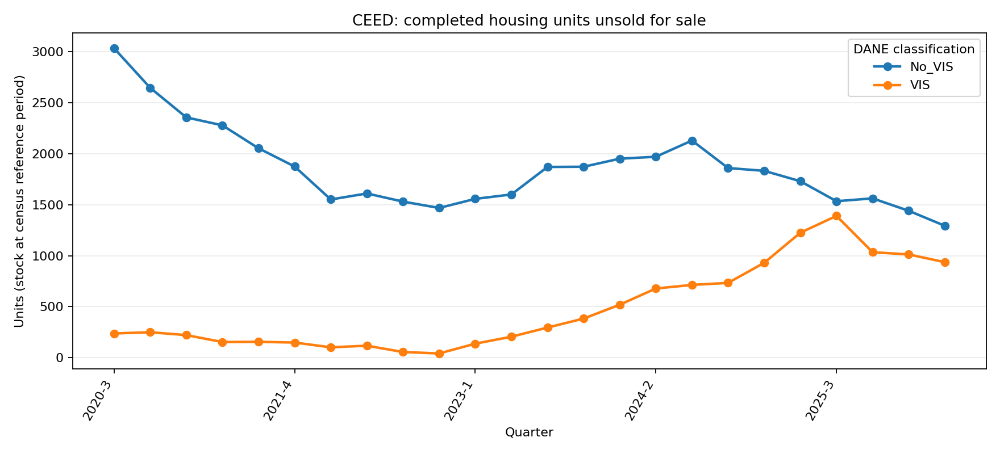

# CEED DANE: saldo de vivienda culminada sin vender

## Trailer ejecutivo

Un desarrollador o financiador necesita distinguir el flujo de nuevas viviendas de la exposición que permanece en inventario terminado. El anexo público de series VIS/No VIS del Censo de Edificaciones (CEED) publica un saldo trimestral de unidades culminadas sin vender. Este companion agrega ese saldo por tipología VIS/No VIS para las 23 áreas cubiertas por CEED, de 2020-III a 2026-II. En el último trimestre disponible, el saldo publicado suma 2.229 unidades: 936 VIS y 1.293 No VIS.

La señal sirve para contextualizar escenarios agregados de vivienda terminada que aún no se vende y para observar su evolución. Puede orientar qué segmentos o áreas requieren indagación adicional de inventarios y ayudar a contrastar planes de oferta agregada con el stock publicado. No mide el inventario total en preventa o en construcción, absorción mensual, antigüedad de cada unidad, desistimientos, precios, descuentos ni rotación por proyecto. Por tanto, no basta para estimar la probabilidad de venta o pérdida de un proyecto ni para tomar una decisión de crédito individual.

## Arquitectura

```text
DANE · archivo agregado de series VIS/No VIS
  → hoja Saldos (municipio, periodo, VIS/No VIS, venta/no venta, unidades)
  → filtro VENTA_SN = 1 y suma de TIP_SALDO por trimestre y VIS/No VIS
  → controles de cobertura temporal, categorías y valores no negativos
  → CSV agregado + gráfico + manifiesto SHA-256
  → señal de inventario terminado para análisis de contexto
```

## Registro de decisiones

| Decisión | Alternativa | Motivo |
|---|---|---|
| Usar `Saldos` y `TIP_SALDO` como saldo de vivienda culminada sin vender | Construir el inventario como culminaciones acumuladas menos ventas observadas en otra fuente | La guía DANE define explícitamente `TIP_SALDO` en Saldos como stock sin vender de obras culminadas; no requiere empalmar cohortes incompatibles. |
| Filtrar `VENTA_SN = 1` | Incluir vivienda construida para arriendo, donación o uso propio | El objetivo es el stock construido para venta. |
| Reportar solo agregado por trimestre y VIS/No VIS | Publicar registros municipales individuales | Mantiene la salida acotada al indicador descriptivo y a la unidad de análisis documentada; el libro no se redistribuye. |
| Tratarlo como inventario terminado, no como oferta comercial completa | Llamarlo preventa, absorción o inventario total | La fuente no cubre todos los estados de comercialización ni identifica una cohorte de ventas netas. |

## Fuente, resultado y límites

- Fuente oficial: [CEED históricos DANE](https://www.dane.gov.co/index.php/estadisticas-por-tema/construccion/censo-de-edificaciones/ceed-historicos), archivo [Serie Tipo Base de unidades iniciadas y culminadas VIS/No VIS, II trimestre de 2026](https://www.dane.gov.co/files/operaciones/VISNoVIS/anex-VISNoVIS-SerieTipoBaseInicCulm-IItrim2026.xlsb).
- Comparador histórico: [boletín DANE VIS/No VIS, IV trimestre de 2024](https://www.dane.gov.co/files/operaciones/VISNoVIS/bol-VISNoVIS-IVtrim2024.pdf), con series publicadas por trimestre para unidades culminadas sin vender.
- La [guía oficial de uso de series](https://www.dane.gov.co/files/operaciones/VISNoVIS/doc-VISNoVIS-GuiaUsoSeries.pdf) documenta `Saldos` por periodo, municipio, destino, estrato, venta/no venta y VIS/No VIS; define el saldo como unidades sin vender de obras culminadas en el periodo de análisis. La cobertura declarada de esta serie es de 23 áreas.
- La cifra del último trimestre se recalcula desde el anexo: 2.229 unidades (936 VIS y 1.293 No VIS). Es un saldo de la operación estadística dentro de su cobertura, no una estimación nacional del inventario residencial.
- Control contra boletines publicados: el archivo II-2026 reproduce exactamente los totales publicados por DANE IV-2024 para 2024-I (2.470) y 2024-IV (2.592). En 2024-II arroja 2.648 (678 VIS + 1.970 No VIS), frente a 2.634 (679 + 1.955) en el boletín; para 2024-III arroja 2.842 (713 + 2.129), frente a 2.834 (713 + 2.121). Las diferencias de +14 y +8 unidades quedan en [`historical_bulletin_checks.csv`](data/historical_bulletin_checks.csv). Se conserva el vintage del archivo más reciente y no se atribuyen las diferencias a una causa confirmada.
- Archivo fuente fuera del repositorio; SHA-256, nombre, campos, filtro y método de agregación quedan en `data/source_manifest.json`. Se conserva el derivado agregado y la cita de DANE; verificar términos de reutilización de la fuente antes de redistribuirlo en otros canales.
- No observa casas/unidades en preventa canceladas, ventas netas, contratos, precios individuales, edad del inventario, vacancia ni resultados crediticios. La población cubierta por CEED no equivale a todos los proyectos ni a toda Colombia.



## Gobierno, regulación y uso

La salida es descriptiva y no constituye un modelo de riesgo ni una métrica regulatoria. El diseño aplica disciplina compatible con principios de calidad y trazabilidad estadística: conserva la fuente y el vintage, registra hash y transformación, filtra explícitamente las viviendas para venta y no extrapola cobertura. El indicador puede aportar contexto macrosectorial a un análisis de riesgo de construcción o crédito; no calcula requerimientos de capital de Basilea ni reemplaza las definiciones institucionales de exposición, default o pérdida.

Para un uso de decisión se requiere una evaluación independiente: verificar la definición/continuidad de `TIP_SALDO`, conciliar agregaciones con archivos publicados posteriores, evaluar revisiones y cambios de cobertura, medir sensibilidad a municipios faltantes y probar estabilidad temporal. Criterio de aceptación de este companion: fuente y hash reproducibles, 24 trimestres consecutivos, categorías VIS válidas y saldos no negativos; la conciliación con boletines históricos queda sujeta a las diferencias anteriores. No se ha hecho backtesting predictivo ni validación de un modelo porque el insumo es una serie descriptiva y carece de outcomes de ventas/cancelaciones.

## Reproducibilidad

Requiere Python 3.10+, `pandas`, `pyxlsb` y `matplotlib`.

```bash
python -m pip install pandas pyxlsb matplotlib
curl -L --fail --silent --show-error \
  'https://www.dane.gov.co/files/operaciones/VISNoVIS/anex-VISNoVIS-SerieTipoBaseInicCulm-IItrim2026.xlsb' \
  -o /tmp/anex-VISNoVIS-SerieTipoBaseInicCulm-IItrim2026.xlsb
python 03-financial-risk/07-financial-and-construction-risk-lab/02-construction-enterprise-risk/07-real-estate-inventory-and-pricing/observed-dane-ceed-unsold-completed-stock/build_companion.py \
  --input /tmp/anex-VISNoVIS-SerieTipoBaseInicCulm-IItrim2026.xlsb
```
