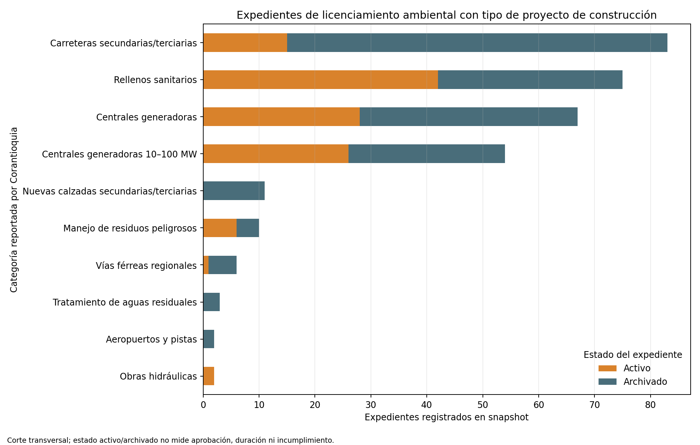

# Licenciamiento ambiental: inventario agregado de Corantioquia

## Trailer ejecutivo

Los proyectos de infraestructura pueden requerir licencias ambientales y permisos cuyo seguimiento condiciona la secuencia de inversión y obra. Para dar contexto a esa exposición, este companion utiliza el conjunto público de expedientes de Corantioquia y agrega por municipio, tipo de proyecto y estado reportado. En el corte consultado hay 1.790 expedientes agregados; 317 pertenecen a 13 categorías cuyo nombre inicia por “Construcción” o “Construc”, distribuidas en 74 municipios. Entre esos expedientes, 122 aparecen como activos y 195 como archivados.

La aplicación ayuda a dimensionar dónde y para qué tipos de proyecto existe actividad de licenciamiento ambiental en la jurisdicción de Corantioquia, y a diseñar preguntas para un registro interno de permisos. No estima tiempo de aprobación ni retraso: la fuente no trae fechas de radicación, requerimiento, decisión, ejecutoria o cierre. “Activo” y “Archivado” son estados del expediente y no significan aprobación, rechazo, cumplimiento ambiental o ejecución de obra. El resultado no puede interpretarse como desempeño de una autoridad ni riesgo de una obra individual.

## Arquitectura

```text
Datos Abiertos · Corantioquia (h6gr-4izn)
  → agregación API por municipio × tipo de proyecto × estado
  → filtro explícito por rótulos de tipo de proyecto de construcción
  → conciliación de los 679 grupos con los 1.790 expedientes del snapshot
  → conteos por tipo, estado y municipio + gráfico y manifiesto SHA-256
  → contexto para diseñar linaje y seguimiento de permisos de proyectos
```

## Registro de decisiones

| Decisión | Alternativa descartada | Justificación |
|---|---|---|
| Consultar y guardar solo conteos agregados | Retener expedientes individuales | La pregunta es cobertura por tipo/municipio/estado; la agregación excluye identificador interno y reduce riesgo de exposición innecesaria. |
| Incluir tipos cuyo rótulo empieza con “Construcción” o “Construc” | Incluir toda extracción de materiales de construcción | La extracción se conserva bajo categorías mineras, no se mezcla con licencias de proyectos constructivos. |
| Interpretar `Activo`/`Archivado` literalmente como estado de expediente | Tratarlos como aprobación, rechazo o finalización de obra | La fuente no define estados de resultado, hitos ni fechas que soporten esa equivalencia. |
| Mantener la jurisdicción local identificada | Extrapolar a Colombia | Corantioquia cubre su área de jurisdicción; no es un registro nacional de licencias. |

## Fuente, corte y resultado

- Fuente primaria: [Licencias ambientales en la jurisdicción de Corantioquia, recurso `h6gr-4izn`](https://www.datos.gov.co/Ambiente-y-Desarrollo-Sostenible/Licencias-ambientales-en-la-jurisdicci-n-de-Corant/h6gr-4izn). La ficha señala que cada registro corresponde a un expediente y describe tipo de proyecto, estado y municipio.
- Corte API: 11 de noviembre de 2026. La fecha de actualización visible en la metadata del conjunto es 1 de noviembre de 2026.
- El snapshot incluido contiene únicamente cuatro campos agregados: municipio, tipo de proyecto, estado y conteo de expedientes. SHA-256: `3091cd206a5fdb79cd0b1e528cd03472b1440ecabb868ee355b5a5887a61be13`.
- De 1.790 expedientes, el filtro incluye 317 asociados a 13 rótulos de proyecto constructivo en 74 municipios. En este subconjunto, 122 están marcados activos y 195 archivados.
- Las categorías con más expedientes incluyen carreteras de redes secundaria/terciaria (83), rellenos sanitarios (75) y centrales generadoras (67). La etiqueta corresponde al tipo del trámite; no confirma que el proyecto haya sido aprobado o ejecutado.
- Los términos de licencia o reutilización no aparecen explícitos en la metadata consultada; confirmar condiciones antes de redistribuir más allá de este agregado atribuido.



## Limitaciones y gobierno

- No hay fechas de solicitud, respuesta, aprobación, ejecutoria, suspensión o cierre: no se calculan duraciones, colas, supervivencia ni demoras regulatorias.
- El estado activo/archivado no determina si se otorgó la licencia ni el resultado ambiental o jurídico.
- La cobertura es Corantioquia, no toda Colombia; las 74 localidades del subconjunto no son un ranking de riesgo.
- No se enlazan empresas, contratos SECOP, obras, presupuestos, cronogramas, ubicaciones precisas ni outcomes.
- Para validar un modelo de demora hacen falta expedientes con hitos fechados y versionados, causas de requerimientos/suspensiones, reglas de censura, características del trámite y una ventana holdout. Se requeriría además revisión independiente y autorización institucional antes de uso.

## Reproducibilidad

Requiere Python 3, pandas y matplotlib. El runner por defecto regenera CSV, gráfico y manifiesto desde el snapshot agregado versionado:

```bash
python3 03-financial-risk/07-financial-and-construction-risk-lab/02-construction-enterprise-risk/08-permit-environmental-and-regulatory-delay/observed-corantioquia-environmental-permits/build_proxy.py
```

Para refrescar manualmente el snapshot agregado desde el API:

```bash
curl -L --fail --silent --show-error 'https://www.datos.gov.co/resource/h6gr-4izn.json?$select=municipio,tipo_proyecto,estado,count(*)%20as%20expedientes&$group=municipio,tipo_proyecto,estado&$limit=50000' -o /ruta/local/corantioquia_permits_aggregated.json
python3 03-financial-risk/07-financial-and-construction-risk-lab/02-construction-enterprise-risk/08-permit-environmental-and-regulatory-delay/observed-corantioquia-environmental-permits/build_proxy.py --input /ruta/local/corantioquia_permits_aggregated.json
```

El runner valida esquema, estados, total de expedientes y la regla de selección antes de producir resultados.
