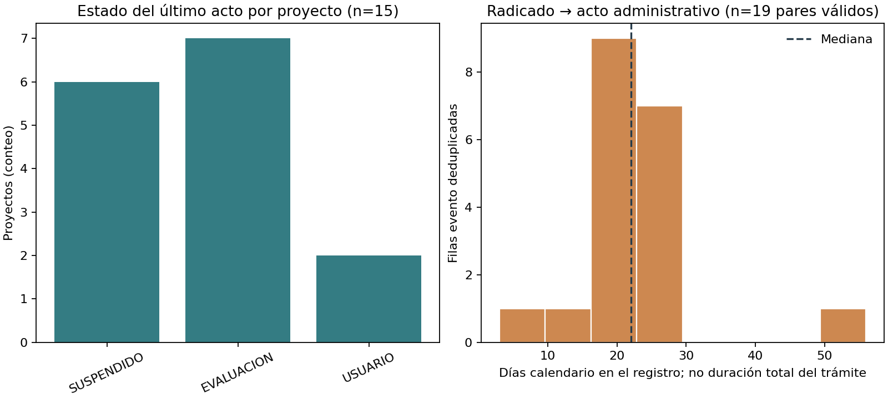

# ANLA: fechas de radicación y acto en proyectos de infraestructura en evaluación

## Trailer ejecutivo

La evaluación ambiental puede condicionar el camino crítico de una obra, pero un conteo de permisos no dice cuánto tiempo transcurre entre una actuación y otra. Esta aplicación toma la capa pública de proyectos de ANLA en etapa de evaluación, filtra el sector oficial `Infraestructura` y compara las fechas `FECHA_RADICADO` y `FEC_ACT_AD` que aparecen juntas en el registro. En el corte consultado el 11 de noviembre de 2026, 77 geometrías se redujeron a 19 combinaciones distintas de proyecto, acto y radicado, correspondientes a 15 expedientes. Los 19 pares tenían orden cronológico no negativo; la mediana del lapso registrado fue 22 días calendario, el percentil 90 (nearest rank) 28 días y el máximo 56 días. Es una señal observada de intervalos entre hitos registrados en el snapshot. Puede ayudar a orientar preguntas de due diligence sobre secuencias y calidad de expedientes, pero no mide duración total de licenciamiento, retraso de obra ni incumplimiento regulatorio. La fuente registra proyectos todavía en estados EVALUACION, SUSPENDIDO y USUARIO, no una cohorte cerrada de decisiones. Para decidir sobre una obra se necesitan las actuaciones completas del expediente, la fecha de radicación completa, suspensiones y respuestas, fecha de decisión, cronograma contractual y causalidad documentada.

## Arquitectura de alto nivel

```text
Feature Service público de ANLA
  └─ capa de polígonos en evaluación, sector 102 (Infraestructura)
       ↓ solicitar solo expediente/acto/radicado/fechas/estado/sector
Deduplicar fragmentos geométricos a proyecto–acto–radicado
       ↓ separar fechas faltantes o cronológicamente negativas
Agregados por estado + distribución de días calendario
       ↓
CSV agregado + resumen de linaje/QA + figura
       ↓
Contexto para preguntar por hitos; no medir demora total ni retraso de obra
```

## Registro de decisiones

| Decisión | Trade-off | Razón |
|---|---|---|
| Usar solo la capa de evaluación y sector `102` | Excluye seguimiento y otros sectores regulados por ANLA | Mantiene una población relevante a permisos de infraestructura y evita sumar sectores heterogéneos. |
| Usar pares de fechas en la misma fila | No representa una cohorte de inicio a decisión | El esquema expone fecha de radicado y fecha de acto, pero no define un hito inicial completo y un hito final de decisión para el ciclo entero. |
| Deduplicar por expediente, sector, número/fecha de acto, estado, radicado y fecha de radicado | No mantiene la geometría segmentada ni permite analizar tramos espaciales | La capa poligonal repite eventos por fragmentos espaciales; el companion conserva solo agregados sin identificadores. |
| Reportar días calendario y estadísticas descriptivas | No aplica días hábiles, términos normativos o correcciones por pausas | El extracto no incorpora tiempos suspendidos, requerimientos y respuestas en secuencia completa, ni clasificación legal de cada evento. |
| Excluir del resumen pares negativos o incompletos | No se imputan fechas ni se arreglan inconsistencias | Evita fabricar intervalos; cada exclusión se cuenta en QA. En este corte el filtro de infraestructura no produjo exclusiones. |

## Resultado reproducible

| Métrica del corte | Valor |
|---|---:|
| Geometrías recibidas | 77 |
| Filas únicas de proyecto–acto–radicado | 19 |
| Expedientes únicos (solo conteo; no se conservan IDs) | 15 |
| Pares de fechas válidos | 19 |
| Mediana / p90 / máximo del lapso radicado–acto | 22 / 28 / 56 días calendario |
| Estado del último acto por expediente | 7 EVALUACION; 6 SUSPENDIDO; 2 USUARIO |
| Ventana de fechas de radicación | 2024-09-01 a 2026-10-20 |



## Fuente, linaje y calidad

- Portal: [Datos Abiertos ANLA](https://datosabiertos-anla.hub.arcgis.com/).
- Ítem: [Proyectos ANLA Evaluación](https://www.arcgis.com/home/item.html?id=fab4a3ec84de4b1c9549ce63b01a0524), descrito por ANLA como georreferenciación de proyectos de competencia de la entidad en sectores de agroquímicos, energía, hidrocarburos, infraestructura y minería, en etapa de evaluación.
- Endpoint usado: [FeatureServer, capa 2 “Area Proyecto Evaluacion”](https://portalsig.anla.gov.co/publico/rest/services/PROYECTOS_ANLA/ProyectosANLA_Evaluacion/FeatureServer/2). El dominio de `sector` define el código `102` como Infraestructura.
- Campos solicitados: `expediente`, `sector`, `num_act_ad`, `fec_act_ad`, `estado`, `radicado` y `fecha_radicado`. Se omite geometría y no se consultan nombre/operador del proyecto.
- QA en el corte: 77 filas geométricas; 19 combinaciones proyecto–acto–radicado después de deduplicar; 15 expedientes distintos; cero fechas faltantes o negativas en este sector/corte. El resumen conserva la huella SHA-256 de la respuesta consultada, fecha UTC, parámetros, conteos y medidas agregadas. No se persiste la respuesta con IDs.
- No se encontró una declaración de licencia de reutilización en los metadatos del ítem. La publicación es accesible desde el portal oficial; este companion conserva atribución y resultados agregados.

## Limitaciones y gobierno

El intervalo reportado es la diferencia calendario entre dos fechas que coexisten en una fila de la capa pública. **No se interpreta como tiempo de evaluación, respuesta a una solicitud completa, tiempo hasta decisión, demora o retraso de la obra.** No se verificó que la fecha de radicado sea siempre la primera radicación ni que el acto sea la resolución final; los registros corresponden a proyectos aún mostrados en etapa de evaluación. El estado SUSPENDIDO no identifica por sí solo motivo, duración, responsable ni fecha de reanudación. Tampoco se incluyen requerimientos y respuestas, consultas previas, etapas externas, cronograma contractual ni impactos de costo. La unidad de análisis y la deduplicación son proxies creados para describir el registro espacial.

Para estimar un tiempo de trámite se requeriría un extracto autorizado y versionado de todas las actuaciones, con fecha de solicitud completa, requerimientos, respuesta del usuario, suspensiones/reanudaciones, acto definitivo y norma/término aplicable; además habría que fijar tratamiento de censura, pausas, cambios de alcance y tiempos de terceros. Para atribuir retraso a una obra se necesitarían hitos del cronograma base y real, ruta crítica, causas y consecuencias económicas. Una revisión independiente debería reconciliar expedientes contra VITAL/SILA y fijar aceptación antes del uso. Este proxy no automatiza alertas ni decisiones contra proyectos o titulares.

## Reproducir

Con Python 3, `requests` y `matplotlib`, ejecutar desde esta carpeta:

```bash
python3 run_companion.py
```

El runner consulta nuevamente el endpoint público y genera `results/summary.json`, `results/lag_summary_by_registered_status.csv` y `results/infrastructure_evaluation_action_dates.png`. Por ser una API viva, los agregados y el hash cambiarán cuando ANLA actualice la capa; el resumen generado conserva el corte consultado. No almacena filas con identificadores.
