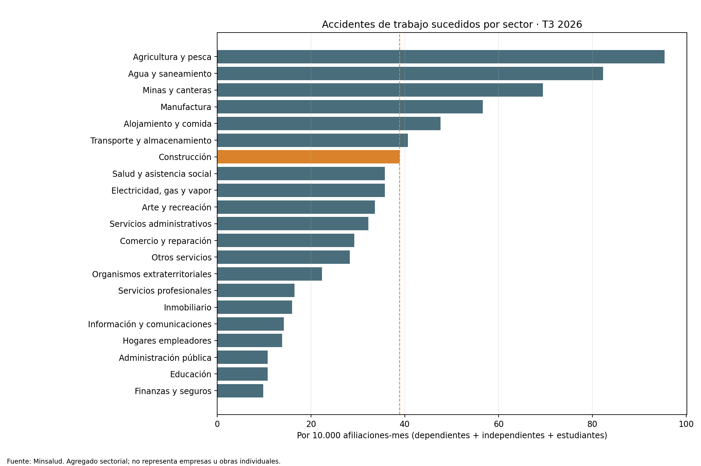

# Seguridad laboral en construcción: contexto sectorial Minsalud, T3 2026

## Trailer ejecutivo

La exposición a accidentes es una señal de riesgo material para promotores, financiadores y responsables de seguridad de obras, pero los resultados de un sector no permiten evaluar una empresa o proyecto específico. Este companion usa el corte oficial del Sistema General de Riesgos Laborales publicado por Minsalud para comparar los sectores en el tercer trimestre de 2026. Extrae accidentes de trabajo sucedidos y afiliaciones dependientes, independientes y estudiantiles; construye una tasa descriptiva por cada 10.000 afiliaciones-mes y conserva el conteo de muertes calificadas asociadas a accidentes de trabajo.

En construcción se reportan 14.666 accidentes sucedidos y 22 muertes calificadas por accidente durante el trimestre. Al dividir por 3.772.481 afiliaciones-mes del mismo sector, la tasa cruda es 38,88 accidentes por cada 10.000 afiliaciones-mes. El indicador sirve para situar el sector y priorizar preguntas de prevención, cobertura y monitoreo. No es una tasa oficial anual, no mide severidad económica ni causalidad, y no identifica una obra, empleador, contratista o mecanismo de accidente.

La decisión habilitada es de diseño de gobierno: definir controles para comparar indicadores internos de obras con benchmarks públicos sin confundirlos con validación de desempeño individual. Un modelo de pérdidas todavía requiere registros HSE por proyecto, exposición (horas trabajadas), severidad, costos directos e indirectos, interrupciones, causas y medidas de control, con revisión independiente y outcomes fechados.

## Arquitectura

```text
Minsalud · workbook sectorial T3 2026
  → tabla por sector, accidentes y afiliaciones de tres categorías
  → conciliación de los 21 sectores frente al total general
  → tasa descriptiva: accidentes sucedidos / afiliaciones-mes × 10.000
  → CSV, figura sectorial y manifiesto de fuente/hash
  → referencia de contexto para diseñar el monitoreo HSE del proyecto
```

## Registro de decisiones

| Decisión | Alternativa descartada | Justificación |
|---|---|---|
| Dividir por afiliaciones-mes agregadas del mismo trimestre | Dividir por el número de afiliaciones trimestrales como si fueran trabajadores únicos | La fuente indica que los valores mensuales no son acumulativos; sumar la exposición mensual mantiene numerador y denominador en el mismo periodo. |
| Incluir afiliaciones dependientes, independientes y estudiantes | Usar solo trabajadores dependientes | El total sectorial del SGRL incluye las tres categorías; se explicitan para que se pueda replicar el denominador. |
| Usar accidentes “sucedidos” exactamente como rotula el workbook | Llamarlos accidentes calificados o siniestros de proyectos | Las categorías son distintas y no se deben equiparar. La tasa construida es propia y descriptiva, no la tasa oficial Minsalud. |
| Mantener el corte agregado T3 2026 | Estimar tendencia o pronóstico | Un corte trimestral no identifica tendencia ni efectos de políticas. |

## Evidencia

- Fuente primaria: [Indicadores de riesgos laborales de Minsalud](https://minsalud.gov.co/Proteccion-Social/RiesgosLaborales/Paginas/indicadores.aspx), apartado de actividad económica y departamento. El [archivo de datos](https://minsalud.gov.co/sites/rid/Lists/BibliotecaDigital/RIDE/VP/RBC/estadisticas-sgrl-actividad-economica-depto.zip) descargado contiene el workbook `Trimestre 3_2026_Corte Septiembre_SECTOR ECONOMICO.xlsx`.
- El texto visible de la página de Minsalud aún menciona un corte anterior (julio de 2026); el ZIP vinculado tiene fecha de elaboración noviembre y el libro identifica explícitamente el trimestre III con corte septiembre. Este companion sigue el periodo del archivo descargado y registra su SHA-256.
- La página ministerial define los indicadores oficiales de accidentalidad con accidentes calificados sobre población afiliada. Este companion conserva la categoría distinta del libro (“AT sucedidos”) y construye una razón simple sobre afiliaciones-mes; no la presenta como tasa oficial.
- El workbook declara que las cifras mensuales no son acumulativas y recomienda seleccionar el mes; este corte se presenta como agregado del trimestre de julio a septiembre de 2026.
- Los 21 sectores reproducen exactamente la fila “Total general” del workbook para las 16 variables numéricas seleccionadas.
- En construcción: 3.613.958 afiliaciones dependientes, 138.058 independientes y 20.465 estudiantes sumadas en el trimestre; 14.666 accidentes sucedidos; 22 muertes reportadas por accidente de trabajo calificado; razón construida de 38,88 por 10.000 afiliaciones-mes.



## Limitaciones y gobierno

- Cobertura del Sistema General de Riesgos Laborales; no incluye trabajadores fuera de la cobertura y no debe extrapolarse a toda la fuerza laboral.
- Afiliaciones-mes no son necesariamente personas únicas ni horas efectivamente trabajadas. La medida no está anualizada.
- El corte no está desagregado por obra, empleador, ubicación, tarea, mecanismo, días perdidos o costo. No enlaza a contratos SECOP.
- Los conteos no permiten atribución causal a controles específicos. Accidentes reportados y muertes reportadas también responden a cobertura, clasificación y rezagos.
- El proyecto de pérdidas HSE sigue en etapa de especificación; no se calibró frecuencia-severidad ni se validó un modelo. Para hacerlo se requiere target y exposición por proyecto, split temporal, backtesting, pruebas de robustez y aceptación de validación independiente antes de uso.

## Reproducibilidad

Requiere Python 3, `pandas`, `openpyxl` y `matplotlib`. Descarga y extrae el workbook oficial fuera del repositorio:

```bash
curl -L --fail --silent --show-error 'https://minsalud.gov.co/sites/rid/Lists/BibliotecaDigital/RIDE/VP/RBC/estadisticas-sgrl-actividad-economica-depto.zip' -o /ruta/local/estadisticas_sgrl.zip
unzip -o /ruta/local/estadisticas_sgrl.zip -d /ruta/local/sgrl
python3 03-financial-risk/07-financial-and-construction-risk-lab/02-construction-enterprise-risk/09-construction-safety-and-operational-loss/observed-minsalud-workplace-safety/build_proxy.py --input '/ruta/local/sgrl/Trimestre 3_2026_Corte Septiembre_SECTOR ECONOMICO.xlsx'
```

El runner verifica hoja y periodo, datos no negativos, 21 sectores y conciliación de todas las variables contra el total general. Luego regenera el CSV sectorial, la figura y el manifiesto con SHA-256 del workbook.
