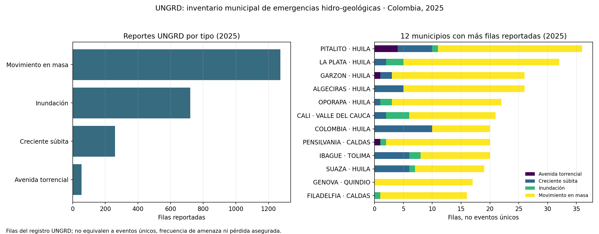

# UNGRD 2025: filas reportadas de eventos hidro-geológicos

## Uso

Esta companion agrega registros oficiales UNGRD de 2025 para inundación, creciente súbita, avenida torrencial y movimiento en masa. Sirve para revisar cobertura del registro y distribución municipal de las filas reportadas. **No estima eventos únicos, frecuencia/probabilidad de amenaza, riesgo de un predio u obra ni pérdida asegurada.**

## Fuente y vintage

- Dataset oficial: [Emergencias UNGRD V2, recurso `2343-nuqp`](https://www.datos.gov.co/Ambiente-y-Desarrollo-Sostenible/Emergencias-UNGRD-V2/2343-nuqp).
- Productor: Unidad Nacional para la Gestión del Riesgo de Desastres.
- API CSV consultada el 11 de noviembre de 2026; actualización declarada por el portal: 22 de septiembre de 2026.
- Snapshot completo: 6.565.780 bytes; SHA-256 `287df83aa1b05e1a80324b200ff4445f8dc240d2a80d65f725ab6b8e01d291ed`. Se conserva fuera de Git porque contiene comentarios de texto libre; el companion no copia ni procesa esos comentarios en sus salidas.
- La respuesta API tuvo 6.506 registros del año 2025. El portal mostraba “13K” en su indicador redondeado, por lo que se fijaron el conteo, bytes y hash exactos del snapshot.

## QA y resultado

De 6.506 registros no hubo filas idénticas completas. Cuatro clases seleccionadas suman 2.309 **filas del registro**: 1.273 movimiento en masa, 721 inundación, 260 creciente súbita y 55 avenida torrencial. No se sumaron personas, familias, viviendas, vías ni hectáreas: el dataset tiene filas repetidas por misma fecha, municipio y tipo (557 combinaciones repetidas) y no ofrece una llave estable de incidente para distinguir actualizaciones de eventos distintos.

La ubicación tiene limitaciones importantes:

- 6.504 de 6.506 coordenadas son cero o vacías; no se genera mapa ni se cruza con activos de construcción.
- Aunque el portal describe un campo DIVIPOLA, 696 de 955 combinaciones departamento-municipio tienen múltiples códigos en el snapshot; 242 filas no tienen un código de cinco dígitos. El análisis no usa ese campo como llave geográfica y conserva solo los nombres de departamento/municipio.
- `codigo_emergencia` tiene un código repetido y no se interpreta como identificador único de evento.

La figura y agregados muestran únicamente la distribución de reportes que contiene el archivo. La ausencia o número de reportes depende también de captura, actualización y clasificación; no mide incidencia real.



## Reproducción

Descargar el CSV oficial completo a un directorio local externo al repositorio:

```bash
curl -L --fail --silent --show-error 'https://www.datos.gov.co/resource/2343-nuqp.csv?$limit=20000' -o /ruta/local/emergencias_ungrd_v2.csv
```

Reproducir tablas, figura y manifiesto (requiere Python 3, `pandas` y `matplotlib`):

```bash
python3 03-financial-risk/07-financial-and-construction-risk-lab/02-construction-enterprise-risk/10-climate-flood-and-physical-risk/build_ungrd_2025_companion.py \
  --input /ruta/local/emergencias_ungrd_v2.csv
```

Salidas sin comentarios de texto libre: `data/official/ungrd-2025/event_type_summary_2025.csv`, `municipality_event_summary_2025.csv`, `source_quality_manifest.json` y la figura mostrada.

## Datos aún requeridos

Para medir riesgo físico de construcción se requieren coordenadas verificadas de proyectos/activos, polígonos oficiales de amenaza con escala y periodo de retorno, altura/uso/fragilidad del activo, fechas y exposición, y pérdidas directas. Para backtesting actuarial harían falta pólizas, siniestros y pagos enlazables con las ubicaciones/eventos. Esta fuente no cubre esos requisitos y la ventana V2 de este snapshot es solo 2025.
