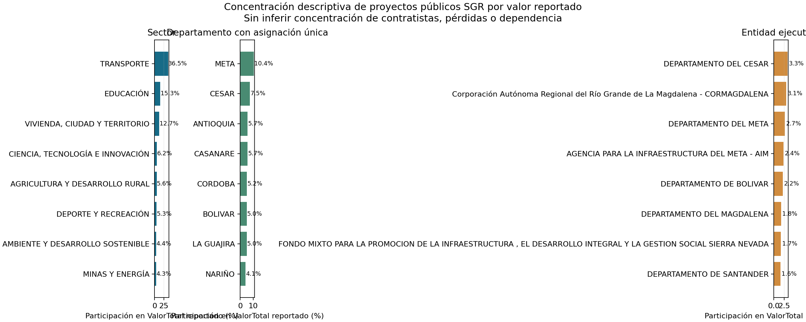

# Perfil observado de concentración de proyectos públicos SGR

## Trailer ejecutivo

Un comité que administra proyectos financiados con regalías necesita distinguir concentración por sector, territorio y entidad ejecutora de la dependencia económica entre proyectos. Este companion analiza el conjunto oficial **DNP-ProyectosSGR** para construir ese primer mapa descriptivo: cuenta proyectos únicos por BPIN y suma el `ValorTotal` reportado una sola vez por proyecto, para los estados `TERMINADO` y `EN EJECUCIÓN`. En el corte consultado el 11 de noviembre de 2026, el dataset contenía 35.010 filas, 33.256 BPIN únicos y 32.012 proyectos en esos dos estados. El HHI de participación en valor total reportado fue 1.882 por sector; Transporte concentró 36,53% y los cinco sectores de mayor participación, 76,35%. La concentración geográfica solo se calcula para proyectos con un departamento único: cubre 83,57% de los proyectos y 78,29% del valor analizado; dentro de esa cobertura, el HHI departamental fue 459. La salida ayuda a decidir dónde enfocar una revisión territorial o sectorial del portafolio público. No identifica contratistas, compradores, covarianza de shocks, pérdida, incumplimiento ni exposición de una entidad privada.

## Arquitectura

```text
DNP-ProyectosSGR (Datos Abiertos Colombia)
  └─ BPIN, ValorTotal, estado, sector, departamento y entidad ejecutora
        ↓ deduplicar por BPIN; excluir proyectos desaprobados
        ↓ separar departamentos faltantes o conflictivos
agregación de conteos y ValorTotal por sector / departamento / entidad ejecutora
        ↓
CSV agregado + manifiesto de corte y calidad + resumen HHI + figura
        ↓
decisión habilitada: priorizar revisión descriptiva de concentración SGR
```

## Resultado y alcance de la decisión

| Dimensión | Proyectos incluidos | Cobertura del valor reportado | HHI por valor | Participación top 5 |
|---|---:|---:|---:|---:|
| Sector | 32.012 | 100,00% | 1.881,94 | 76,35% |
| Departamento con asignación única | 26.753 | 78,29% | 458,99 | 34,47% |
| Entidad ejecutora | 32.012 | 100,00% | 81,21 | 13,57% |

El HHI se calcula como la suma de cuadrados de las participaciones porcentuales sobre `ValorTotal` reportado; su rango teórico es 0–10.000. Es una estadística de concentración del **universo público SGR observado**, no un umbral de riesgo ni una medida de dependencia o pérdida. Los departamentos se analizan sobre el subconjunto con asignación única; no se redistribuye el monto de un proyecto ambiguo entre territorios.



## Registro de decisiones y trade-offs

| Decisión | Trade-off | Motivo |
|---|---|---|
| Usar el BPIN como unidad y sumar una vez `ValorTotal` por BPIN | Se descartan filas repetidas | El extracto tiene filas duplicadas; repetirlas inflaría montos y conteos. Para los campos usados, el valor, sector, ejecutor y estado son consistentes en las repeticiones. |
| Incluir `TERMINADO` y `EN EJECUCIÓN`; excluir `DESAPROBADO` | No representa todas las solicitudes ni estados del ciclo | El objetivo es describir proyectos terminados o en ejecución en el corte. No se infiere fecha de aprobación ni trayectoria temporal. |
| Analizar departamento solo si hay una etiqueta no vacía y única para el BPIN | La cobertura territorial es menor | 205 BPIN tienen etiquetas de departamento conflictivas; otros carecen de dato. No es posible asignar una fracción de `ValorTotal` a cada departamento con este esquema. |
| Usar el `ValorTotal` publicado y no `EjecucionFinanciera` | No se calcula capital ejecutado ni saldo en riesgo | El dataset no desglosa fuentes de financiación, cronograma, pagos, costo final ni pérdida. El porcentaje financiero reportado contiene valores fuera de 0–100 y no se usa en el indicador. |
| Agregar por entidad ejecutora, sin usarla como contraparte | El análisis no clasifica contratistas ni propietarios finales | DNP define la variable como entidad responsable de ejecutar el proyecto; no es un identificador de contratista, comprador ni garante. |

## Fuente, linaje y calidad

Fuente primaria: [DNP-ProyectosSGR, Datos Abiertos Colombia](https://www.datos.gov.co/Econom-a-y-Finanzas/DNP-ProyectosSGR/mzgh-shtp), suministrada por el Departamento Nacional de Planeación. El recurso tiene licencia [Creative Commons Attribution-ShareAlike 4.0](https://creativecommons.org/licenses/by-sa/4.0/legalcode). El corte de actualización de la fuente reportado por la API fue 20 de octubre de 2026; la consulta se realizó el 11 de noviembre de 2026.

- Campos consultados: `codigobpin`, `valortotal`, `sector`, `departamento`, `entidadejecutora`, `estado`, `ejecucionfisica` y `ejecucionfinanciera`.
- Extracción recibida: 35.010 filas; 33.256 BPIN únicos; 1.427 BPIN con más de una fila y 1.754 filas excedentes. Se identificaron 1.222 grupos repetidos idénticos; las restantes repeticiones relevantes para este análisis solo difieren en el campo departamento.
- Reglas de calidad: no hubo BPIN vacíos, montos `ValorTotal` ausentes ni montos negativos entre los estados incluidos. Se identificaron 205 BPIN con más de un valor de departamento; 5.259 proyectos incluidos se excluyeron del corte territorial por dato faltante o ambiguo.
- Ejecución física/financiera no se usa. En el extracto hubo 205 valores fuera del intervalo 0–100 entre estos campos; el manifiesto los cuenta para calidad, sin corregirlos.
- El snapshot de Git guarda solamente conteos y sumas agregadas por categoría; no conserva BPIN, nombres de proyectos ni filas de DNP. `source_quality_manifest.json` registra parámetros, fechas y SHA-256 de la respuesta original procesada.

`ValorTotal` se conserva como unidad monetaria reportada por la fuente. No se interpreta como asignación exclusiva del SGR, desembolso, saldo vigente ni exposición económica comparable entre sectores. El campo entidad ejecutora no identifica al contratista. La fuente no aporta fechas por proyecto, cronograma plan-real, contratos enlazados, ventas, compradores, pérdidas o causa común de eventos.

## Limitaciones y gobierno

Este perfil no valida un modelo de riesgo de portafolio, no estima dependencia entre proyectos, correlación de pérdidas, riesgo sistémico, PD/LGD ni probabilidad de incumplimiento. La concentración por sector o territorio no prueba que los resultados de proyectos estén correlacionados. Tampoco representa un portafolio institucional del usuario: la población está limitada a proyectos financiados con recursos del SGR y a lo reportado en el corte.

Para validar dependencia multiproyecto se necesitan identificadores enlazables de obra, contratista y comprador con autorización; valores por fuente de financiación y presupuesto versionado; cronogramas planeados y reales; flujo de caja; causas de suspensión; costos, terminación y pérdidas; ubicación; y un panel fechado. La validación requeriría revisar unicidad y cobertura, definir outcomes y ventanas, comparar dependencias con independencia/baselines, realizar estrés común y fuera de tiempo, y fijar aceptación antes del análisis. El snapshot público no cumple esos requisitos.

El companion ofrece trazabilidad descriptiva alineada con prácticas de ISO 31000/COSO ERM para identificar concentraciones de recursos; no implica certificación, cumplimiento regulatorio ni aprobación de modelo.

## Reproducción

Requiere Python 3, `requests` y `matplotlib`. Desde esta carpeta, para regenerar resumen y figura del snapshot agregado:

```bash
python3 build_companion.py
```

Para volver a consultar la API oficial, rehacer deduplicación y actualizar deliberadamente el snapshot:

```bash
python3 build_companion.py --refresh
```

El refresh procesa la respuesta seleccionada en memoria, pero no persiste filas individuales. Actualiza `data/aggregated_sgr_projects.csv`, `data/source_quality_manifest.json` y los derivados en `results/`. La API es mutable; antes de actualizar se debe conservar el manifest y CSV agregados anteriores si se requiere una comparación entre vintages.
