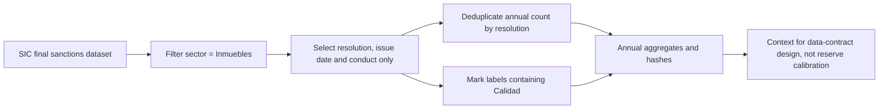
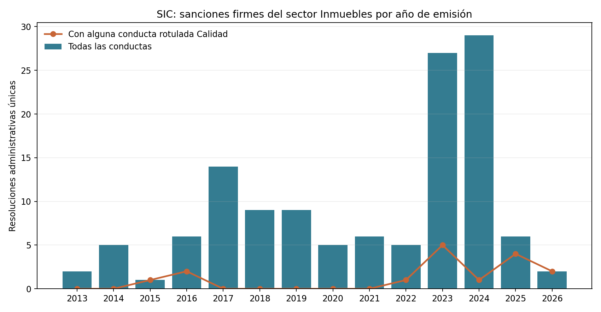

# SIC final consumer-protection sanctions: Inmuebles

## Executive trailer

A warranty-reserve model needs observed defects, units exposed, repair costs, and claim development. Public enforcement records cannot supply all of those outcomes, but they can show whether finalized consumer-protection sanctions in the `Inmuebles` sector provide a reproducible quality signal. This companion queries the SIC open-data table of final sanctions and keeps only resolution number, issue date, and conduct label while processing the response. In the November 11, 2026 extraction, the sector filter returned 142 source rows mapped to 126 unique resolutions dated 2013–2026. Sixteen unique resolutions had at least one conduct label containing “Calidad.” The output helps a model owner assess whether official enforcement labels could inform a future data contract and highlights the need to distinguish quality-related enforcement from general property-sector sanctions. It does not identify buildings, construction projects, warranty claims, repairs, covered units, severity, paid losses, or reserves. Multiple conduct rows can belong to one resolution, so raw rows are not counted as independent sanctions. The substring rule is transparent but not a legal classification of warranty claims. This is external administrative context only; claim frequency-severity and reserve adequacy still require authorized project-level exposure, claim, cost, and payment data with independent validation.

## High-level flow



## Observed result

| Indicator | Result | Meaning |
|---|---:|---|
| Selected source rows | 142 | Rows may repeat a resolution for multiple conduct labels |
| Unique resolutions | 126 | Deduplicated by the public resolution identifier in memory |
| Period | 2013–2026 | Issue-year coverage in this mutable endpoint extract |
| Resolutions with a conduct label containing “Calidad” | 16 | Non-exclusive administrative text signal, not a warranty-claim count |



The [annual counts](results/annual_unique_resolutions.csv), [conduct summary](results/conduct_summary.csv), and [manifest](results/manifest.json) contain aggregates and hashes only. No names or case identifiers are published.

## Source and reproduction

Primary source: [Sanciones impuestas en firme por la SIC](https://www.datos.gov.co/Comercio-Industria-y-Turismo/Sanciones-impuestas-en-firme-por-la-SIC/73dx-n59j), dataset `73dx-n59j`, published by the Superintendencia de Industria y Comercio. Datos Abiertos declares [Creative Commons Attribution-ShareAlike 4.0](https://creativecommons.org/licenses/by-sa/4.0/legalcode). The query filters `sector='Inmuebles'` and selects only `res_sancion`, `fecha_emitida`, and `conducta`. The response is processed in memory; the raw table contains entity/case details that are deliberately not written to the repository.

Install Python 3 dependencies and execute from the repository root:

```bash
python3 -m pip install -r 03-financial-risk/07-financial-and-construction-risk-lab/02-construction-enterprise-risk/12-construction-quality-warranty-reserves/observed-sic-real-estate-sanctions/requirements.txt
python3 03-financial-risk/07-financial-and-construction-risk-lab/02-construction-enterprise-risk/12-construction-quality-warranty-reserves/observed-sic-real-estate-sanctions/build_companion.py
```

The runner records the extraction time, selected fields, response SHA-256, row counts and output hashes. The endpoint is mutable; an updated extraction is a new vintage, not a silent continuation of this one.

## Decision log

| Choice | Trade-off |
|---|---|
| Count unique `res_sancion` per year | Avoids treating multiple conduct rows from one resolution as separate sanctions. |
| Retain the conduct table as non-exclusive | Preserves multiple labels; conduct counts can sum above unique resolutions. |
| Flag “Calidad” by case-insensitive substring | Simple and auditable, but does not determine legal warranty coverage or classify defect type. |
| Omit `multado`, `radicado`, fine amount, and resolution number from outputs | Reduces personal/business identifiers and prevents fines from being confused with repair loss; identifiers are used only in memory for deduplication. |

## Limitations and governance

The SIC dataset records final administrative consumer-protection sanctions, not every complaint or claim. `Inmuebles` is not restricted to construction defects, delivered dwellings, or a cohort of builders. A `Calidad` conduct may concern matters other than warranty repairs. There is no denominator of units or exposure-years, no defect severity, no claim outcome, no repair cost, no paid indemnity, and no reserve amount. The label is therefore descriptive context and cannot estimate defect frequency, warranty-call probability, IBNR, severity, or reserve adequacy.

For an institutional reserve model, the minimum remains project-linked units delivered and exposure duration, defect notices and claim development, claim decisions, repair and indemnity amounts, dates, closures/reopenings, accounting reconciliations, and permissions. Validation should use completed and active cohorts, development triangles, out-of-time tests, inflation/maturation sensitivities, and independent acceptance criteria. This companion does not establish IFRS 9, Basel, ISO 31000, COSO ERM, or model-risk compliance.
