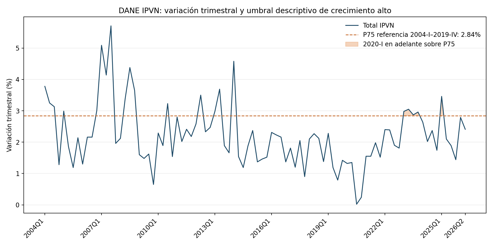

# DANE IPVN: observación de cambios de precios

Este companion agrega una lectura reproducible de la variación trimestral nacional del Índice de Precios de Vivienda Nueva (IPVN). Responde una pregunta acotada: ¿cómo se compara el cambio de precios observado en el trimestre más reciente con la distribución histórica publicada por DANE?

## Resultado

El anexo DANE del segundo trimestre de 2026 contiene 90 observaciones trimestrales, desde 2004-I hasta 2026-II. La variación total del trimestre más reciente fue 2,41%; apartamentos, 2,37%; casas, 3,68%. El percentil 75 de la variación trimestral total en el período de referencia 2004-I–2019-IV fue 2,845%. En 2026-II, el total quedó por debajo de ese umbral; la variación de casas fue superior. Esta comparación describe precios agregados y no permite inferir volúmenes vendidos, absorción ni desempeño financiero de proyectos.



La figura y la tabla derivada se regeneran desde el anexo oficial; no se incorpora ni duplica el libro Excel original.

## Fuente y reproducción

- Productor: [DANE, Índice de Precios de Vivienda Nueva](https://www.dane.gov.co/index.php/estadisticas-por-tema/construccion/indice-de-precios-de-vivienda-nueva-ipvn/indice-de-precios-de-vivienda-nueva).
- Snapshot: [anexo IPVN 2026-II](https://www.dane.gov.co/files/operaciones/IPVN/anex-IPVN-IItrim2026.xlsx), descargado el 11 de noviembre de 2026.
- SHA-256 del snapshot: `acde19eaf0108b0046c0df926c5047194cb7c2145177f3de45d5738d6fd4b3db`.
- Hoja/campos: `TOTAL Y DESTINOS `, variación trimestral nacional en total, apartamentos y casas; unidad: porcentaje trimestre contra trimestre.
- Grano: una observación por trimestre, agregado nacional publicado por DANE; 2004-I a 2026-II.

Con Python, `pandas`, `openpyxl` y `matplotlib` instalados, descargar el anexo del enlace anterior y ejecutar:

```bash
python3 run_companion.py --source-xlsx /ruta/al/anex-IPVN-IItrim2026.xlsx
```

El runner comprueba el SHA-256 antes de extraer. Genera `ipvn_quarterly_derived.csv`, `summary.json` y `ipvn_price_regimes.png`. La serie derivada conserva únicamente trimestre, año, número de trimestre y variaciones para total, apartamentos y casas.

## Método y uso admisible

El umbral naranja es el percentil 75 de la variación trimestral total durante 2004-I–2019-IV (64 trimestres). Se fija antes del período de evaluación 2020-I–2026-II (26 trimestres), y señala observaciones posteriores que superan ese nivel de referencia. Es una regla descriptiva transparente, no un régimen latente estimado ni una señal prospectiva. No se evalúa un pronóstico ni se mide calibración predictiva. Se prioriza este baseline frente a un modelo Markov de estados ocultos, que requeriría decisiones de especificación y validación adicional.

El indicador puede aportar contexto sectorial para discutir supuestos de precios de venta o sensibilidad de escenarios en estudios preliminares. No prueba precios de transacción de una obra, ingresos realizados, ritmo de ventas, inventario, costos de construcción, valor de garantía ni capacidad de pago. El IPVN observa precios de vivienda nueva en obras incluidas en su marco; las unidades/agregados, composición del panel, cobertura geográfica y mezcla de productos pueden cambiar. El índice no sustituye información del proyecto ni permite atribuir cambios a una política o condición macroeconómica.

Para validar exposición o resultados de una obra específica hacen falta su historial de precios/ventas con unidad y fecha, inventario disponible, desistimientos, etapa de construcción, ubicación y tipología, conciliados con datos administrativos y permisos de uso. Hasta contar con esos datos, este companion solo permite comparar la dinámica agregada de precios publicada con su historia.
