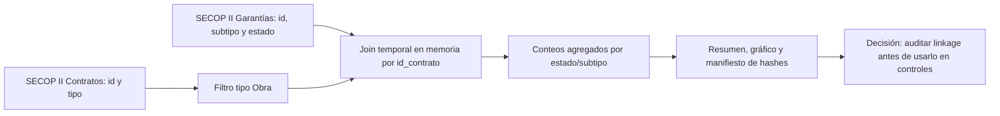
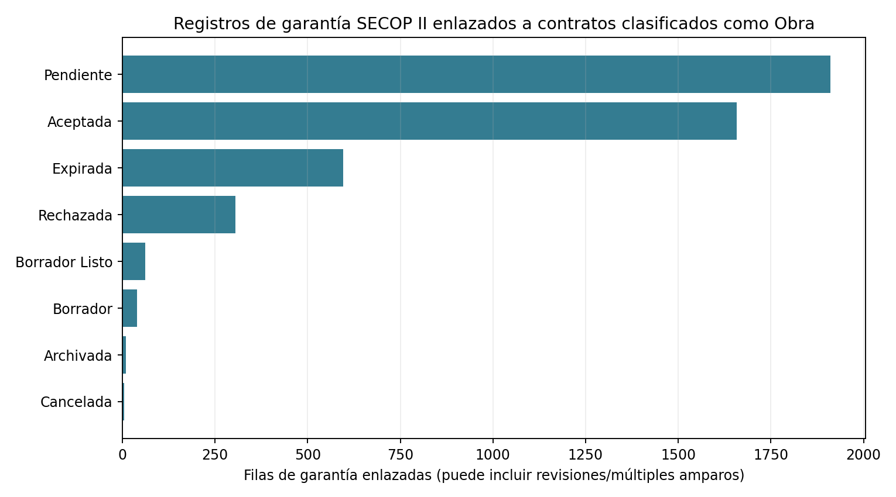

# Pólizas y garantías de cumplimiento

**Estado:** companion observado de registros administrativos enlazados; modelo de pérdidas no calibrado ni validado.

## Caso ejecutivo

Una entidad que administra contratos de obra necesita conocer si sus registros de garantías se pueden enlazar con el catálogo de contratos antes de medir exposición o diseñar controles de aseguramiento. Este companion realiza ese cruce sobre los conjuntos públicos de Colombia Compra Eficiente: toma IDs de contratos cuyo tipo publicado es `Obra` y los compara, en memoria, con IDs de las filas del conjunto SECOP II de garantías. En la extracción del 11 de noviembre de 2026 encontró 50.154 IDs únicos de contratos de obra y 48.949 filas de garantía de todos los tipos; 1.076 contratos de obra tenían al menos una fila enlazada (2,15%) y 379 tenían al menos una fila con estado administrativo `Aceptada` (0,76%). La decisión que habilita es de calidad y gobierno del dato: medir el grado de enlace y priorizar una revisión de estados y subtipos antes de depender de estos registros en un proceso de control. La lectura tiene límites fuertes: “No Definido” domina los subtipos, una obra puede tener varias filas o revisiones, el registro no confirma si la garantía cubre la obligación requerida, y el dataset no registra reclamaciones, pagos, recuperaciones o pérdidas. Por eso el porcentaje no es una tasa de cobertura jurídica, suficiencia, default o ejecución de póliza. Los IDs solo se procesan durante el join; no se guardan pólizas, nombres, aseguradoras ni beneficiarios. Para estimar probabilidad o severidad de reclamación siguen siendo indispensables resultados de siniestro y contrato autorizados, con revisión independiente.

## Arquitectura de alto nivel



## Resultado del corte

| Indicador | Resultado | Interpretación admisible |
|---|---:|---|
| IDs únicos de contratos tipo `Obra` | 50.154 | Denominador de contratos clasificados como obra en el endpoint consultado |
| Filas de garantías consultadas | 48.949 | Incluye tipos de instrumento y estados diversos |
| Filas de garantía enlazadas a obras | 4.584 | Filas administrativas, no pólizas deduplicadas ni siniestros |
| Contratos de obra con cualquier fila enlazada | 1.076 (2,1454%) | Coincidencia registrada entre los dos endpoints; no cobertura efectiva |
| Contratos de obra con al menos una fila `Aceptada` | 379 (0,7557%) | Estado publicado en una fila; no acredita vigencia ni suficiencia legal |



El detalle agregado está en [summary.json](observed-secopsurety-works-link/results/summary.json) y [filas por estado/subtipo](observed-secopsurety-works-link/results/linked_rows_by_status_subtype.csv). El manifiesto conserva hashes por página, conteos consultados y hashes de salida.

## Pregunta y alcance
Probabilidad de ejecución y severidad de garantías. ¿En qué condiciones se materializa el riesgo y qué acciones de mitigación generan valor ajustado por riesgo?

## Modelo propuesto
```text
BondEL = P(call)*E[severity|call]
```
Especificar unidades, granularidad, horizonte, estados observables/latentes, supuestos de identificación y dependencias. Cuantificar incertidumbre de estimación, simulación y especificación.

## Datos y estimación
Requeridos según proyecto: ERP y cuentas contables, presupuestos originales y revisados, cronogramas, actas de avance, órdenes de compra, proveedores, ventas y desistimientos, contratos, deuda y covenants, datos geográficos, indicadores públicos DANE/BanRep/Camacol cuando proceda. Registrar disponibilidad histórica, calidad, fechas de observación y permisos de uso. Para series escasas usar regularización o pooling jerárquico y reportar incertidumbre.

### Linaje, licencia y reproducción

- [SECOP II – Contratos Electrónicos](https://www.datos.gov.co/Estad-sticas-Nacionales/SECOP-II-Contratos-Electr-nicos/jbjy-vk9h), dataset `jbjy-vk9h`, entidad propietaria Colombia Compra Eficiente; filtro `tipo_de_contrato='Obra'`, selección exclusiva de `id_contrato`.
- [SECOP II – Garantías](https://www.datos.gov.co/Gastos-Gubernamentales/SECOP-II-Garantias/gjp9-cutm), dataset `gjp9-cutm`, misma entidad propietaria; campos seleccionados: `id_contrato`, `tipopoliza`, `subtipopoliza`, `estado`.
- Ambos metadatos de Datos Abiertos declaran licencia [Creative Commons Attribution-ShareAlike 4.0](https://creativecommons.org/licenses/by-sa/4.0/legalcode). Consulta del companion: 2026-11-11 19:00 UTC.
- El runner pagina las APIs con reintentos y procesa filas en memoria. No escribe filas fuente ni IDs al repositorio. El manifiesto registra conteos, offsets, tamaños y SHA-256 de cada respuesta de página y cada salida.

Desde la raíz del repositorio, con Python 3, instala el entorno declarado en `requirements.txt` y ejecuta:

```bash
python3 -m pip install -r 03-financial-risk/07-financial-and-construction-risk-lab/02-construction-enterprise-risk/14-surety-performance-bond-risk/observed-secopsurety-works-link/requirements.txt
python3 03-financial-risk/07-financial-and-construction-risk-lab/02-construction-enterprise-risk/14-surety-performance-bond-risk/observed-secopsurety-works-link/build_companion.py
```

## Registro de decisiones

| Decisión | Trade-off |
|---|---|
| Pedir solo IDs para contratos y estado/subtipo para garantías | Evita descargar nombres, NIT, beneficiarios, aseguradora, número de póliza y valor; permite medir linkage, no suficiencia económica. |
| Usar IDs únicos de contrato para la proporción de obras con alguna fila | Evita que múltiples filas inflen el numerador de contratos; el conteo de filas se presenta aparte. |
| Mantener todos los estados y subtipos publicados | Describe lo que contiene el registro, pero mezcla instrumentos distintos y filas que pueden corresponder a revisiones. |
| No deduplicar filas de garantía por número de póliza | Ese identificador no se necesita para el cruce y no se publica; por eso las filas enlazadas no son pólizas únicas. |
| Fallar si cambia el conteo fuente durante una extracción incompleta | Prioriza un corte verificable; una fuente mutable se vuelve a consultar deliberadamente y genera nuevos hashes. |

## Limitaciones y gobierno

El estado administrativo `Aceptada` no demuestra eficacia jurídica, vigencia, cuantía recuperable, amparo correcto ni aceptación por el supervisor del contrato. `subtipopoliza` está frecuentemente como `No Definido`; la tabla puede incluir varias filas por contrato, modificaciones y más de un amparo. El catálogo de contratos representa contratos registrados, no un universo auditado de obligaciones que requieren garantía. Los endpoints cambian; el porcentaje es de este corte, no una serie temporal.

La fuente no contiene llamadas, reclamaciones, siniestros asegurados, valor exigido/pagado, recuperaciones ni pérdida neta. La [brecha residual](DATA_GAP.md) especifica lo requerido para pasar del linkage administrativo a un análisis de severidad. No se estima `P(call)`, `E[severity|call]`, default de contratista ni ranking de aseguradoras. Una validación institucional requiere expediente contractual y póliza autorizados, definición jurídica del evento, outcomes fechados, conciliación de pagos y revisión independiente.

## Validación y experimentación
Dependencia con retrasos y calidad de contraparte. Separación temporal de entrenamiento/prueba, benchmarks simples, backtesting, calibración de probabilidades, sensibilidad, stress y reverse stress. No presentar precisión predictiva hasta medirla con datos reales.

## Plan de construcción
1. Contrato de datos y definición de target sin leakage.
2. Baseline reproducible y tests unitarios.
3. Modelo estadístico principal y cuantificación de incertidumbre.
4. Backtesting temporal y comparación con benchmark.
5. API/reportes, trazabilidad, límites y aprobación de riesgo de modelo.

## Productos esperados
Metodología, código, pruebas, escenarios, reporte de validación y dashboard de decisiones.
