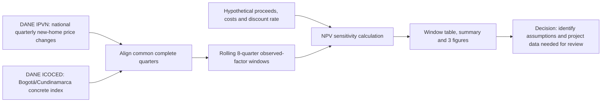
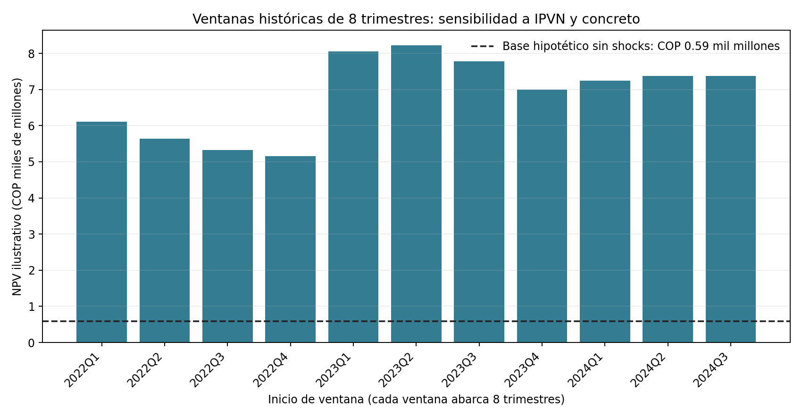
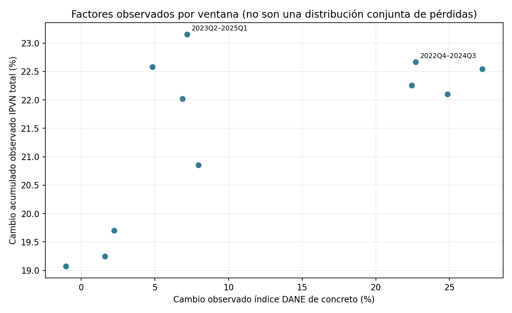
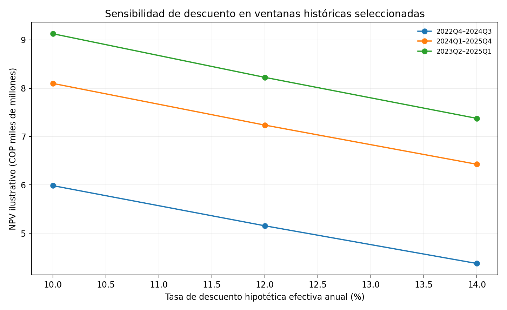

# DANE observed-factor NPV sensitivity

## Executive trailer

A development committee needs to know whether its NPV is especially sensitive to sales-price escalation, construction-input costs, or the discount assumption before committing capital. This companion joins two public DANE signals—national new-housing price changes (IPVN) and the Bogotá/Cundinamarca price index for common concrete (ICOCED)—over the 18 complete quarters from 2022-Q1 to 2026-Q2. It applies each rolling eight-quarter history to the same transparent, hypothetical development cash-flow schedule and shows the resulting NPV range and discount-rate sensitivity. In the latest available window, 2024-Q3 to 2026-Q2, the illustrative NPV is COP 7.37 billion; across 11 overlapping historical windows it ranges from COP 5.15 billion to COP 8.22 billion under the selected assumptions. These numbers are not project results: the sales-price series is national, the concrete index is regional and covers one input, the cost and proceeds amounts are assumed, and the 12% discount rate is not an observed project WACC. The exercise therefore answers a narrow decision-design question: which public factors and project assumptions should a development team make explicit in an early NPV review? It does not estimate probability of loss, VaR, a forecast, or an investment recommendation. A real NPV-at-Risk application still requires dated, versioned project budgets, sales and collections, debt, schedule and realized cash flows, followed by independent backtesting on completed and active projects.

## High-level flow



## Results and decision use

The hypothetical schedule uses COP 2bn of non-material cost and COP 3bn of concrete-exposed cost each quarter for eight quarters, COP 45bn of base sale proceeds in quarter eight, and a 12% effective annual discount rate. Observed IPVN quarterly changes adjust the proceeds; the concrete index level relative to the first quarter of each window adjusts only the concrete tranche. The base NPV with no price changes is COP 0.59bn. The latest historical window gives COP 7.37bn. The lowest and highest modeled window NPVs are COP 5.15bn and COP 8.22bn, respectively.

These positive values are an output of the illustrative cash-flow amounts and the selected historic price windows. They are not evidence that actual developments earned positive margins. The windows overlap and are not independent observations. No frequency, confidence level, probability, VaR or “NPV at risk” statistic is estimated.







## Reproduction and lineage

From the repository root, with Python 3 and `matplotlib` installed:

```bash
python3 03-financial-risk/07-financial-and-construction-risk-lab/02-construction-enterprise-risk/15-project-npv-at-risk/observed-dane-npv-sensitivity/run_sensitivity.py
```

The runner is offline and validates SHA-256 for the two processed inputs before calculation. It writes the window and discount-sensitivity CSVs, JSON summary, three figures, and `results/manifest.json` with input, upstream-source and output hashes.

- **IPVN:** DANE national quarterly changes, 2004-Q1 to 2026-Q2. The processed series and its source vintage/hash are documented in the [IPVN companion](../../13-real-estate-price-demand-regimes/observed-dane-ipvn-price-regimes/README.md); primary source: [DANE IPVN](https://www.dane.gov.co/index.php/estadisticas-por-tema/construccion/indice-de-precios-de-vivienda-nueva-ipvn/indice-de-precios-de-vivienda-nueva).
- **ICOCED:** DANE common-concrete index for Bogotá/Cundinamarca AR, monthly 2022-01 to 2026-09. The processed series and original workbook hash are documented in the [ICOCED materials companion](../../06-materials-inflation-and-supply-chain/README.md); primary source: [DANE ICOCED historical files](https://www.dane.gov.co/index.php/estadisticas-por-tema/precios-y-costos/indice-de-costos-de-la-construccion-de-edificaciones-icoced/indice-de-costos-de-la-construccion-de-edificaciones-icoced-historicos).

To refresh, first regenerate the upstream DANE companions from their official workbooks, review the new vintages and derived rows, then deliberately update expected hashes in this runner. The underlying raw workbook snapshots remain governed by their upstream companions.

## Decision log

| Decision | Trade-off and reason |
|---|---|
| Use observed DANE series rather than simulated factor draws | Preserves a historical sensitivity that readers can trace; only 11 overlapping eight-quarter windows are available in the common construction-price window. |
| Use national IPVN with regional concrete index | Gives a consistent public price signal and a local input-cost signal; geography, product mix and population do not match. They are not treated as a joint representative project factor process. |
| Apply the concrete index only to one explicit COP 3bn quarterly tranche | Avoids claiming that one material represents total construction costs; actual quantities, procurement and contracts are unknown. |
| Fix other costs and use a 12% discount rate, with 10%/14% sensitivity | Makes cash-flow and discount assumptions visible; none is inferred from a project or an observed WACC. |
| Report rolling windows, not a fitted tail model | The aligned history is short and overlapping; it cannot support a probability distribution or VaR claim. |

## Limitations, governance and model risk

This is a public-factor sensitivity companion, not a calibrated NPV-at-Risk model, forecast, valuation or investment recommendation. IPVN measures aggregate national new-housing price changes and does not measure this hypothetical project's realized selling prices, units sold, cancellations, collection dates or mix. ICOCED measures a representative input-price index, not invoices, quantities, supplier availability, labor, land, permits or total project cost. The hypothetical schedule has no tax, debt, fees, development phasing or terminal inventory. Its discount rate is an assumption. The window statistic is neither a loss nor an estimated distribution of future outcomes.

For a project application, require dated approved budget versions; quantities and procurement/invoice records; units, pricing, presales, cancellations and collections; debt drawdown and repayment schedules; actual construction milestones; and realized cash flows. Reconcile those records to accounting, retain forecast vintages, define the NPV target and horizon before estimation, and compare against a deterministic baseline in rolling out-of-time windows. Independent validation should test source alignment, leakage, sensitivity to geography/product/cost weights, discount assumptions, tail uncertainty, and acceptance criteria approved by model governance. Until then, the application remains a reproducible external-data sensitivity only.

The explicit data lineage and assumption register support sound risk-governance practice; they do not establish compliance with IFRS 9, Basel, ISO 31000, COSO ERM, or any institutional model-risk policy.
