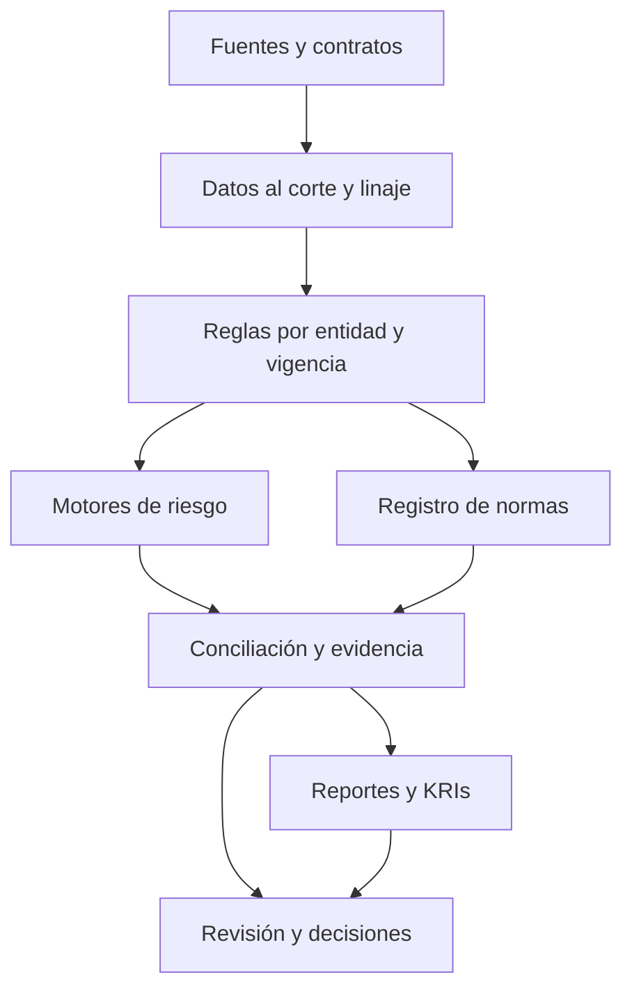

# Arquitectura de referencia

## Contratos de ejecución

Entrada: run_id, corte, moneda, entidad, perímetro, data_version, rule_version, model_version, scenario_id. Salida: resultados por exposición y agregado, unidades, advertencias, fallos de calidad, fuentes y manifiesto de hashes. Una corrida incompleta no debe producir un reporte marcado como aprobado.

## Separación de responsabilidades

- SQL: extracción, claves únicas, joins controlados, reconstrucción point-in-time y conciliación.
- Python: referencia numérica, investigación, validación y orquestación.
- C++: extensiones de cálculo intensivo sujetas a contrato numérico y benchmark; no implementadas aquí.
- Motor de reglas: selecciona configuración, nunca consulta normas mediante texto generado como fuente de verdad.
- IA/RAG: apoyo para localizar evidencia y proponer cambios con citas; revisión humana antes de activar reglas.

## Reutilización

Crédito y mercado consumen las bibliotecas de 01-credit-risk y 02-market-and-model-risk; advisory conserva fundamentos de gobierno; los motores ejecutivos conservan apetito y decisiones. Esta carpeta agrega integración regulatoria y componentes ilustrativos, sin mover ni duplicar las implementaciones existentes.

## Controles previstos

Acceso por rol, segregación de funciones, cifrado, minimización de datos, bitácora inmutable, configuración versionada, reconciliación fuente-reporte, reejecución idempotente y rollback de reglas. Son arquitectura objetivo, no capacidades desplegadas.
