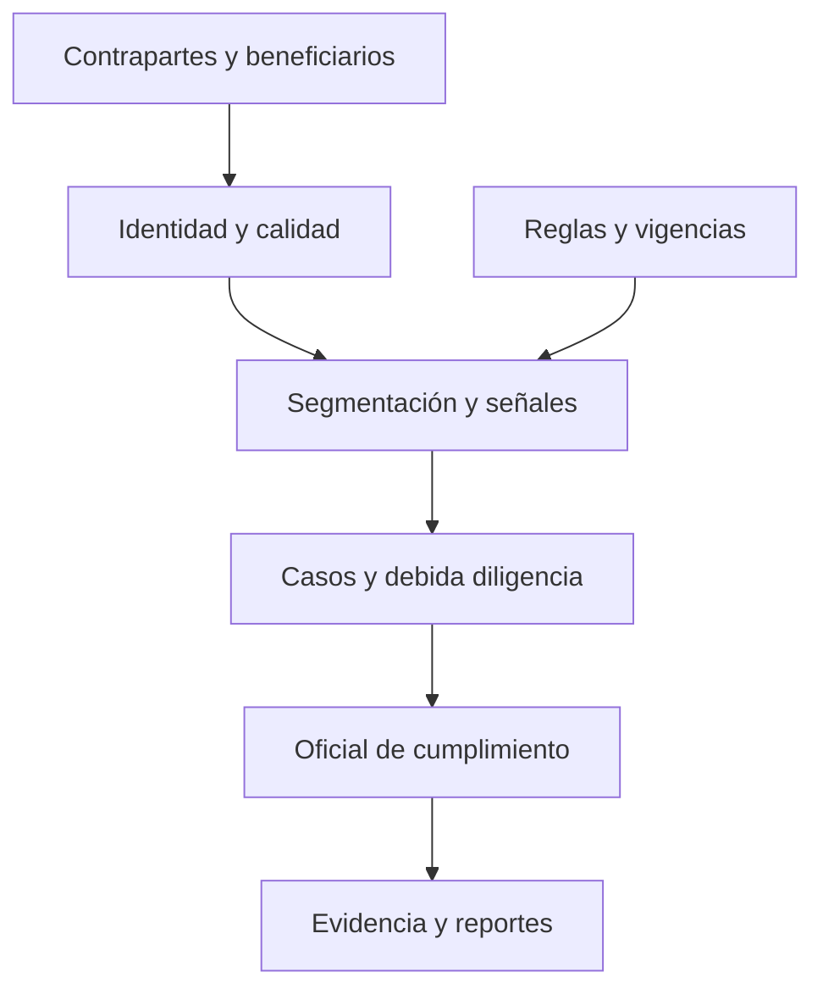

# SAGRILAFT — Supersociedades

**Estado: diseño S1; no motor productivo.** Sistema de Autocontrol y Gestión del Riesgo Integral LA/FT/FPADM. SARLAFT y SAGRILAFT comparten problemas analíticos, pero requieren configuraciones normativas separadas.

## Fundamentos y perímetro

Identificar supervisor, sujeto obligado, actividad, condiciones de aplicación y fecha antes de seleccionar obligaciones. No asumir que toda sociedad está obligada ni fijar umbrales sin verificar el texto vigente. Distinguir SAGRILAFT, Régimen de Medidas Mínimas y PTEE; este último no sustituye prevención de LA/FT.

Fuentes: [portal oficial SAGRILAFT](https://supersociedades.gov.co/web/asuntos-economicos-societarios/sagrilaft) y [Capítulo X](https://supersociedades.gov.co/web/nuestra-entidad/cap-10-autocontrol-y-gesti%C3%B3n-del-riesgo-integral). El portal ya referencia la nueva CBJ, CE 100-000020 de julio de 2026; verificar documento consolidado y transiciones, evitando depender solo de versiones de 2020.

## Arquitectura

## Motores propuestos

| Motor | Datos | Salida y validación |
|---|---|---|
| Aplicabilidad normativa | Supervisor, actividad, condiciones, corte y norma | Obligaciones con evidencia; bloquear decisión si faltan datos |
| Beneficiario final | Participaciones directas e indirectas, fechas y fuentes | Rutas de propiedad, ciclos y datos pendientes; contrastar manualmente |
| Segmentación de contrapartes | Producto, canal, jurisdicción, actividad y operación | Segmentos explicables; estabilidad temporal y exclusión de variables improcedentes |
| Alertas y casos | Transacciones, señales, capacidad y decisiones históricas | Cola priorizada y motivos; recall bajo etiquetas incompletas y costo de revisión |
| Evidencia y vencimientos | Diligencias, responsables, documentos y fechas | Pendientes y trazabilidad; no enviar reportes automáticamente |

Un puntaje compuesto puede servir como baseline de investigación: score = suma w_j x_j. Debe documentar escala, pesos, datos faltantes y sensibilidad; no es probabilidad calibrada ni regla legal.

## Tres experimentos

1. Grafo temporal de propiedad frente a revisión tabular: medir rutas relevantes recuperadas y falsos enlaces.
2. Alertas por segmento frente a umbral global: comparar utilidad por hora de revisión y carga operativa.
3. Vigencia de debida diligencia según riesgo frente a calendario fijo: evaluar cobertura y costo sin reducir mínimos aplicables.

## Gobierno y aceptación

Datos de identificación y beneficiarios requieren acceso restringido, minimización, retención definida y registro de consultas. Una alerta no prueba delito. Oficial de cumplimiento y órganos responsables revisan decisiones y reportes. Antes de promover a prototipo: contratos, datos autorizados, casos manuales, notebook, pruebas de sesgo, fuentes normativas y revisión independiente.

Reutilizar componentes de [SARLAFT](../09-sarlaft-financial-crime/) mediante contratos comunes; mantener separados perímetro, políticas y reportes.
