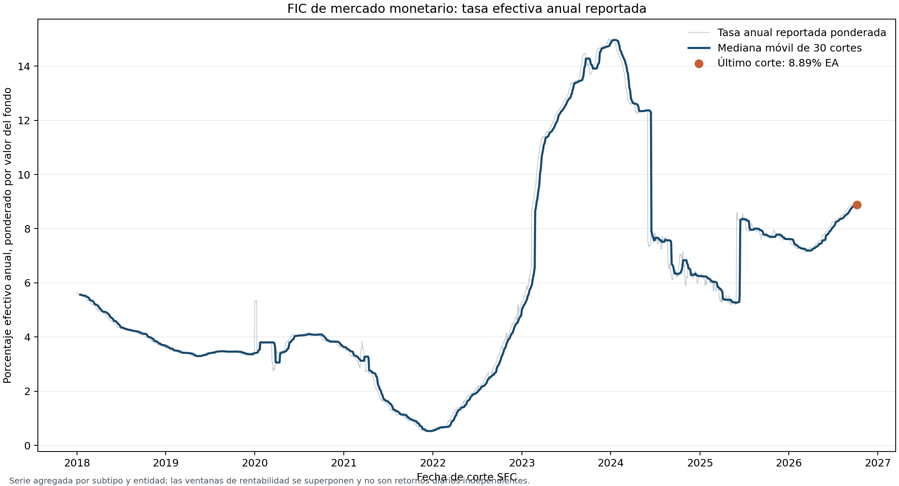

# Tasa reportada en FIC de mercado monetario: aplicación observada

## Pregunta y alcance

¿Cómo evolucionó la rentabilidad efectiva anual reportada para los FIC de mercado monetario administrados por sociedades fiduciarias? Esta edición companion agrega por valor del fondo la tasa anual reportada en la fuente SFC y muestra su serie de cortes diarios para documentar una lectura de desempeño con datos observados.

La observación es **una tasa EA de horizonte anual reportada en cada fecha de corte**, no el retorno de ese día. La agregación describe el subtipo; no es el rendimiento de un fondo investible ni una cartera con flujos y pesos propios. El laboratorio sintético y la biblioteca de métricas originales siguen separados.

## Fuente, vintage y grano

Fuente: [Rentabilidades de los Fondos de Inversión Colectiva (FIC), dataset qhpu-8ixx](https://www.datos.gov.co/Hacienda-y-Cr-dito-P-blico/Rentabilidades-de-los-Fondos-de-Inversi-n-Colecti/qhpu-8ixx). La [SFC explica que publica los informes diarios Formato 523 / Informe 77](https://www.superfinanciera.gov.co/ReporteInformacionFIC/faces/reporte/consultaReporte.xhtml). Las rentabilidades reportadas se basan en valores de unidad; la metodología regulatoria de rentabilidad efectiva anual utiliza el cociente entre valores de unidad y el número de días del periodo. La SFC publica campos diarios, mensuales, semestrales y anuales.

El snapshot externo se descargó el **11 de octubre de 2026**. Incluye 36.900 filas agregadas desde **2018-01-01** hasta **2026-10-07**, para 3 tipos de entidad y 5 subtipos FIC. La consulta agrupa por fecha × tipo de entidad × subtipo. No se copia el archivo de entrada: `data/source_reference.json` conserva ruta, consulta, vintage y SHA-256 `8ba05a76fbb86a5803419673d2c5427b77f42fea7dd96953fcae01bd50813c68`.

La serie de este companion selecciona `SF-SOCIEDAD FIDUCIARIA` y `FIC DE MERCADO MONETARIO`, con **3.202 cortes** desde el 1 de enero de 2018 hasta el 7 de octubre de 2026. En el último corte, la consulta representa 15 registros FIC subyacentes. La suma de inversionistas reportados no está deduplicada entre fondos.

## Cálculo y lectura

La fuente agregada contiene la suma del producto entre rentabilidad anual reportada y valor del fondo, además de la suma de valores de fondo. El runner reconstruye la tasa promedio ponderada por valor:

```text
tasa EA ponderada (%) = sum(tasa EA reportada × valor del fondo) / sum(valor del fondo)
```

Los porcentajes se conservan en la escala publicada; no se multiplican por 100. La línea gris muestra los cortes observados y la azul la mediana móvil de los últimos 30 cortes para facilitar la lectura. Las ventanas anuales se superponen y los puntos diarios son serialmente dependientes.

El corte final registra **8,89% EA** ponderado por valor y aproximadamente **COP 11,51 billones** en valor agregado de fondos para el subtipo. Es una descripción estadística de los reportes agrupados, no un benchmark de inversión.



## Limitaciones y gobierno

- La unidad de análisis que se conserva es fecha × tipo de entidad × subtipo. No se reconstruyen series individuales por FIC ni por tipo de participación.
- La ponderación por valor es una regla descriptiva, sensible al tamaño y composición de los FIC presentes en cada fecha. La población que reporta puede cambiar; no es un panel balanceado.
- La serie contiene cambios diarios marcados, incluido un descenso de 4,79 puntos porcentuales el 1 de junio de 2024 y un aumento de 2,05 puntos el 10 de febrero de 2023. La tabla agrupada no permite separar cambios de composición, entradas/salidas, revisiones o movimientos de las tasas de los fondos; se muestran sin winsorizar ni atribuir causalidad.
- No se computan retornos periódicos de cartera, volatilidad, Sharpe, Sortino, drawdown, beta, tracking error, atribución ni causalidad. La tasa EA de ventana móvil no se puede interpretar como rentabilidad diaria.
- Los registros diarios tienen ventanas superpuestas y autocorrelación; no se presentan intervalos iid ni pruebas de significancia.
- El número de inversionistas es una suma de reportes de fondos y puede contar varias veces a un inversionista que participe en más de un FIC.
- El archivo conserva 2018-2026, pero se generó a partir de una extracción fechada en octubre de 2026 y no se actualiza automáticamente. El último dato es 2026-10-07.
- Esto valida lectura, transformación y visualización de tasas regulatorias reportadas para un subtipo; no valida la biblioteca original de métricas sobre carteras reales ni el desempeño de una estrategia.

## Reproducción

Requiere Python con `pandas` y `matplotlib`. El runner verifica SHA-256, número de filas, rango de fechas, esquema y unicidad de la llave antes de procesar. Se pasa la ruta al archivo canónico externo; no se descarga ni copia el raw:

```bash
python3 official_companion.py --source-csv "/ruta/externa/sfc_fic_rentabilidad_diaria.csv"
```

El runner escribe:

- `reports/fic_market_money_annual_return.csv` — tasa ponderada, valor del fondo, suma de inversionistas y número de FIC reportados por fecha;
- `reports/fic_market_money_summary.json` — corte, cobertura, hash y resumen descriptivo;
- `reports/fic_market_money_annual_return.png` — visual de la serie y mediana móvil.

Una actualización requiere congelar un nuevo snapshot, su hash, consulta, grano y corte, y revisar comparabilidad de población antes de reemplazar el vintage.

## Referencias

- [Dataset SFC en Datos Abiertos Colombia](https://www.datos.gov.co/Hacienda-y-Cr-dito-P-blico/Rentabilidades-de-los-Fondos-de-Inversi-n-Colecti/qhpu-8ixx)
- [Reporte de Rentabilidades FIC — SFC](https://www.superfinanciera.gov.co/ReporteInformacionFIC/faces/reporte/consultaReporte.xhtml)
- [Circular Básica Jurídica, Parte III, Título VI, Capítulo III, Anexo 6 — metodología de ficha técnica](https://www.superfinanciera.gov.co/publicaciones/10084317/normativanormativa-generalcirculares-externas-cartas-circulares-y-resoluciones-desde-el-ano-circulares-externascirculares-externas-10084317/)
